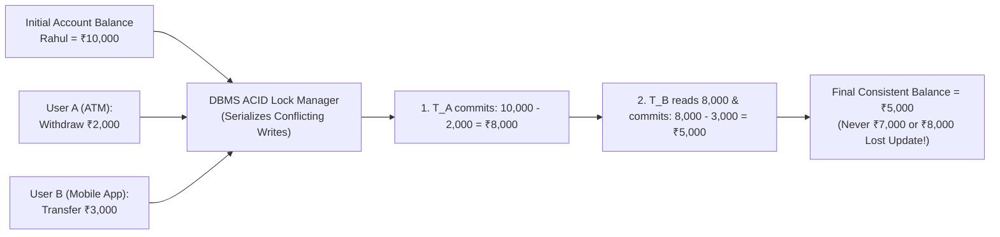
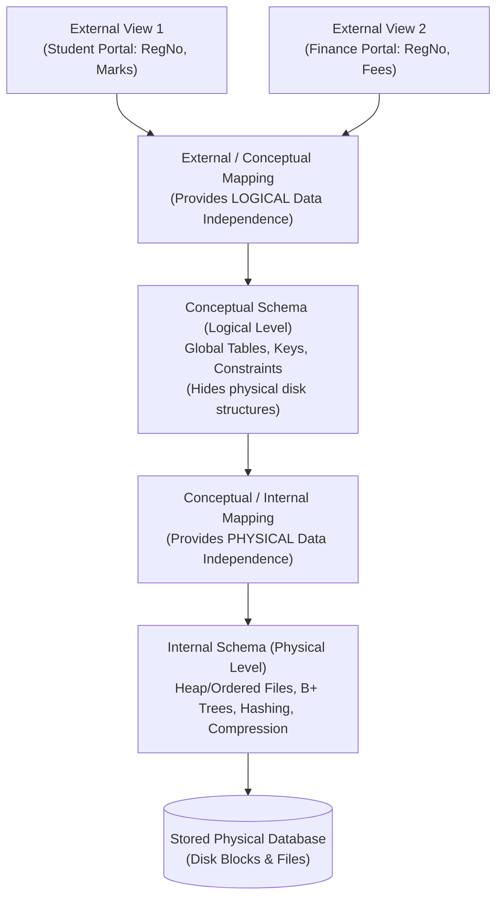
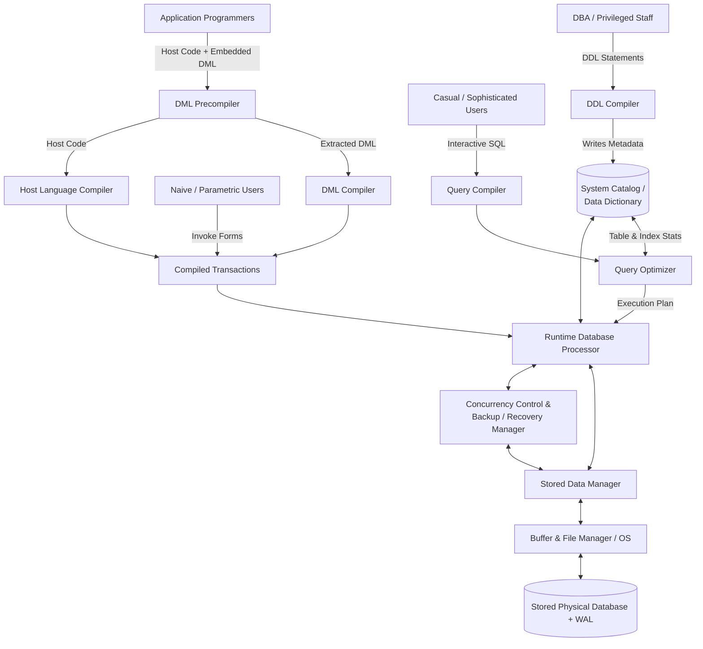
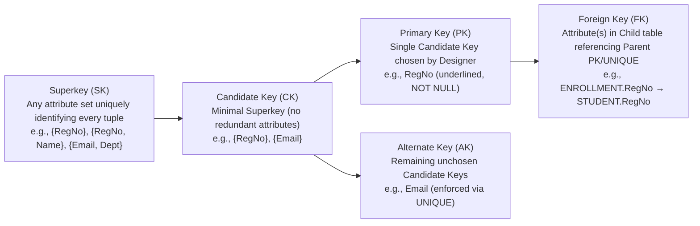

# BACSE202 — Database Systems
## Module 1: Database Systems and Data Models

> **Course Alignment:** VIT `BACSE202` (Database Systems — Syllabus v1.0) · **Module 1 (7 Lecture Hours · CO1)**  
> **Primary Textbooks:** R. Elmasri & S. B. Navathe (*Fundamentals of Database Systems*, 7th Ed., Ch. 1, 2 & 5); Silberschatz, Korth & Sudarshan (*Database System Concepts*, 7th Ed., Ch. 1 & 2)  
> **Synthesized From:** *Module_0_DATA_(Pre_Requiste).pptx*, *Module 1. Database Systems Concepts and Architecture.pptx*, and *Nov 2026 FAT Slot Papers (A1+TA1 & A2+TA2)*

---

## Table of Contents

- [Part I: Foundations, Data Concepts & DBMS Architecture](#part-i-foundations-data-concepts--dbms-architecture)
  - [1. Data Foundations & Prerequisite Measurement Scales (Module 0)](#1-data-foundations--prerequisite-measurement-scales-module-0)
  - [2. Traditional File Processing Systems vs. The DBMS Approach](#2-traditional-file-processing-systems-vs-the-dbms-approach)
  - [3. Characteristics & Advantages of the Database Approach](#3-characteristics--advantages-of-the-database-approach)
  - [4. Actors on the Scene vs. Workers Behind the Scene & DBMS Classification](#4-actors-on-the-scene-vs-workers-behind-the-scene--dbms-classification)
  - [5. Data Models, Schemas, Instances & Three-Schema Architecture](#5-data-models-schemas-instances--three-schema-architecture)
  - [6. Database System Environment, Component Modules & 8 Modern Data Paradigms](#6-database-system-environment-component-modules--8-modern-data-paradigms)
- [Part II: The Relational Data Model & Integrity Constraints](#part-ii-the-relational-data-model--integrity-constraints)
  - [7. Relational Model Concepts & Codd's 7 Validity Characteristics](#7-relational-model-concepts--codds-7-validity-characteristics)
  - [8. Three-Valued NULL Semantics & SQL Evaluation Rules](#8-three-valued-null-semantics--sql-evaluation-rules)
  - [9. Key Hierarchy & The Five Relational Integrity Constraints](#9-key-hierarchy--the-five-relational-integrity-constraints)
  - [10. Update Operations & Referential Integrity Violation Actions](#10-update-operations--referential-integrity-violation-actions)
- [Part III: Exam Prep, Worked FAT Solutions & Revision Self-Check](#part-iii-exam-prep-worked-fat-solutions--revision-self-check)
  - [11. Worked FAT Examination Solutions](#11-worked-fat-examination-solutions)
  - [12. Module 1 Revision Self-Check Quiz](#12-module-1-revision-self-check-quiz)
  - [13. Official Fall 2026-27 Model Question Paper & Slide Additions (`Module_0_DATA` & `Module_1_Arch`)](#13-official-fall-2026-27-model-question-paper--slide-additions-module_0_data--module_1_arch)

---

# Part I: Foundations, Data Concepts & DBMS Architecture

## 1. Data Foundations & Prerequisite Measurement Scales (Module 0)

Before designing databases, it is essential to distinguish raw data from meaningful information and understand the mathematical measurement scales that restrict valid operations on attributes.

### 1.1 The Data → Information → Knowledge Hierarchy


- **Data:** Unprocessed, raw recorded facts (numbers, text, timestamps, sensor readings, images) that have implicit meaning when interpreted, such as `Marks = 85` or `5`.
- **Information:** Data that has been cleaned, structured, aggregated, or placed into context so it aids human or machine decisions (e.g., `"Section A average marks = 84.3"` or `"$5"`).
- **Knowledge, Experience & Wisdom:** Actionable patterns synthesized from information over time (e.g., predicting failure risk from historical attendance and quiz trends).

### 1.2 Storage & Analytical Groupings
- **Dataset:** A bounded, coherent collection of related records formatted for a specific analysis or application (e.g., `students_2026.csv`).
- **Dataspace:** An umbrella abstraction spanning multiple heterogeneous, loosely structured sources across an organization (e.g., ERP tables + PDFs + JSON telemetry + email archives).
- **Data Center:** Physical facility housing networked compute clusters, redundant storage arrays, cooling, and power backups for hosting databases.
- **Data Cube:** A multidimensional matrix (`Time × Region × Product`) supporting fast OLAP roll-up and slice-and-dice analytics.

### 1.3 Four Statistical Measurement Scales (Mod 0 Exam Favorite)

| Scale | Mathematical Property | Valid Operations | Concrete Database Example |
| :--- | :--- | :--- | :--- |
| **Nominal** | Unordered labels / categories | Equality (`=`, `≠`), `COUNT`, Mode | `Department` (`CSE`, `ECE`), `Blood_Group` |
| **Ordinal** | Ranked categories without guaranteed equal spacing | `=`, `≠`, `<`, `>`, Median | `Grade` (`S`, `A`, `B`, `C`), Satisfaction (`1..5`) |
| **Interval** | Equal numerical intervals, **Arbitrary Zero** (no true absence) | `+`, `−`, Mean (ratios INVALID!) | Temperature in `°C` (`20°C` is NOT twice as hot as `10°C`; `0°C ≠ no heat`) |
| **Ratio** | Equal numerical intervals + **Absolute True Zero** | `+`, `−`, `×`, `÷`, Ratios | `Salary`, `CGPA`, `Weight`, Temperature in `Kelvin` (`0` = complete absence) |

---

## 2. Traditional File Processing Systems vs. The DBMS Approach

### 2.1 Core Definitions
- **Database:** A shared collection of logically related data (and a description of that data) designed to meet the information needs of an organization.
- **Database Management System (DBMS):** A generalized software system (Silberschatz: *"a collection of interrelated data and a set of programs to access those data"*) that enables users to:
  1. **Define** data types, structures, and constraints (DDL).
  2. **Construct** the physical database on secondary storage.
  3. **Manipulate** data via querying, inserting, updating, and deleting (DML/DQL).
  4. **Share** concurrent access safely across multiple users and applications while protecting integrity and security.

### 2.2 Why Flat File Systems Failed (Pre-1970 Architecture)
In early computing, every university office or bank department wrote standalone C/COBOL programs operating over private text/binary files (`Student.txt`, `Hostel.txt`, `Exam.txt`, `Fee.txt`). That architecture suffered five structural failures:

| Dimension | Traditional File Processing System | Database Management System (DBMS) |
| :--- | :--- | :--- |
| **Metadata Storage** | File layout hardcoded inside every C/COBOL program. | Stored once in a **System Catalog** alongside the database. |
| **Data Redundancy** | Identical student details duplicated across Library, Exam, and Hostel files, wasting disk space. | Controlled sharing via normalized relations eliminates unnecessary duplication. |
| **Data Inconsistency** | Updating a phone number in `Hostel.txt` leaves `Exam.txt` holding a stale phone number. | Single logical source of truth + constraints prevent contradictory copies. |
| **Program-Data Coupling** | Adding one column (`Email`) breaks byte offsets in every existing program, forcing full recompilation. | **Program-Data Independence** shields applications from internal layout changes. |
| **Data Isolation & Ad-hoc Queries** | Answering a cross-file question (*"Hostel students with CGPA > 9"*) requires writing a custom merge program. | Declarative SQL `JOIN` answers ad-hoc queries immediately. |
| **Concurrency & Crash Safety** | Simultaneous writes corrupt files; crashes mid-update leave half-completed garbage. | **ACID Transactions**, locking, and Write-Ahead Logging (WAL) guarantee consistency. |

---

## 3. Characteristics & Advantages of the Database Approach

Four fundamental characteristics distinguish a true DBMS from a collection of files:

1. **Self-Describing Nature (System Catalog / Metadata):**
   A DBMS stores a complete definition of every table name, column name, data type, storage format, and constraint inside an internal **Catalog (Metadata)**. Because the schema lives inside the DBMS rather than inside application code, a single generic DBMS kernel (like PostgreSQL or Oracle) can manage banking, hospital, and university databases equally well.
2. **Insulation Between Programs and Data (Program-Data & Program-Operation Independence):**
   - *Program-Data Independence:* Adding a column (such as `Email` to `STUDENT`) or reorganizing record offsets on disk does not break legacy portals querying `(RegNo, Name, CGPA)`.
   - *Program-Operation Independence (Data Abstraction):* Object-oriented and abstract data types separate public method signatures (*interface*) from physical code (*implementation*).
3. **Support of Multiple Views of the Data:**
   Different stakeholders share the same underlying relations while seeing customized, security-filtered **Views**. In a university:
   - The **Faculty View** exposes `RegNo`, `Name`, and `Marks`, hiding bank/fee details.
   - The **Finance View** exposes `RegNo`, `Tuition_Paid`, and `Due_Amount`, hiding exam grades.
   - The **Student View** restricts each user to rows matching their own `RegNo`.
4. **Sharing of Data & Multiuser Transaction Control (ACID Serialization):**
   When multiple users read and update the same record simultaneously, the DBMS serializes access through concurrency control so updates are never lost.

### Worked Concurrency Check: Rahul's `₹10,000` Concurrent Debit



- **Without DBMS Concurrency Control (Flat File Race):** Both ATM and Mobile read `₹10,000` concurrently; ATM writes `₹8,000`, then Mobile overwrites with `₹7,000`—losing the `₹2,000` debit (**Lost Update Anomaly**).
- **With DBMS ACID Locking:** `T_A` acquires an exclusive lock, debits `₹2,000` (`₹8,000`), and releases the lock at commit; `T_B` then reads `₹8,000` and debits `₹3,000`, producing the exact invariant **`₹5,000`**.

---

## 4. Actors on the Scene vs. Workers Behind the Scene & DBMS Classification

Elmasri & Navathe divide database personnel into two groups based on whether they interact with the stored data directly or build the underlying software/infrastructure.

### 4.1 Actors on the Scene (Use & Administer Data Content)

| Role | Primary Responsibilities | Typical Tools / Interfaces | Concrete Campus Example |
| :--- | :--- | :--- | :--- |
| **1. Database Administrator (DBA)** | Authorizes access (`GRANT`/`REVOKE`), creates/modifies physical schemas, monitors locks/queries, schedules backups & crash recovery. | DDL, DCL, performance dashboards | Grants read access on `GRADES`, adds a B+ Tree index, restores after outage. |
| **2. Database Designers** | Gathers requirements, builds conceptual ER/EER models, normalizes relations, specifies integrity constraints and views. | ER tools, Normalization | Designs `STUDENT`, `COURSE`, `ENROLLMENT` and foreign keys. |
| **3. End Users — Naive / Parametric** | Execute pre-written, thoroughly tested **canned transactions** daily without knowing SQL. | Web/mobile forms, kiosks | ATM customers, railway ticket clerks, bank tellers, fee payment counter. |
| **4. End Users — Casual** | Access the DB occasionally using ad-hoc queries for unpredictable needs. | SQL consoles, BI query bars | A Dean running a custom semester-end query for scholarship cutoffs. |
| **5. End Users — Sophisticated** | Write complex custom queries, analytical models, and engineering scripts directly. | Advanced SQL, Python/BI | Data scientists, financial quantitative analysts, ML engineers. |
| **6. End Users — Specialized / Standalone** | Use domain-specific packages (CAD, GIS, multimedia) or personal single-user DBs. | ArcGIS, AutoCAD, SQLite | Cartographer querying spatial layers; tax consultant using desktop DB. |
| **7. System Analysts & Application Programmers** | Analysts translate user specs into canned transaction workflows; programmers code host applications embedding DML queries. | Java/Python/C++ + JDBC/ORM | Backend engineers building VTOP attendance & course registration APIs. |

> **Exam Trap Alert:** Do **NOT** confuse **Naive (Parametric)** users with **Casual** users. A bank teller uses the DB constantly all day via fixed forms (**Naive/Parametric**); a senior manager opens a query prompt once a month for a custom summary (**Casual**).

### 4.2 Workers Behind the Scene (Design & Operate DBMS Software)
End users never interact directly with these hidden infrastructure teams:
1. **DBMS System Designers and Implementers:** Software systems engineers who design and code the DBMS engine itself (query parser, cost-based optimizer, buffer pool manager, lock manager, WAL recovery engine) in C/C++/Rust.
2. **Tool Developers:** Engineers building independent software packages that work alongside DBMSs—ER diagramming tools, schema migration GUIs, performance profilers, and ETL pipelines.
3. **Operators and Maintenance Personnel:** System/network administrators keeping server hardware, OS patches, storage RAID arrays, and power systems running 24×7.

### 4.3 Evolution & 8-Category Classification of DBMSs

#### Historical Lineage
1. **Hierarchical Model (Late 1960s — IBM IMS):** Stores data as rigid parent–child **trees** (`1:N` only). Representing `M:N` relationships forced duplicating child records across parents.
2. **Network Model (1960s — Charles Bachman's IDS / CODASYL DBTG):** Organizes records in directed graphs allowing `M:N` owner–member sets, but programmers still had to navigate low-level physical pointers manually (*"navigational DBMS"*).
3. **Relational Model (1970 — Dr. E. F. Codd):** Separated logical set-theoretic tables from physical pointers so users declare *WHAT* data they want in SQL rather than *HOW* to walk pointer chains.

#### Classification Criteria
- **By Data Model:** Relational (`PostgreSQL`, `Oracle`), Object-Oriented / Object-Relational, Semi-Structured (`MongoDB`), Graph (`Neo4j`), Wide-Column (`Cassandra`), Key-Value (`Redis`), Vector (`Milvus`).
- **By Number of Users:** Single-user desktop (`SQLite`, `MS Access`) vs. Multi-user enterprise (`MySQL`, `Oracle`, `PostgreSQL`).
- **By Distribution:** Centralized (all data at 1 physical site) vs. Distributed (data fragmented/replicated across network sites).
- **By Cost / Purpose:** Open-source (`PostgreSQL`), Commercial enterprise (`Oracle`), Embedded (`SQLite`), General-purpose vs. Special-purpose (OLTP Airline reservation vs. OLAP Data Warehouse).

---

## 5. Data Models, Schemas, Instances & Three-Schema Architecture

### 5.1 Data Models
A **Data Model** is a collection of concepts used to describe the structure of a database, its operations, and its constraints:
- **High-Level (Conceptual) Data Models:** Close to how humans perceive reality using **entities, attributes, and relationships** (e.g., ER and EER Models).
- **Representational (Implementation) Data Models:** Understood by end users yet directly implementable in a DBMS (e.g., **Relational**, Object, Network).
- **Low-Level (Physical) Data Models:** Describe how data is stored as bytes on disk blocks—record formats, block offsets, B+ Tree access paths, hash buckets.

### 5.2 Database Schema (Intension) vs. Database Instance (Extension / State)

| Property | Database Schema (Intension) | Database Instance / State (Extension) |
| :--- | :--- | :--- |
| **Definition** | Overall logical description/blueprint of tables, columns, data types, and constraints. | Actual collection of data tuples stored in the database at one specific instant in time. |
| **Analogy** | House architectural blueprint (3 bedrooms, 1 kitchen). | Actual people and furniture currently inside the house. |
| **Rate of Change** | Changes very rarely (only during `CREATE`/`ALTER` schema evolution). | Changes continuously on every `INSERT`, `UPDATE`, `DELETE`. |
| **Initial State** | Populated immediately when DBA runs DDL (`CREATE TABLE`). | Initially **empty state** until first rows are loaded. |

### 5.3 The ANSI/SPARC Three-Schema Architecture & Data Independence (`Nov 2026 FAT A2+TA2 · Q1`)

To insulate end users and applications from physical storage mechanics and schema evolution, the ANSI/SPARC architecture splits metadata into three stratified levels connected by **two explicit mapping layers**:



1. **External Level (View Schema):** Contains multiple customized **External Views** (`StudentView`, `PlacementView`), exposing only relevant tables/columns to specific user roles and hiding sensitive attributes (security + simplicity).
2. **Conceptual Level (Logical Schema):** Describes the *entire* database structure for the community of users—all entities, data types, relationships, user operations, and constraints—while hiding all physical storage implementation details.
3. **Internal Level (Physical Schema):** Describes the physical storage structures and access paths: record layouts, blocking factors, encryption/compression, and index files (B+ Trees, Extendible Hashing).

#### How Mappings Deliver Data Independence
**Data Independence** is the capacity to modify a schema at one level without having to rewrite schemas or application programs at the next higher level. Because requests flow through two **Mapping Layers** stored in the System Catalog, changes are absorbed simply by updating the mapping rules:

| Independence Type | Mapping Boundary | Definition | Concrete Real-World Examples | Relative Difficulty |
| :--- | :--- | :--- | :--- | :--- |
| **Logical Data Independence** | **External ↔ Conceptual** | Capacity to change the Conceptual Schema without altering External Schemas or application programs. | 1) Adding column `Email` or `LinkedIn_URL` to `STUDENT`.<br/>2) Splitting `ACCOUNT(AccNo, Type, Bal)` into `SAVINGS` and `CURRENT` while redefining a unified `VIEW` mapping. | **Harder** (application queries explicitly name logical tables and attributes). |
| **Physical Data Independence** | **Conceptual ↔ Internal** | Capacity to change the Internal Schema without altering the Conceptual Schema (or External views). | 1) Adding a **B+ Tree index** on `Student(CGPA)`.<br/>2) Moving data files from HDD to NVMe SSD, changing hash functions, or enabling block compression. | **Easier** (no SQL query references disk block addresses). |

### 5.4 Client–Server DBMS Topologies (1-Tier, 2-Tier, 3-Tier)
- **1-Tier Architecture:** User sits directly on the machine hosting the DBMS (e.g., local SQLite or developer running MySQL CLI locally). Zero network boundary.
- **2-Tier Architecture:** Client UI executes application logic and communicates directly with the Database Server via standardized APIs (**ODBC / JDBC**). Works well on trusted LANs, but thick clients struggle to scale across thousands of web users.
- **3-Tier Architecture:** Inserts a dedicated **Middle Tier (Application / Web Server)** between the thin Client Browser and the Database Server (`Client UI ↔ Application Server ↔ Database Server`). Enforces business rules centrally, pools DB connections, and hides DB credentials from clients.

---

## 6. Database System Environment, Component Modules & 8 Modern Data Paradigms

### 6.1 Overall DBMS Component Modules (`Nov 2026 FAT A1+TA1 · Q1` — Elmasri Fig. 2.3)

A production DBMS is not a monolith; it coordinates specialized compilers, optimizers, and runtime/storage managers around the **System Catalog**:



#### Step-by-Step Signal Flow Through the Modules
1. **Schema Setup Path (DBA):** The DBA writes `CREATE TABLE`, `ALTER`, and `GRANT` statements in **DDL**. The **DDL Compiler** parses them and writes table/constraint/privilege definitions as metadata into the **System Catalog**.
2. **Ad-Hoc Query Path (Casual & Sophisticated Users):** Interactive SQL queries enter the **Query Compiler**, which validates syntax against the System Catalog. The **Query Optimizer** rearranges operators (heuristic + cost-based optimization using catalog statistics) into an efficient execution plan passed to the **Runtime Database Processor**.
3. **Host Application Path (Programmers → Naive Users):** Embedded SQL/DML inside Java/Python/C++ passes through the **DML Precompiler**, which extracts DML commands into procedure calls and sends them to the **DML Compiler**. Remaining host code passes through the **Host Language Compiler**, linking into reusable **Compiled Transactions** invoked repeatedly by Naive users.
4. **Execution, Buffer & Storage Control:** The **Runtime Database Processor** executes plans by requesting blocks via the **Stored Data Manager** and **Buffer/File Manager** (interacting with OS disk I/O), while **Concurrency Control** (locking/timestamps) and **Backup/Recovery** (WAL logs) preserve ACID invariants.

### 6.2 SQL's Five Sub-Languages
- **DDL (Data Definition Language):** Defines schema structure (`CREATE`, `ALTER`, `DROP`, `TRUNCATE`, `RENAME`, `COMMENT`).
- **DML (Data Manipulation Language):** Modifies data rows (`INSERT`, `UPDATE`, `DELETE`, `MERGE`).
- **DQL (Data Query Language):** Retrieves rows (`SELECT`).
- **DCL (Data Control Language):** Controls security permissions (`GRANT`, `REVOKE`).
- **TCL (Transaction Control Language):** Manages transaction boundaries (`COMMIT`, `ROLLBACK`, `SAVEPOINT`).

### 6.3 Eight Modern Database Paradigms & Selection Criteria

| Model | Core Structure | Ideal Use Case | Real Engines |
| :--- | :--- | :--- | :--- |
| **1. Relational** | Normalized fixed tables (`rows × cols`) + SQL | Strict ACID transactions, financial ledgers, campus ERP | `Oracle`, `PostgreSQL`, `MySQL` |
| **2. Semi-Structured** | Self-describing flexible JSON / BSON / XML trees | Evolving e-commerce catalogs, APIs, content profiles | `MongoDB`, `CouchDB` |
| **3. Graph** | Nodes, directed typed edges & properties | Fraud rings, social 4-hop recommendations, route maps | `Neo4j`, `Neptune` |
| **4. Vector** | High-dimensional dense float arrays + ANN indexes | Semantic similarity search, RAG LLM grounding, image search | `Pinecone`, `Milvus`, `pgvector` |
| **5. Time-Series** | Append-only timestamp-indexed metrics | IoT sensors, stock ticks, server CPU/latency monitoring | `InfluxDB`, `TimescaleDB` |
| **6. Unstructured / Blob** | Raw files, PDFs, audio, video streams | Medical imaging (DICOM), media streaming | Object Storage (`S3`), GridFS |
| **7. Distributed DB** | Logically linked fragments across network sites | Multi-branch banking (SBI Chennai, Delhi, Mumbai) | `Spanner`, `CockroachDB` |
| **8. Cloud DB** | Managed DBaaS running on rented elastic cloud infrastructure | Zero-ops provisioning, auto-scaling SaaS backends | `AWS RDS`, `Cloud SQL`, `Atlas` |

> **Distributed vs. Cloud Memory Trick:**  
> - **Distributed DB** answers **"WHERE is the data physically stored?"** (across multiple network sites).  
> - **Cloud DB** answers **"WHERE is the database hosted?"** (on managed cloud VMs/containers).  
> *Test:* Can a Cloud DB be non-distributed? **Yes** (single AWS EC2 instance). Can an On-Premises DB be distributed? **Yes** (on-prem bank branches connected via WAN).

---

# Part II: The Relational Data Model & Integrity Constraints

## 7. Relational Model Concepts & Codd's 7 Validity Characteristics

Proposed by **Dr. E. F. Codd (1970)**, the Relational Model grounds database design in mathematical set theory and first-order predicate logic.

### 7.1 Mathematical Formalism & Core Terms
- **Domain ($D$):** A set of allowable atomic values (e.g., `Dom(CGPA) = { x ∈ ℝ | 0.00 ≤ x ≤ 10.00 }`), specified by a logical data type and format.
- **Relation Schema $R(A_1, A_2, \dots, A_n)$:** Consists of relation name $R$ and ordered list of attributes $A_1 \dots A_n$, each mapped to domain $\text{dom}(A_i)$.
- **Degree (Arity):** Number of attributes $n$ in schema $R$.
- **Relation Instance / State $r(R)$:** A finite mathematical subset of the Cartesian product of attribute domains:
  $$r(R) \subseteq \text{dom}(A_1) \times \text{dom}(A_2) \times \dots \times \text{dom}(A_n)$$
- **Tuple ($t$):** A single ordered row $t = \langle v_1, v_2, \dots, v_n \rangle$ in $r(R)$, where $v_i \in \text{dom}(A_i) \cup \{\text{NULL}\}$.
- **Cardinality:** Current number of tuples $|r|$ in the relation state.

> **Mnemonic:** **D**egree = **D**imensions (columns) · **C**ardinality = **C**ount of tuples (rows).  
> Example: `STUDENT(RegNo, Name, CGPA, Phone)` holding 2 rows has **Degree = 4** and **Cardinality = 2**.

### 7.2 Codd's 7 Characteristics of a Valid Relation

| # | Characteristic | Meaning | Valid vs. Violation Example |
| :--- | :--- | :--- | :--- |
| **1** | **Unique Relation Name** | Each table inside a schema has a distinct name. | `STUDENT`, `FACULTY` valid; two `STUDENT` tables invalid. |
| **2** | **Unique Attribute Names** | Columns within one relation cannot repeat names. | `(RegNo, Name, CGPA)` valid; `(RegNo, Name, Name)` invalid. |
| **3** | **Atomic Cell Values (1NF)** | No multivalued lists or nested tables inside a single cell. | `Name = "Rahul"` valid; `Name = "Rahul, Priya"` invalid. |
| **4** | **Homogeneous Column Domain** | Every entry in column $A_i$ belongs to $\text{dom}(A_i)$. | `CGPA = 8.5` valid; `CGPA = "N/A"` invalid. |
| **5** | **No Duplicate Tuples** | Because $r(R)$ is a mathematical *set*, every row must be unique. | Enforced automatically by Primary Keys. |
| **6** | **Row Ordering is Irrelevant** | Swapping rows produces the identical logical relation. | Rely on `ORDER BY`, never physical row position. |
| **7** | **Attribute Ordering is Irrelevant** | Swapping columns (along with their headers) leaves relation meaning unchanged. | `STUDENT(RegNo, Name)` $\equiv$ `STUDENT(Name, RegNo)` as tuples map attribute names to values. |

---

## 8. Three-Valued NULL Semantics & SQL Evaluation Rules

In real-world schemas, optional or pending attributes cannot always hold values. SQL uses a special marker **`NULL`**—which is **NOT** numeric `0`, **NOT** blank space `" "`, **NOT** empty string `""`, and **NOT** Boolean `FALSE`.

### 8.1 Three Distinct Semantic Meanings of `NULL`
1. **Value Unknown (Exists, Not Yet Recorded):** A student has a phone number or an employee has a salary, but the clerk has not entered it yet.
2. **Value Unavailable / Withheld:** A user intentionally left an optional field blank (e.g., `Alternate_Phone`).
3. **Attribute Not Applicable:** The attribute makes no sense for this specific tuple (e.g., `Spouse_Name` for an unmarried employee, or `Thesis_Title` for an undergraduate non-honors student).

### 8.2 Three-Valued Logic (`TRUE`, `FALSE`, `UNKNOWN`)
Any arithmetic or standard comparison involving `NULL` produces **`UNKNOWN`**:
- `NULL = NULL` $\rightarrow$ **`UNKNOWN`** (NOT `TRUE`!)
- `NULL <> 5` $\rightarrow$ **`UNKNOWN`**
- SQL `WHERE` clauses return rows **ONLY** when the predicate evaluates to `TRUE` (dropping both `FALSE` and `UNKNOWN`).

```sql
-- WRONG: Returns 0 rows even if Priya's Phone is NULL!
SELECT Name FROM STUDENT WHERE Phone = NULL;

-- CORRECT: Uses dedicated IS NULL / IS NOT NULL predicate
SELECT Name FROM STUDENT WHERE Phone IS NULL;
```

---

## 9. Key Hierarchy & The Five Relational Integrity Constraints

### 9.1 Key Hierarchy



### 9.2 The Five Relational Integrity Constraints

| # | Constraint | SQL Syntax | Rule Enforced | Rejection Example |
| :--- | :--- | :--- | :--- | :--- |
| **1** | **Domain Constraint** | Data type + `CHECK (...)` | Every cell value must be atomic and lie within the column's legal type, length, or range. | Inserting `CGPA = 12.5` into `CHECK (CGPA BETWEEN 0 AND 10)` or `'ABC'` into `DECIMAL`. |
| **2** | **Key Constraint** | `UNIQUE` / `PRIMARY KEY` | No two distinct tuples may hold the same non-NULL value on a key/candidate-key attribute. | Inserting a second `PATIENT` with an already registered `phone`. |
| **3** | **NULL Constraint** | `NOT NULL` | Mandatory attribute cannot be left missing (`NULL`). | Inserting `PATIENT(patient_id=10, patient_name=NULL, ...)`. |
| **4** | **Entity Integrity** | `PRIMARY KEY` | **No attribute forming any part of a Primary Key may ever be `NULL`.** *(Justification: PK identifies individual rows; an unidentified entity is meaningless.)* | Inserting `PATIENT(patient_id=NULL, patient_name='Asha', ...)`. |
| **5** | **Referential Integrity** | `FOREIGN KEY ... REFERENCES` | Every tuple $t_1$ in referencing (child) relation $R_1$ must satisfy either $t_1[\text{FK}] = t_2[\text{PK}]$ for some existing tuple $t_2$ in referenced (parent) relation $R_2$, **OR** $t_1[\text{FK}] = \text{NULL}$ (if nullable). | Inserting `APPOINTMENT(app_id=9, patient_id='P999', ...)` when `'P999'` does not exist in `PATIENT`. |

---

## 10. Update Operations & Referential Integrity Violation Actions

Every database update falls into three primitive operations: **`INSERT`**, **`DELETE`**, and **`UPDATE`**.

### 10.1 Which Constraints Can Each Operation Violate?

| Operation | Constraints at Risk | How DBMS Handles Failure |
| :--- | :--- | :--- |
| **`INSERT` into Parent or Child** | Domain, Key (`UNIQUE`), Entity Integrity (`PK=NULL`), Referential Integrity (inserting orphan child FK). | **Reject** the invalid `INSERT` immediately with an error. |
| **`DELETE` from Child** | **None!** Deleting a child row never breaks any parent constraint. | Always **succeeds** immediately. |
| **`DELETE` from Parent** | **Referential Integrity ONLY** (when existing child tuples still point to the deleted parent PK). | Applies configured referential action: `RESTRICT`, `CASCADE`, `SET NULL`, or `SET DEFAULT`. |
| **`UPDATE` of Non-Key Attribute** | Domain, `NOT NULL`, `UNIQUE` (if `UNIQUE` column). | **Reject** if violated; no FK cascades triggered. |
| **`UPDATE` of Parent PK / Child FK** | Child FK: must match an existing Parent PK. Parent PK: triggers same check as Parent `DELETE`! | Same 4 options (`ON UPDATE RESTRICT / CASCADE / SET NULL / SET DEFAULT`). |

### 10.2 Four DBMS Actions on Parent `DELETE` Violation
Suppose `EXPENDITURE(Exp_ID, Project_ID [FK], Amount)` references `PROJECT_GRANT(Project_ID [PK], Title)` and we run:

```sql
DELETE FROM PROJECT_GRANT WHERE Project_ID = 'P101';
-- Problem: Rows in EXPENDITURE still hold Project_ID = 'P101'!
```

| Referential Action | SQL Clause | Behavior on Referencing Child Rows in `EXPENDITURE` | When to Use |
| :--- | :--- | :--- | :--- |
| **1. `RESTRICT` / `NO ACTION`** *(Default)* | `ON DELETE RESTRICT` | **Rejects** deleting `'P101'` from `PROJECT_GRANT`; database remains unchanged. | Financial/audit records that must never vanish silently. |
| **2. `CASCADE`** | `ON DELETE CASCADE` | Deletes `'P101'` from `PROJECT_GRANT` **and automatically deletes** all referencing child rows in `EXPENDITURE`. | Weak entities or dependent sub-items (`ORDER_ITEMS` when `ORDER` is cancelled). |
| **3. `SET NULL`** | `ON DELETE SET NULL` | Deletes `'P101'` and sets `EXPENDITURE.Project_ID = NULL` (only legal if `Project_ID` is NOT part of `EXPENDITURE`'s PK and is nullable!). | Retaining historical employee/expense logs after a department/project closes. |
| **4. `SET DEFAULT`** | `ON DELETE SET DEFAULT` | Deletes `'P101'` and assigns `EXPENDITURE.Project_ID` to a predefined valid placeholder parent PK (e.g., `'UNASSIGNED'`). | Reassigning orphaned tickets to a catch-all queue. |

---

# Part III: Exam Prep, Worked FAT Solutions & Revision Self-Check

## 11. Worked FAT Examination Solutions

### Worked Question 1 — `Nov 2026 FAT · Slot A1+TA1 · Q1` [10M, CO1, BL1]
> **Question:** Draw a block diagram showing the overall component modules of a Database System Environment. Briefly explain how it works.

**Model Solution (10/10 Marking Rubric):**
1. **Block Diagram [4M]:** Draw the complete layered component diagram shown in [Section 6.1](#61-overall-dbms-component-modules-nov-2026-fat-a1ta1--q1--elmasri-fig-23):
   - **Top Layer (Users):** `DBA`, `Casual/Sophisticated Users`, `Application Programmers`, `Naive Users`.
   - **Compilation Layer:** `DDL Compiler`, `Query Compiler -> Query Optimizer`, `DML Precompiler -> DML Compiler` + `Host Language Compiler -> Compiled Transactions`.
   - **Metadata Bridge:** `System Catalog` connected bidirectionally to `DDL Compiler` (writes) and `Query Optimizer / Runtime DB Processor` (reads).
   - **Execution & Storage Layer:** `Runtime Database Processor` coordinating `Concurrency Control`, `Backup/Recovery`, `Stored Data Manager`, and `Buffer/File Manager` over the `Stored Database` on disk.
2. **DDL Schema Setup Explanation [1.5M]:** Explain how the DBA defines tables and constraints via DDL; the **DDL Compiler** stores metadata inside the **System Catalog**.
3. **Interactive vs. Application Execution Explanation [3M]:** Contrast **Casual Users** (SQL parsed by **Query Compiler**, tuned by **Query Optimizer** using Catalog stats, executed by **Runtime DB Processor**) against **Application Programmers** (**DML Precompiler** extracts embedded DML; **Host Compiler** generates **Compiled Transactions** executed repetitively by **Naive Users**).
4. **Runtime, Buffer & Transaction Safeguards [1.5M]:** Explain how **Runtime DB Processor** fetches pages through **Stored Data / Buffer / File Managers** while **Concurrency Control** and **Recovery Managers** maintain ACID serializability and crash durability.

---

### Worked Question 2 — `Nov 2026 FAT · Slot A2+TA2 · Q1` [10M, CO1, BL1]
> **Question:** Explain the Three-Schema Architecture with a neat block diagram. Describe the functions of each schema level and explain how the architecture provides data independence. Illustrate each type of data independence with one suitable real-world database example.

**Model Solution (10/10 Marking Rubric):**
1. **Diagram [3M]:** Draw **External Level (`View 1..n`)** $\leftrightarrow$ **External/Conceptual Mapping** $\leftrightarrow$ **Conceptual Schema** $\leftrightarrow$ **Conceptual/Internal Mapping** $\leftrightarrow$ **Internal Schema** $\leftrightarrow$ **Stored Database** (explicitly labeling both mapping layers!).
2. **Functions of the Three Levels [3M]:**
   - **External Schema:** Provides customized, role-based security views tailored to distinct user groups (e.g., `PlacementView` sees `CGPA`, `StudentView` hides faculty evaluation remarks).
   - **Conceptual Schema:** Defines global entities, attributes, data types, relationships, and integrity constraints across the entire enterprise, abstracting away physical disk storage.
   - **Internal Schema:** Specifies low-level file organizations (`Heap`, `Ordered`), index structures (`B+ Trees`, `Extendible Hashing`), block layout, and compression.
3. **How Mappings Achieve Data Independence [2M]:** Requests travel through the two mapping definitions stored in the System Catalog. When a lower schema changes, only its mapping layer is updated—insulating all upper layers from rewriting.
4. **Real-World Examples [2M]:**
   - **Physical Data Independence:** Creating a B+ Tree index on `STUDENT(CGPA)` or migrating files from HDD to SSD changes only the Internal Schema and Conceptual/Internal mapping; SQL queries and table definitions stay 100% untouched.
   - **Logical Data Independence:** Splitting `CUSTOMER(CID, Name, Street, City)` into two normalized tables or adding `Email` to `STUDENT` updates only the Conceptual Schema and External/Conceptual view mapping, leaving existing legacy portals unchanged.

---

### Worked Question 3 — `Nov 2026 FAT · Slot A2+TA2 · Q2` [10M, CO1, BL3]
> **Question:** Discuss the need for integrity constraints and describe their types. Given `PATIENT(patient_id, patient_name, phone, age, gender)`, `DOCTOR(doctor_id, doctor_name, specialization)`, and `APPOINTMENT(appointment_id, patient_id, doctor_id, appointment_date, status)`, map requirements `(a)–(e)` to the exact constraint and justify:
> (a) Every patient must have a unique `patient_id` · (b) A patient's phone number must not be duplicated · (c) Patient age must be between 1 and 120 · (d) `patient_name` and `doctor_name` cannot be left empty · (e) An appointment can be created only for an existing patient and existing doctor.

**Model Solution (10/10 Marking Rubric):**
1. **Need & Overview of Integrity Constraints [3M]:** Integrity constraints act as automated guardrails preserving data accuracy, uniqueness, and inter-table consistency during inserts, updates, and deletes (summarize Domain, Key, `NOT NULL`, Entity Integrity, and Referential Integrity).
2. **Exact Requirement Mapping [7M]:**
   - **(a) Unique `patient_id` → Entity Integrity + Key Constraint (`PRIMARY KEY (patient_id)`):** Guarantees every patient row is uniquely identifiable AND guarantees `patient_id` can never be `NULL`. *(Pitfall: Do not write "Key constraint only"—Entity Integrity is mandatory for Primary Keys!)*
   - **(b) No duplicate `phone` → Key Constraint (`UNIQUE (phone)`):** Prevents two distinct patient tuples from storing the same phone number without promoting `phone` to the Primary Key.
   - **(c) `age` between `1` and `120` → Domain Constraint (`CHECK (age BETWEEN 1 AND 120)`):** Restricts numeric column values to a valid business range and integer data type.
   - **(d) `patient_name`, `doctor_name` not empty → NULL Constraint (`NOT NULL`):** Ensures mandatory descriptive attributes are always supplied upon tuple creation.
   - **(e) Appointment requires valid patient & doctor → Referential Integrity (`FOREIGN KEY`):** `APPOINTMENT.patient_id REFERENCES PATIENT(patient_id)` and `APPOINTMENT.doctor_id REFERENCES DOCTOR(doctor_id)` block orphan appointments referencing non-existent patients or doctors.

---

### Worked Question 4 — `Nov 2026 FAT · Slot A1+TA1 · Q2(A) & Q2(C)` [4M of 10M, CO1, BL2/BL3]
> **Schema:** `PROJECT_GRANT(Project_ID, Project_Title, Principal_Investigator_SSN, PI_Name, Sponsor_Agency, Budget_Amount)` *(Note: Part B [6M] covers Insertion/Deletion/Update Anomalies, detailed in Module 2!)*

- **Part A — Domain Constraint & `PROJECT_GRANT` Violation [2M]:**
  A **Domain Constraint** requires every attribute value to be atomic and belong to its declared data type, format, or valid range (`CHECK`). For `PROJECT_GRANT`, define `Budget_Amount DECIMAL(12,2) CHECK (Budget_Amount > 0)`. Attempting `INSERT INTO PROJECT_GRANT VALUES ('P101', 'AI Lab', '123-45', 'Dr. Rao', 'DST', -50000)` (or `"Five Lakhs"`) triggers a **Domain Constraint Violation** and is rejected.
- **Part C — Handling Parent `DELETE` When Referenced by Foreign Key [2M]:**
  If another table (e.g., `EXPENDITURE(Exp_ID, Project_ID)`) holds foreign key references to `PROJECT_GRANT.Project_ID`, deleting a referenced parent row triggers a **Referential Integrity Check**, resolved according to the schema's configured rule:
  1. **`RESTRICT` / `NO ACTION`** *(default)*: Rejects the `DELETE` immediately.
  2. **`ON DELETE CASCADE`**: Deletes the parent `PROJECT_GRANT` row and cascades deletion to all referencing child rows.
  3. **`ON DELETE SET NULL`**: Deletes the parent row and sets child `Project_ID` values to `NULL` (if nullable).
  4. **`ON DELETE SET DEFAULT`**: Deletes the parent row and sets child `Project_ID` to a valid default placeholder.

---

## 12. Module 1 Revision Self-Check Quiz

1. **Q:** *Why is Logical Data Independence considered harder to achieve than Physical Data Independence?*  
   **A:** Application programs and SQL views explicitly depend on logical relation and attribute names (Conceptual Schema), so splitting or renaming conceptual tables requires updating External-to-Conceptual mappings carefully; in contrast, almost no application embeds physical disk block or B+ Tree addresses.

2. **Q:** *Under Codd's characteristics of relations, why does `"WHERE Phone = NULL"` return zero rows even when tuples have missing phone numbers?*  
   **A:** In three-valued SQL logic, any equality comparison against `NULL` evaluates to **`UNKNOWN`**, and `WHERE` returns only rows evaluating to `TRUE`. Queries must use **`WHERE Phone IS NULL`**.

3. **Q:** *In the Campus Placement schema `STUDENT(RegNo, SName, CGPA, Email)`, `RegNo` is the Primary Key and `Email` is `UNIQUE`. What key category is `Email`, and what constraint rejects `CGPA = 11.4`?*  
   **A:** `Email` is an **Alternate Key** (a Candidate Key not chosen as Primary Key). Rejecting `CGPA = 11.4` is enforced by a **Domain Constraint** (`CHECK (CGPA BETWEEN 0.00 AND 10.00)`).

4. **Q:** *Identify the exact Actor or Worker category: (i) Bank customer using an ATM; (ii) Software engineer coding PostgreSQL's B+ Tree split module; (iii) University Dean running a one-time ad-hoc SQL query for gold medalists.*  
   **A:** (i) **Naive / Parametric End User** (Actor on the Scene); (ii) **DBMS System Designer & Implementer** (Worker Behind the Scene); (iii) **Casual End User** (Actor on the Scene).


---

## 13. Official Fall 2026-27 Model Question Paper & Slide Additions (`Module_0_DATA` & `Module_1_Arch`)

### 13.1 Stevens’ Four Levels of Data Measurement (`NOIR` Framework — `Module_0_DATA_(Pre_Requiste).pptx`)

| Property / Dimension | **Nominal** | **Ordinal** | **Interval** | **Ratio** |
| :--- | :--- | :--- | :--- | :--- |
| **Core Meaning** | Qualitative labels/categories only | Categories with meaningful rank order | Equal intervals between values; **arbitrary zero** | Equal intervals + **true absolute zero** (`0` = complete absence) |
| **Mathematical Operators** | `=` and `≠` | `=`, `≠`, `<`, `>` | `=`, `≠`, `<`, `>`, `+`, `-` | `=`, `≠`, `<`, `>`, `+`, `-`, `×`, `÷` (all ratios valid) |
| **Central Tendency** | Mode | Mode, Median | Mode, Median, Arithmetic Mean | Mode, Median, Arithmetic Mean, Geometric Mean |
| **Zero Point** | None | None | **Arbitrary Zero** (`0 °C` and `0 °F` do *not* mean absence of heat; `40 °C` is not twice as hot as `20 °C`) | **Absolute Zero** (`0 K = -273.15 °C`, `₹0` salary, `0 kg` weight) |
| **DBMS Column Examples** | `Gender`, `Blood_Group`, `PinCode` | `Course_Grade (S,A,B)`, `Customer_Tier` | `Temperature_Celsius`, `Calendar_Year` | `Salary`, `Account_Balance`, `Marks_Scored`, `Kelvin_Temp` |

### 13.2 Dataset vs. Dataspace vs. Data Cube vs. Data Center (`Module_0_DATA`)

| Term | Formal Scope & Structure | Primary DBMS / Engineering Role |
| :--- | :--- | :--- |
| **Dataset** | A single bounded collection of related data records (e.g., a CSV file or benchmark table) | Input to analytics, ML training, or single-table reporting |
| **Database** | Logically interrelated data + tight upfront schema managed by a DBMS (`ACID` + `SQL`) | Operational OLTP record-keeping |
| **Dataspace** | Pay-as-you-go **"co-existence"** umbrella across heterogeneous structured, semi-structured, and unstructured sources without upfront global schema integration | Enterprise-wide search and incremental semantic integration |
| **Data Cube** | Multidimensional OLAP array (`Product × Time × Region`) with pre-aggregated measures (`Roll-up`, `Drill-down`, `Slice`, `Dice`, `Pivot`) | Executive OLAP decision support & data warehousing |

### 13.3 Official Fall 2026-27 Model Question Paper — Q2(a) & Q2(b) [6M + 4M = 10 Marks]

> **Prompt Q2(a) [6M]:** *A retail company uses a centralized database across multiple branches. Different users interact with the system: Sales staff view only billing and product prices; Store managers access sales summaries and inventory reports; Database administrators manage table structures and storage details; System upgrades are planned at the storage level without affecting user applications. Identify and explain the suitable database architecture that supports these requirements. Illustrate with a neat diagram and justify how the system ensures minimal impact during upgrades.*
>
> **Prompt Q2(b) [4M]:** *Explain the centralized and client/server architectures for DBMS.*

#### Model Solution — Q2(a) [6 Marks]:
1. **Architecture Identification:** The **ANSI/SPARC Three-Schema Architecture** (External, Conceptual, and Internal levels) supports customized multi-role user views and zero-downtime storage upgrades.
2. **Role Mapping to the Three Schema Levels:**
   - **External / View Level:** Defines tailored `CREATE VIEW` schemas—**View 1 (Sales Staff)** exposes only `(ProductID, ProductName, UnitPrice, BillTotal)` while hiding wholesale cost and payroll; **View 2 (Store Managers)** exposes pre-aggregated regional inventory and sales summaries.
   - **Conceptual / Logical Level:** Maintained by the **DBA**; defines the unified enterprise logical tables (`BRANCH`, `PRODUCT`, `INVENTORY`, `SALES_INVOICE`), attributes, data types, and `PK/FK` constraints while hiding physical disk structures.
   - **Internal / Physical Level:** Managed by the **DBA & Storage Engine**; specifies B+ tree indexes, hash buckets, block sizes, and disk file paths.
3. **Why Storage Upgrades Do Not Affect Applications:** Guaranteed by **Physical Data Independence**—modifying the Internal Schema (migrating to NVMe SSDs, adding B+ tree indexes, or re-partitioning data files) only updates the **Conceptual/Internal Mapping**, leaving the Conceptual Schema, External Views, and branch billing software completely untouched.

#### Model Solution — Q2(b) [4 Marks]:
- **Centralized DBMS Architecture:** All DBMS software, query processing, concurrency control, and application programs execute on a single central host/mainframe accessed via dumb terminals or remote display sessions. Simple to administer, but the central host is a single point of failure and scalability bottleneck.
- **2-Tier Client/Server Architecture:** Thin/fat clients handle presentation and business logic and connect directly to the Database Server over `ODBC/JDBC` to send SQL queries and receive result tuples.
- **3-Tier Client/Server Architecture:** Inserts a middle **Application / Web Server Tier** (`Client UI <-> Application Server <-> Database Server`) that enforces business rules, connection pooling, and credential isolation so external clients never connect directly to the database server.
