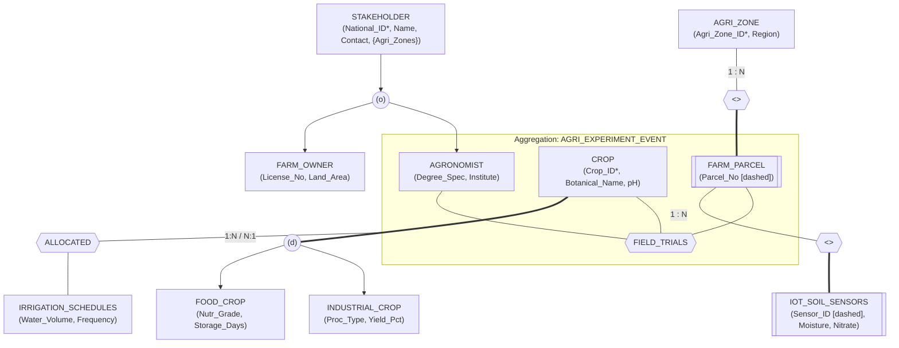

# BACSE202 — Database Systems
## Module 2: ER Modeling and Relational Database Design

> **Course Alignment:** VIT `BACSE202` (Database Systems — Syllabus v1.0) · **Module 2 (10 Lecture Hours · CO5)**  
> **Primary Textbooks:** R. Elmasri & S. B. Navathe (*Fundamentals of Database Systems*, 7th Ed., Ch. 3, 4, 9, 14 & 15); Silberschatz, Korth & Sudarshan (*Database System Concepts*, 7th Ed., Ch. 6 & 7)  
> **Synthesized From:** *Module 2. Relational Model and E-R Modeling.pptx*, *Module 2 Part 1 & Part 2*, *Module-2-Consolidated.ppt*, and *Nov 2026 FAT Slot Papers (A1+TA1 & A2+TA2)*

---

## Table of Contents

- [Part I: Conceptual Design — ER & Extended ER (EER) Modeling](#part-i-conceptual-design--er--extended-er-eer-modeling)
  - [1. Entity-Relationship (ER) Foundations & Weak Entities](#1-entity-relationship-er-foundations--weak-entities)
  - [2. Structural Constraints: Cardinality Ratios & `(min, max)` Participation](#2-structural-constraints-cardinality-ratios--min-max-participation)
  - [3. Extended ER (EER) Modeling: Specialization, Generalization, Lattices & Aggregation](#3-extended-er-eer-modeling-specialization-generalization-lattices--aggregation)
  - [4. The Deterministic 7-Step ER & 4-Option EER-to-Relational Mapping Algorithm](#4-the-deterministic-7-step-er--4-option-eer-to-relational-mapping-algorithm)
- [Part II: Relational Design Theory — FDs & Normalization (1NF to 5NF)](#part-ii-relational-design-theory--fds--normalization-1nf-to-5nf)
  - [5. Database Anomalies & Four Goodness Guidelines](#5-database-anomalies--four-goodness-guidelines)
  - [6. Functional Dependencies (FDs), Armstrong's Axioms & Equivalence](#6-functional-dependencies-fds-armstrongs-axioms--equivalence)
  - [7. Candidate Keys (`L / LR / R` Partitioning) & 3-Step Minimal Cover](#7-candidate-keys-l--lr--r-partitioning--3-step-minimal-cover)
  - [8. Normalization: 1NF, 2NF, 3NF & BCNF (3.5NF)](#8-normalization-1nf-2nf-3nf--bcnf-35nf)
  - [9. Lossless (Non-Additive) Join & Dependency Preservation Proofs](#9-lossless-non-additive-join--dependency-preservation-proofs)
  - [10. Higher Normal Forms: Multivalued Dependencies (4NF) & Join Dependencies (5NF / PJNF)](#10-higher-normal-forms-multivalued-dependencies-4nf--join-dependencies-5nf--pjnf)
- [Part III: Exam Prep, Worked FAT Solutions & Revision Self-Check](#part-iii-exam-prep-worked-fat-solutions--revision-self-check)
  - [11. Worked FAT Examination Solutions](#11-worked-fat-examination-solutions)
  - [12. Module 2 Revision Self-Check Quiz](#12-module-2-revision-self-check-quiz)
  - [13. Official Fall 2026-27 Model Question Paper & Slide Additions (`M2_ER_Rel`, `M2_Part1`, `M2_Part2`)](#13-official-fall-2026-27-model-question-paper--slide-additions-m2_er_rel-m2_part1-m2_part2)

---

# Part I: Conceptual Design — ER & Extended ER (EER) Modeling

## 1. Entity-Relationship (ER) Foundations & Weak Entities

Conceptual modeling translates fuzzy business requirements into a precise graphical blueprint (**Chen ER Diagram**) before any SQL `CREATE TABLE` statement is written.

### 1.1 Entities & Entity Sets
- **Entity:** A distinguishable real-world object (physical like a *Student* or *Room*, or conceptual like a *Course* or *Loan*).
- **Entity Type / Entity Set:** A collection of entities sharing identical attribute types (e.g., `STUDENT`, `ROOM`).
- **Strong (Regular) Entity Type:** Possesses an independent **Key Attribute** whose value uniquely identifies every instance across the entire entity set. Drawn as a **single rectangle**.
- **Weak Entity Type:** Lacks sufficient attributes of its own to form a globally unique primary key (e.g., `BED` numbered `B1, B2` inside each `ROOM`, or `DEPENDENT` named `Asha` inside an `EMPLOYEE`'s family). A weak entity **MUST** satisfy five exact Chen visual rules:
  1. Drawn as a **Double-Lined Rectangle** (e.g., `[[BED]]`).
  2. Its **Partial Key (Discriminator)** uses a **Dashed Underline** (e.g., `Bed_No`).
  3. Linked to its **Identifying Owner** (`ROOM`) through a **Double-Lined Diamond** (`<<HAS_BED>>` — Identifying Relationship).
  4. Connected to that double diamond by a **Double Line** (**Total Participation** — a weak entity cannot exist without its owner).
  5. When mapped to SQL, its Primary Key becomes composite: **`(Owner_PK, Partial_Key)`**.

### 1.2 Six Attribute Types & Exact Chen Visual Symbols

| Attribute Classification | Meaning | Chen ER Symbol | Concrete Example |
| :--- | :--- | :--- | :--- |
| **Simple (Atomic)** | Cannot be divided further into meaningful parts. | Single Oval | `CGPA`, `Tariff`, `Gender` |
| **Composite** | Subdivides into independent smaller sub-attributes (hierarchy). | Oval branching to sub-ovals | `Name` $\rightarrow$ (`First_Name`, `Middle_Initial`, `Last_Name`) |
| **Single-Valued** | Holds exactly one value per entity instance. | Single Oval | `DOB`, `National_ID` |
| **Multivalued** | Can hold a set of 0, 1, or multiple values for one entity. | **Double-Line Oval** | `{Phone_Numbers}`, `{Assigned_Agri_Zones}` |
| **Stored** | Persisted physically on disk. | Solid Oval | `DOB`, `Joining_Date` |
| **Derived** | Computed dynamically from stored attributes (saves update drift). | **Dashed-Line Oval** | `Age` (from `DOB`), `Number_of_Employees` |
| **Key / Partial Key** | Uniquely identifies entity (or weakly within owner). | **Solid Underline** / **Dashed Underline** | <u>`Guest_ID`</u> / `_Bed_No_` |

### 1.3 Relationship Types, Degrees & Recursive Roles
- **Relationship Type ($R$):** Meaningful association among $n$ entity types (drawn as a **Diamond**).
- **Degree of Relationship:**
  - **Degree 1 (Unary / Recursive):** Links entities from the *same* entity type in two distinct **Role Names** (`EMPLOYEE` $\xrightarrow{\text{supervisor}}$ `SUPERVISES` $\xleftarrow{\text{subordinate}}$ `EMPLOYEE`).
  - **Degree 2 (Binary):** Links two distinct entity types (most common: `STUDENT — ENROLLS — COURSE`).
  - **Degree 3 (Ternary):** Simultaneously binds three entity types (`AGRONOMIST`, `CROP`, `FARM_PARCEL` in `FIELD_TRIALS`).
- **Relationship Attributes:** Descriptive attributes belonging to the association itself rather than either entity alone—drawn as ovals attached directly to the **Relationship Diamond** (e.g., `Quantity` and `Service_Date` on `M:N` relationship `USES(BOOKING, SERVICE)`, or `Hours` on `WORKS_ON(EMPLOYEE, PROJECT)`). *(Note: On `1:N` relationships, attributes can migrate to the `N`-side entity upon SQL mapping; on `M:N`, they MUST live in the junction table!)*

> **When is a Ternary Relationship Mandatory instead of 3 Binary Relationships?**  
> If Doctor $D$ prescribes Medicine $M$ to Patient $P$ during a single visit, knowing $(D \leftrightarrow P)$, $(P \leftrightarrow M)$, and $(D \leftrightarrow M)$ separately fails to prove whether *Doctor $D$ specifically gave Medicine $M$ to Patient $P$* or to a different patient. Only a Ternary Diamond preserves exact 3-way tuple identity.

---

## 2. Structural Constraints: Cardinality Ratios & `(min, max)` Participation

Every binary relationship enforces two complementary structural rules:

1. **Cardinality Ratio (`1:1`, `1:N`, `M:N`):** Restricts the **maximum** number of relationship instances an entity can participate in.
   - `1:1`: An Employee manages at most 1 Department, and a Department is managed by 1 Employee.
   - `1:N`: One Department employs many (`N`) Employees; each Employee works for at most `1` Department.
   - `M:N`: A Booking reserves many Rooms (`>=1`), and a Room appears in many Bookings over time.
2. **Participation Constraint (`Total` vs. `Partial`) — Minimum Participation:**
   - **Total (Mandatory) Participation — Double Line (`====`):** Every entity in the set *must* participate in at least one relationship (`min ≥ 1`). Phrases like *"every employee works in a department"* or *"each booking includes at least one room"* demand a **double line**.
   - **Partial (Optional) Participation — Single Line (`----`):** Participation is optional (`min = 0`). Phrases like *"a guest makes zero or more bookings"* demand a **single line**.

### `(min, max)` Structural Notation vs. Cardinality Ratio (Avoid Swapping!)
- In **Cardinality Ratio (`1:N`)**, the `1` is placed near the `1`-side (`DEPARTMENT`) and `N` near the `N`-side (`EMPLOYEE`).
- In **`(min, max)` notation**, the pair placed next to entity `E` counts **how many times ONE instance of `E` enters the diamond**:
  - Each `DEPARTMENT` employs `0` (newly created) or up to `N` employees $\rightarrow$ **`(0, N)`** beside `DEPARTMENT`.
  - Each `EMPLOYEE` works for minimum `1` and maximum `1` department $\rightarrow$ **`(1, 1)`** beside `EMPLOYEE`.

---

## 3. Extended ER (EER) Modeling: Specialization, Generalization, Lattices & Aggregation

EER Modeling extends Chen ER diagrams with four object-oriented modeling mechanisms:

### 3.1 Superclass, Subclass & Attribute/Relationship Inheritance
- An **`IS-A`** hierarchy defines specialized groupings (**Subclasses**) of a parent **Superclass** (e.g., `DOCTOR IS-A STAFF`, `SAVINGS_ACCOUNT IS-A ACCOUNT`).
- **Inheritance:** Every subclass automatically inherits **all attributes and all relationships** of its superclass—never redraw inherited attributes like `Staff_ID` or `Name` inside the subclass box! Add only subclass-specific attributes (`MCI_Reg_No` on `DOCTOR`) and subclass-specific relationships (`SURGEON — PERFORMS — SURGERY`).

### 3.2 Specialization (Top-Down) vs. Generalization (Bottom-Up)
- **Specialization (Top-Down):** Starting from an existing entity (`EMPLOYEE`), partition it into specialized subgroups (`SECRETARY`, `TECHNICIAN`, `ENGINEER`) based on distinct attributes or roles.
- **Generalization (Bottom-Up):** Discovering common attributes across existing separate entities (`CAR`, `TRUCK`, `MOTORCYCLE`) and factoring shared fields (`Vehicle_ID`, `License_Plate`, `Price`) upward into a single superclass (`VEHICLE`).
- **Visual Note:** Both draw with the **identical** circle + subset symbol (`⊂`) notation in EER diagrams!

### 3.3 The Four Specialization Constraint Combinations (`d / o` × `Total / Partial`)

Always annotate **BOTH** axes on every specialization hierarchy—inside the circle (`d` or `o`) and on the line leaving the superclass (double line `==` or single line `—`):

| Combination | Circle + Top Line | Logical Constraint | Real FAT Exam Example |
| :--- | :--- | :--- | :--- |
| **Disjoint + Total** | Circle **`(d)`** + **Double line (`==`)** | Every superclass entity MUST belong to **EXACTLY ONE** subclass. | `A1 Q3`: `CROP` $\rightarrow$ `{FOOD_CROP, INDUSTRIAL_CROP}`; `A2 Q3`: `BED` $\rightarrow$ `{SINGLE_BED, DOUBLE_BED}` |
| **Disjoint + Partial** | Circle **`(d)`** + **Single line (`—`)** | Superclass entity belongs to **AT MOST ONE** subclass (0 or 1). | `VEHICLE` $\rightarrow$ `{TWO_WHEELER, FOUR_WHEELER}` (trucks belong to neither) |
| **Overlapping + Total** | Circle **`(o)`** + **Double line (`==`)** | Superclass entity belongs to **AT LEAST ONE** subclass (1, 2, or more simultaneously). | `UNIVERSITY_MEMBER` $\rightarrow$ `{STUDENT, EMPLOYEE}` (grad TAs belong to both) |
| **Overlapping + Partial** | Circle **`(o)`** + **Single line (`—`)** | May belong to **0, 1, or multiple** subclasses simultaneously. | `A1 Q3`: `STAKEHOLDER` $\rightarrow$ `{FARM_OWNER, AGRONOMIST}`; `A2 Q9b`: `USERS` $\rightarrow$ `{CUSTOMER, SELLER}` |

- **Predicate-Defined (Condition-Defined) vs. User-Defined:** If a superclass attribute controls subclass assignment (e.g., `Job_Type = 'Engineer'`), write the condition on the branch; otherwise membership is **User-Defined** (assigned manually). A **Union Type / Category** uses circle **`(U)`** when a single subclass inherits selectively from *unrelated* superclasses (e.g., `OWNER` $\cup$ from `PERSON`, `BANK`, `COMPANY`).

### 3.4 Multiple Inheritance (Shared Subclass / EER Lattice)
When a single subclass inherits simultaneously from **two or more immediate superclasses**, the hierarchy becomes a **Lattice** and that child is called a **Shared Subclass**:
- **Example (`Nov 2026 FAT A2+TA2 Q9b`):** `CUSTOMER` and `BUSINESS_SELLER` both point downward into shared subclass **`BUYER_SELLER`** (which inherits `Customer_ID` from `CUSTOMER` and `Seller_ID` + `User_ID, Name, Email` from `BUSINESS_SELLER -> SELLER -> USERS`).

### 3.5 Aggregation (Treating a Relationship Event as an Abstraction)
Standard ER diamonds cannot connect directly to another relationship diamond. **Aggregation** draws a **dashed/solid rectangle boundary** around a relationship diamond and its participating entities—treating the entire association as a higher-level abstract entity set that can link to another entity.
- **Example (`Nov 2026 FAT A1+TA1 Q3`):** Ternary `FIELD_TRIALS(AGRONOMIST, CROP, FARM_PARCEL)` is wrapped inside an Aggregation boundary named **`AGRI_EXPERIMENT_EVENT`**, which then connects to `IRRIGATION_SCHEDULES` via `<ALLOCATED>`.

---

## 4. The Deterministic 7-Step ER & 4-Option EER-to-Relational Mapping Algorithm

Every ER/EER diagram converts systematically into SQL relations via Elmasri & Navathe's **7-Step Algorithm** plus **EER Step 8 (Options 8A–8D)**:

```mermaid
flowchart LR
    S1["1. Strong Entities<br/>Flatten composite attrs"] --> S2["2. Weak Entities<br/>Composite PK=(Owner_PK, Partial_Key)"]
    S2 --> S3["3. Binary 1:1<br/>FK in Total side (or Merge)"]
    S3 --> S4["4. Binary 1:N<br/>Owner PK → FK in N-side"]
    S4 --> S5["5. Binary M:N<br/>New Junction Table (PK1, PK2)"]
    S5 --> S6["6. Multivalued Attrs<br/>New Table (Owner_PK, Val)"]
    S6 --> S7["7. N-ary (≥3)<br/>New Table with all PKs"]
    S7 --> S8["8. EER Subclasses<br/>Choose 8A, 8B, 8C, or 8D"]
```

### 4.1 Complete 7-Step ER Mapping Reference

| Step | ER Construct | Resulting Relational Table(s) | Primary Key (PK) | Foreign Key (FK) & Rule |
| :--- | :--- | :--- | :--- | :--- |
| **1** | Strong Entity `E(k*, a, Comp(c1,c2))` | `E(k, a, c1, c2)` | `k` | Flatten composite attributes into simple columns; ignore derived attributes (`Age`). |
| **2** | Weak Entity `W(p_partial, b)` owned by `E(k*)` | `W(k, p_partial, b)` | **`(k, p_partial)`** | `k` references `E(k)` **`NOT NULL ON DELETE CASCADE`**. |
| **3** | Binary `1:1` (`E1 — E2, attr`) | **Foreign Key Approach:** Place PK of partial side inside total side (or **Merged** single table if both total). | Host table's PK | Included FK must carry `UNIQUE` constraint + `attr`. |
| **4** | Binary `1:N` (`E1 1 — N E2, attr`) | Add `E1`'s PK + `attr` directly as columns inside `N`-side table `E2`. | `E2`'s existing PK | `E1.k` in `E2` is FK referencing `E1(k)`. *(Never put `N`-side PK inside `1`-side!)* |
| **5** | Binary `M:N` (`E1 M — N E2, attr`) | Create **new Junction Relation** `R(k1, k2, attr)`. | **`(k1, k2)`** | `k1` FK $\rightarrow$ `E1(k1)`, `k2` FK $\rightarrow$ `E2(k2)`. |
| **6** | Multivalued Attribute `{M}` of `E(k*)` | Create **new Relation** `E_M(k, M)`. | **`(k, M)`** | `k` FK $\rightarrow$ `E(k) ON DELETE CASCADE`. |
| **7** | N-ary (`n ≥ 3`) Rel `R(E1..En, attr)` | Create **new Relation** `R(k1, k2, ..., kn, attr)`. | All `k1..kn` (unless one side has cardinality `1`) | Each `k_i` is FK referencing `E_i(k_i)`. |

### 4.2 Four EER Subclass Mapping Options (Step 8: `8A, 8B, 8C, 8D`)

| Option | Relational Tables Generated | Compatible Constraints | Trade-Off & Selection Rule |
| :--- | :--- | :--- | :--- |
| **8A** | **Superclass + Subclass tables:** `L(k, a...)` + `S1(k, s1...)`, `S2(k, s2...)` | **Universal** (`d` or `o`, `Total` or `Partial`) | Zero `NULL`s; requires a `JOIN` on `k` to assemble a complete subclass entity. |
| **8B** | **Subclass tables ONLY:** `S1(k, a..., s1...)`, `S2(k, a..., s2...)` (no superclass table) | **Disjoint + Total ONLY!** | Zero joins when querying one subclass; **FAILS** if Overlapping (duplicates superclass rows!) or Partial (loses superclass-only entities!). |
| **8C** | **Single Table + 1 Type Discriminator:** `L(k, a..., Type, s1..., s2...)` | **Disjoint `(d)`** | Fastest queries (zero joins); generates `NULL`s in columns belonging to non-matching subclasses. |
| **8D** | **Single Table + Boolean Flags:** `L(k, a..., Is_S1, s1..., Is_S2, s2...)` | **Overlapping `(o)`** *(also works for Disjoint)* | Handles belonging to multiple subclasses simultaneously; generates `NULL`s for inactive subclass fields. |

---

# Part II: Relational Design Theory — FDs & Normalization (1NF to 5NF)

## 5. Database Anomalies & Four Goodness Guidelines

A poorly designed "universal table" combines facts about two or more unrelated entities (e.g., putting both `Project` details and repeating `Principal_Investigator` details inside `PROJECT_GRANT`), causing **redundancy** and **three data modification anomalies**:

1. **Insertion Anomaly:** Cannot insert a newly hired Principal Investigator (`SSN`, `PI_Name`) until they are assigned a `Project_ID` (leaving `Project_ID = NULL` violates Entity Integrity!). Or, forcing redundant repetition of all PI fields every time a project row is added.
2. **Deletion Anomaly:** Deleting the sole remaining project led by a PI unintentionally wipes out all information about that PI from the database.
3. **Update (Modification) Anomaly:** If a PI leads 10 projects and changes their legal `PI_Name`, updating only 1 of the 10 rows leaves contradictory `PI_Name` values for the same `Principal_Investigator_SSN`.

### Four Informal Design Goodness Measures (Elmasri Ch. 14)
1. **Clear Tuple Semantics:** Each relation should describe *one* entity type or relationship—never mix attributes of `EMPLOYEE` and `DEPARTMENT` in one flat table.
2. **Minimize Redundant Values:** Eliminate repeated copies of facts across rows.
3. **Minimize `NULL` Values:** Isolate attributes that apply to `< 10%` of tuples into separate tables to avoid sparse rows.
4. **Prevent Spurious Tuples:** Every vertical split `(R1, R2)` MUST guarantee that natural joining `R1 ⋈ R2` never fabricates false rows (**Lossless Join**).

---

## 6. Functional Dependencies (FDs), Armstrong's Axioms & Equivalence

### 6.1 Definition of Functional Dependency ($X \rightarrow Y$)
Given relation schema $R$, attribute set $X \subseteq R$ **functionally determines** $Y \subseteq R$ (written **$X \rightarrow Y$**) if and only if for every valid relation state $r(R)$:
$$\forall\, t_1, t_2 \in r(R), \quad t_1[X] = t_2[X] \implies t_1[Y] = t_2[Y]$$
- **Trivial FD:** $Y \subseteq X$ (always true for every relation, e.g., $\{A, B\} \rightarrow A$).
- **Non-Trivial FD:** $Y \not\subseteq X$ (at least one attribute in $Y$ is not in $X$).
- **Completely Non-Trivial FD:** $X \cap Y = \emptyset$.

### 6.2 Armstrong's Inference Rules (Sound & Complete)

| Rule Category | Rule Name | Formal Statement |
| :--- | :--- | :--- |
| **Primary Axiom (IR1)** | **Reflexivity** | If $Y \subseteq X$, then $X \rightarrow Y$ |
| **Primary Axiom (IR2)** | **Augmentation** | If $X \rightarrow Y$, then $XZ \rightarrow YZ$ (for any set $Z$) |
| **Primary Axiom (IR3)** | **Transitivity** | If $X \rightarrow Y$ and $Y \rightarrow Z$, then $X \rightarrow Z$ |
| **Derived Rule** | **Union (Additive)** | If $X \rightarrow Y$ and $X \rightarrow Z$, then $X \rightarrow YZ$ |
| **Derived Rule** | **Decomposition (Projective)** | If $X \rightarrow YZ$, then $X \rightarrow Y$ and $X \rightarrow Z$ |
| **Derived Rule** | **Pseudotransitivity** | If $X \rightarrow Y$ and $WY \rightarrow Z$, then $WX \rightarrow Z$ |

> **Pitfall Alert:** `AB -> C` does **NOT** imply `A -> C` and `B -> C`! Decomposition applies **only to the RHS** (`X -> YZ` splits to `X -> Y` and `X -> Z`), **never the LHS**!

### 6.3 Equivalence of Two FD Sets ($E$ and $F$)
1. **$F$ covers $E$ ($E \subseteq F^+$):** For every FD $(X \rightarrow Y) \in E$, verify whether $Y \subseteq (X^+)_F$.
2. **$E$ and $F$ are Equivalent ($E \equiv F$):** $F$ covers $E$ **AND** $E$ covers $F$.

---

## 7. Candidate Keys (`L / LR / R` Partitioning) & 3-Step Minimal Cover

### 7.1 Attribute Closure Algorithm ($X^+$)
Starting with $\text{result} := X$, repeatedly scan FDs $(A \rightarrow B) \in F$: whenever $A \subseteq \text{result}$, add $\text{result} := \text{result} \cup B$ until no new attributes can be added. $X$ is a **Superkey** iff $X^+ = R$.

### 7.2 Fast Candidate Key Discovery (`L / LR / R` Partition Shortcut)
Before guessing random attribute subsets across $n$ columns ($2^n$ possibilities), partition every attribute of $R$ into three disjoint buckets based on $F$:

| Bucket | Condition in $F$ | Candidate Key Rule |
| :--- | :--- | :--- |
| **`L` (Essential)** | Appears **ONLY on LHS** OR **never appears in any FD** | **MUST belong to EVERY Candidate Key!** *(Start with $L^+$!)* |
| **`R` (Dead End)** | Appears **ONLY on RHS** (never on any LHS) | Cannot help determine other columns $\rightarrow$ **Exclude** from minimal Candidate Keys (unless it already lies in $L$—impossible!). |
| **`LR` (Bridge)** | Appears on **BOTH LHS and RHS** | If $L^+ = R$, then $L$ is the *unique* Candidate Key! Otherwise append combinations from `LR` until closure hits $R$. |

#### Classification of Attributes After Finding ALL Candidate Keys
- **Prime Attribute:** Any attribute belonging to **at least one** Candidate Key.
- **Non-Prime Attribute:** Any attribute not belonging to **any** Candidate Key.

### 7.3 The 3-Step Minimal (Canonical) Cover Algorithm ($F_c$)
A **Minimal Cover** $F_c$ is the smallest equivalent FD set with singleton RHS, no extraneous LHS attributes, and no redundant FDs. Always run Steps 1 $\rightarrow$ 2 $\rightarrow$ 3 in **exact order**:

1. **Step 1 — Decompose RHS into Singletons:** Rewrite every $X \rightarrow A_1 A_2 \dots A_k$ into $k$ separate FDs $X \rightarrow A_1, \dots, X \rightarrow A_k$.
2. **Step 2 — Eliminate Extraneous LHS Attributes:** For each $X \rightarrow A$ with $|X| \ge 2$, test removing each $b \in X$: compute $(X - \{b\})^+$ using current $F$. If $A \in (X - \{b\})^+$, then $b$ is **extraneous**—drop $b$ and remove duplicate rules!
3. **Step 3 — Remove Redundant FDs:** For each remaining $X \rightarrow A$, temporarily delete it and compute $X^+$ under $F - \{X \rightarrow A\}$. If $A \in X^+$, that FD is implied by the remaining set—delete it permanently!

**Worked Example:** Given $F = \{ A \rightarrow BC,\; B \rightarrow C,\; A \rightarrow B,\; AB \rightarrow C \}$:
- *Step 1:* $F_1 = \{ A \rightarrow B,\; A \rightarrow C,\; B \rightarrow C,\; AB \rightarrow C \}$.
- *Step 2:* In $AB \rightarrow C$, check $A^+ = \{A, B, C\}$ under $F_1$—already reaches $C$! So $B$ is extraneous $\rightarrow$ replace $AB \rightarrow C$ with $A \rightarrow C$ and deduplicate: $F_2 = \{ A \rightarrow B,\; A \rightarrow C,\; B \rightarrow C \}$.
- *Step 3:* Drop $A \rightarrow C$ temporarily: from $\{A \rightarrow B, B \rightarrow C\}$, $A^+ = \{A, B, C\}$ still implies $C$! Remove $A \rightarrow C$. Neither $A \rightarrow B$ nor $B \rightarrow C$ is redundant.  
**Result:** $F_c = \{ A \rightarrow B,\; B \rightarrow C \}$.

---

## 8. Normalization: 1NF, 2NF, 3NF & BCNF (3.5NF)

### 8.1 Exact Normal Form Progression & Formal Tests

| Normal Form | Formal Condition (for every non-trivial FD $X \rightarrow Y$) | Eliminates | Preserves |
| :--- | :--- | :--- | :--- |
| **1NF** | Every attribute domain contains only **atomic (indivisible)** values; no repeating groups or nested sub-tables. | Multi-valued cells (`"DBMS, OS"`), composite groups | Base relational compliance |
| **2NF** | In 1NF **AND** no non-prime attribute is partially dependent on any proper subset of a Candidate Key ($\not\exists\, K' \subsetneq CK$ s.t. $K' \rightarrow \text{NonPrime}$). | **Partial Dependencies** *(Automatic if all CKs are single-attribute!)* | Always **Lossless** & **FD-Preserving** |
| **3NF** | In 2NF **AND** for every non-trivial $X \rightarrow A$: **EITHER $X$ is a Superkey OR $A$ is a Prime Attribute**. | **Transitive Dependencies** (`NonKey -> NonPrime`) | Always **Lossless** & **FD-Preserving** |
| **BCNF (3.5NF)** | For every non-trivial $X \rightarrow A$: **$X$ MUST BE A SUPERKEY** *(drops the prime-attribute RHS exception!)*. | **ALL redundancy from Functional Dependencies** | Always **Lossless**; **NOT always FD-Preserving!** |

### 8.2 Classic 3NF vs. BCNF Separation Example
Consider $R(A, B, C)$ with $F = \{ AB \rightarrow C,\; C \rightarrow B \}$:
- **Candidate Keys:** $AB^+ = \{A,B,C\}$ and $AC^+ = \{A,C,B\}$ $\implies$ CKs = $\{AB\}, \{AC\}$. **Prime attributes = $\{A, B, C\}$** *(zero non-prime attributes!)*.
- **Is $R$ in 3NF?** Check $C \rightarrow B$: $C$ is NOT a superkey, **but $B$ IS a Prime Attribute** $\implies$ **3NF holds!**
- **Is $R$ in BCNF?** Check $C \rightarrow B$: $C$ is **NOT a Superkey** $\implies$ **FAILS BCNF!**
- **BCNF Trade-off:** Splitting on $C \rightarrow B$ produces $R_1(\underline{C}, B)$ and $R_2(\underline{A}, \underline{C})$. Both satisfy BCNF and preserve Lossless Join ($R_1 \cap R_2 = \{C\} \rightarrow R_1$), **yet FD $AB \rightarrow C$ is lost across two tables**! *(This proves why production schemas sometimes stop at 3NF when dependency preservation matters more than rare multi-key redundancy.)*

---

## 9. Lossless (Non-Additive) Join & Dependency Preservation Proofs

Every decomposition $D = \{R_1, R_2, \dots, R_m\}$ of relation $R$ must be verified for two formal properties:

### 9.1 Binary Lossless Join Test
A two-way decomposition $R \rightarrow (R_1, R_2)$ is **Lossless (Non-Additive)** with respect to $F$ if and only if **at least one** of the following FDs holds in $F^+$:
$$(R_1 \cap R_2) \rightarrow R_1 \quad \text{OR} \quad (R_1 \cap R_2) \rightarrow R_2$$
- **Meaning:** Their common intersection attributes must form a **Superkey** of at least one of the two split tables; otherwise $R_1 \bowtie R_2$ generates **spurious (fake) tuples**!
- **Multi-way Decomposition Chase Test ($k \ge 3$):** Or iteratively verify that each binary step satisfies the superkey intersection rule.

### 9.2 Dependency Preservation Test
Every original FD $(X \rightarrow Y) \in F$ should be enforceable within a *single* table $R_i$ without performing cross-table joins on every `INSERT`/`UPDATE`. Formally, let $\pi_{R_i}(F)$ be the projection of $F^+$ onto attributes of $R_i$. $D$ preserves dependencies iff:
$$\left( \bigcup_{i=1}^{m} \pi_{R_i}(F) \right)^+ \equiv F^+$$
*(Quick shortcut: If every FD in $F$ has both its LHS and RHS wholly contained inside at least one $R_i$, dependency preservation holds immediately!)*

### 9.3 Standard 3NF Synthesis Algorithm (Guaranteed Lossless + FD-Preserving)
1. Compute Minimal Cover $F_c$.
2. Group FDs with identical LHS: for each distinct LHS $X$ with FDs $X \rightarrow A_1, \dots, X \rightarrow A_k$, build relation $R_i(X, A_1, \dots, A_k)$ with key $X$.
3. **Key Preservation Check:** If NO created relation $R_i$ contains any Candidate Key of original $R$, create one extra table containing all attributes of one Candidate Key!
4. Drop any relation completely contained as a subset of another relation.

---

## 10. Higher Normal Forms: Multivalued Dependencies (4NF) & Join Dependencies (5NF / PJNF)

Even an **"all-key" relation** with zero non-trivial FDs (automatically passing 1NF, 2NF, 3NF, AND BCNF!) can still suffer severe Cartesian-product duplication.

### 10.1 Multivalued Dependency (`X ↠ Y`) & Fourth Normal Form (4NF)
- **Intuition:** An entity key $X$ independently pairs with a multi-valued set of $Y$ values AND an independent multi-valued set of $Z$ values ($Z = R - (X \cup Y)$), forcing every combination $|Y| \times |Z|$ to be stored redundantly!
- **Formal Definition (`X ↠ Y`):** Whenever two tuples $t_1, t_2 \in r(R)$ agree on $X$, swapping their $Y$-values must yield two valid tuples $t_3, t_4$ that also exist in $r(R)$.
- **Trivial MVD:** $X \twoheadrightarrow Y$ is trivial iff $Y \subseteq X$ OR $X \cup Y = R$ (only two independent columns exist).
- **4NF Rule:** Relation $R$ is in **4NF** iff for every non-trivial MVD $X \twoheadrightarrow Y$, **$X$ is a Superkey of $R$**.

#### Worked 4NF Example: `COURSE_INFO(Course, Prof, Book)`
- Course `C-100` has 2 Professors `{X, Y}` and 2 Recommended Books `{T1, T2}` (completely independent choices).
- Single all-key table (`CK = {Course, Prof, Book}`, zero non-trivial FDs $\implies$ **already BCNF!**) stores $2 \times 2 = 4$ redundant rows: `(C-100, X, T1), (C-100, X, T2), (C-100, Y, T1), (C-100, Y, T2)`.
- Because `Course ↠ Prof | Book` holds and `Course` is NOT a superkey, **4NF fails**!
- **4NF Decomposition:** Split into `COURSE_PROF(Course, Prof)` [2 rows] and `COURSE_BOOK(Course, Book)` [2 rows].

### 10.2 Join Dependency (`*(R1, R2, ..., Rn)`) & Fifth Normal Form (5NF / PJNF)
- Also called **Project-Join Normal Form (PJNF)**.
- A relation satisfies Join Dependency `*(R1, R2, ..., Rn)` iff $R$ equals the lossless natural join $R_1 \bowtie R_2 \bowtie \dots \bowtie R_n$, where binary joins of any two projections still produce spurious tuples!
- **5NF Rule:** $R$ is in **5NF** iff it is in 4NF and every non-trivial Join Dependency is implied strictly by the Candidate Keys of $R$.
- **Canonical 5NF Example (`AGENT_COMPANY_PRODUCT`):** If *Agent $A$ represents Company $C$*, *Company $C$ makes Product $P$*, and *Agent $A$ sells Product $P$*, a symmetric 3-way business rule dictates `(A, C, P)` exists—requiring 3 binary projections `R1(Agent, Company) ⋈ R2(Company, Product) ⋈ R3(Agent, Product) = R` (any 2 projections alone fail!).

---

# Part III: Exam Prep, Worked FAT Solutions & Revision Self-Check

## 11. Worked FAT Examination Solutions

### Worked Question 1 — `Nov 2026 FAT · Slot A1+TA1 · Q3` [10M, CO5, BL6]
> **ARRMS Agriculture EER Diagram:** `STAKEHOLDER(National_ID [PK], Name, Primary_Contact, {Assigned_Agri_Zones})` specializes into `FARM_OWNER(Ownership_License_No, Total_Land_Area)` and `AGRONOMIST(Degree_Specialization, Research_Institute)` (can be both simultaneously). `CROP(Crop_ID [PK], Botanical_Name, Optimal_pH_Range)` classifies into exactly one of `FOOD_CROP(Nutritional_Grade, Storage_Life_Days)` or `INDUSTRIAL_CROP(Processing_Industry_Type, Extraction_Yield_Pct)`. `FARM_PARCEL(Parcel_No [partial])` is weak within `AGRI_ZONE(Agri_Zone_ID [PK], Climatic_Region)`. `IOT_SOIL_SENSORS(Sensor_ID [partial], Moisture_Level, Nitrate_Content)` is weak within `FARM_PARCEL`. Ternary `FIELD_TRIALS(AGRONOMIST, CROP, FARM_PARCEL)` is aggregated as `AGRI_EXPERIMENT_EVENT` and linked to `IRRIGATION_SCHEDULES(Water_Volume_Liters, Frequency)`.

**Marking Breakdown & Checklist [10M]:**
- `STAKEHOLDER` (`{Assigned_Agri_Zones}` double oval) $\rightarrow$ **Single line Partial + Circle `(o)` Overlapping** into `FARM_OWNER` and `AGRONOMIST` [2.5M].
- `CROP` $\rightarrow$ **Double line Total (`==`) + Circle `(d)` Disjoint** into `FOOD_CROP` and `INDUSTRIAL_CROP` [2M].
- **Nested Weak Entities:** `AGRI_ZONE` $\rightarrow$ `<<LOCATED_IN>>` `==` `[[FARM_PARCEL]]` (dashed partial key `Parcel_No`) $\rightarrow$ `<<MONITORS>>` `==` `[[IOT_SOIL_SENSORS]]` (dashed partial key `Sensor_ID`) [2.5M].
- **Ternary + Aggregation:** `FIELD_TRIALS` connecting `AGRONOMIST`, `CROP`, `FARM_PARCEL` enclosed inside dashed **Aggregation box `AGRI_EXPERIMENT_EVENT`**, linked to `IRRIGATION_SCHEDULES` [3M].

---

### Worked Question 2 — `Nov 2026 FAT · Slot A2+TA2 · Q3` [10M, CO5, BL3/BL6]
> **Hotel Management ER/EER Schema:** `GUEST(Guest_ID*, Name, Phone, Email)`, `ROOM(Room_No*, Room_Type, Tariff)`, `BOOKING(Booking_ID*, Booking_Date, Check_In, Check_Out)`, `SERVICE(Service_ID*, Name, Charge)`. Guest makes `≥ 0` Bookings; Booking belongs to 1 Guest and includes `≥ 1` Room (Rooms have multiple Bookings over time). Guests use multiple Services during a Booking (record `Quantity`, `Service_Date`). Each Room has `≥ 1` Beds; `BED(Bed_No)` is weak within `ROOM`, and every bed is `Single` or `Double`.

**1. Exact ER/EER Visual Rules [6M]:**
- `GUEST` (`1`) — `<MAKES>` == (`N`) `BOOKING` *(Booking total `==`, Guest partial `—`)*.
- `BOOKING` (`M`) == `<RESERVES>` — (`N`) `ROOM` *(Booking total `==`, Room partial `—`)*.
- `BOOKING` (`M`) — `<USES_SERVICE>` (relationship attributes: `Quantity`, `Service_Date`) — (`N`) `SERVICE`.
- `ROOM` (`1`) == `<<HAS_BED>>` (`N`) == `[[BED]]` (`Bed_No` dashed underline; BOTH sides Total `==` because each Room has $\ge 1$ Bed and every Bed belongs to a Room!).
- `[[BED]]` == Circle **`(d)`** $\rightarrow$ `{SINGLE_BED, DOUBLE_BED}` (**Disjoint + Total**).

**2. Complete Relational Schema Mapping (Bonus Verification):**
- `GUEST(`<u>`Guest_ID`</u>`, Name, Phone, Email)`
- `ROOM(`<u>`Room_No`</u>`, Room_Type, Tariff)`
- `BOOKING(`<u>`Booking_ID`</u>`, Guest_ID [FK -> GUEST], Booking_Date, Check_In, Check_Out)`
- `BOOKING_ROOM(`<u>`Booking_ID`</u>`, `<u>`Room_No`</u>`)` *(both FKs)*
- `SERVICE(`<u>`Service_ID`</u>`, Service_Name, Charge)`
- `BOOKING_SERVICE(`<u>`Booking_ID`</u>`, `<u>`Service_ID`</u>`, `<u>`Service_Date`</u>`, Quantity)`
- `BED(`<u>`Room_No`</u>`, `<u>`Bed_No`</u>`, Bed_Type)` *(Weak Step 2 + EER Option 8C)*

---

### Worked Question 3 — `Nov 2026 FAT · Slot A2+TA2 · Q9(b)` [10M, CO5, BL3]
> **Online Shopping Shared Subclass EER:** `USERS(User_ID*, Name, Email)` $\rightarrow$ `CUSTOMER(Customer_ID)` or `SELLER(Seller_ID)` or both (optional). Every `SELLER` is either `INDIVIDUAL_SELLER` or `BUSINESS_SELLER`. A `BUSINESS_SELLER` who is also a `CUSTOMER` forms `BUYER_SELLER(Buyer_Seller_ID, Business_Name)`. Every `BUYER_SELLER` is either `PREMIUM_BUYER_SELLER` or `REGULAR_BUYER_SELLER`.

1. **Shared Subclass Identification [2M]:** **Shared Subclass = `BUYER_SELLER`**; its **two immediate superclasses = `CUSTOMER` and `BUSINESS_SELLER`** (Multiple Inheritance / EER Lattice).
2. **Hierarchy & Constraint Check [8M]:**
   - `USERS` $\xrightarrow{\text{Single line (Partial)}}$ **`(o)` Overlapping** $\rightarrow$ `CUSTOMER` and `SELLER`.
   - `SELLER` $\xRightarrow{\text{Double line (Total)}}$ **`(d)` Disjoint** $\rightarrow$ `INDIVIDUAL_SELLER` and `BUSINESS_SELLER`.
   - `CUSTOMER` $\searrow$ + `BUSINESS_SELLER` $\swarrow$ $\rightarrow$ **`BUYER_SELLER`** (`Buyer_Seller_ID`, `Business_Name`).
   - `BUYER_SELLER` $\xRightarrow{\text{Double line (Total)}}$ **`(d)` Disjoint** $\rightarrow$ `PREMIUM_BUYER_SELLER` and `REGULAR_BUYER_SELLER`.

---

### Worked Question 4 — `Nov 2026 FAT · Slot A1+TA1 · Q4` [10M, CO5, BL3]
> **Given:** `PATIENT_DIAGNOSIS(Patient_ID, Appt_Date, Doctor_ID, Doctor_Name, Dept_Code, Dept_Head, Test_Name, Test_Result)`  
> **FDs:** `FD1: (Patient_ID, Appt_Date) -> Doctor_ID` · `FD2: Doctor_ID -> Doctor_Name, Dept_Code` · `FD3: Dept_Code -> Dept_Head` · `FD4: (Patient_ID, Appt_Date, Test_Name) -> Test_Result`.

- **Part A — Highest Normal Form [4M]:**
  - *Step 1 (Candidate Key):* `Patient_ID`, `Appt_Date`, `Test_Name` never appear on any RHS (`L`-only!). Compute closure:
    $$\{Patient\_ID, Appt\_Date, Test\_Name\}^+ \xrightarrow{\text{FD1}} Doctor\_ID \xrightarrow{\text{FD2}} Doctor\_Name, Dept\_Code \xrightarrow{\text{FD3}} Dept\_Head \xrightarrow{\text{FD4}} Test\_Result$$
    Covers all 8 attributes! Only Candidate Key = **`(Patient_ID, Appt_Date, Test_Name)`**. Prime = `{Patient_ID, Appt_Date, Test_Name}`; Non-Prime = remaining 5 attributes.
  - *Step 2 (Normal Form Test):* Domains are atomic $\rightarrow$ **1NF holds**. Check 2NF: In **FD1 (`{Patient_ID, Appt_Date} -> Doctor_ID`)**, the LHS is a **proper subset of the Candidate Key** and `Doctor_ID` is **non-prime** $\rightarrow$ **Partial Dependency exists $\implies$ FAILS 2NF!** (Note: FD2 and FD3 are also transitive dependencies.) Therefore, **Highest Normal Form = `1NF`**.
- **Part B — Lossless BCNF Decomposition [6M]:**
  Decompose iteratively on FDs whose LHS is not a superkey:
  1. Split on `FD3 (Dept_Code -> Dept_Head)`: `R4(`<u>`Dept_Code`</u>`, Dept_Head)`.
  2. Split remaining on `FD2 (Doctor_ID -> Doctor_Name, Dept_Code)`: `R3(`<u>`Doctor_ID`</u>`, Doctor_Name, Dept_Code [FK -> R4])`.
  3. Split remaining on `FD1 (Patient_ID, Appt_Date -> Doctor_ID)`: `R2(`<u>`Patient_ID`</u>`, `<u>`Appt_Date`</u>`, Doctor_ID [FK -> R3])`.
  4. Final remaining relation: `R1(`<u>`Patient_ID`</u>`, `<u>`Appt_Date`</u>`, `<u>`Test_Name`</u>`, Test_Result)`.
  - **BCNF & Lossless Verdict:** Every active FD in `R1..R4` has its relation's Superkey on the LHS (`BCNF satisfied!`), every join intersection (`Dept_Code`, `Doctor_ID`, `{Patient_ID, Appt_Date}`) is a Superkey (`Lossless Join`), and all 4 FDs live inside single tables (`Dependency Preserving`).

---

### Worked Question 5 — `Nov 2026 FAT · Slot A2+TA2 · Q9(a)` [10M, CO5, BL3]
> **Given:** `PROJECT_EVALUATION(Student_ID, Project_ID, Title, Guide_ID, Guide_Name, Department, Evaluation_Date, Marks)`  
> **FDs:** `(Student_ID, Project_ID) -> Evaluation_Date, Marks` · `Project_ID -> Title, Guide_ID` · `Guide_ID -> Guide_Name, Department`.

1. **Candidate Key & Initial NF [2.5M]:** `L`-only = `{Student_ID, Project_ID}`. Its closure reaches all 8 attributes $\rightarrow$ single **CK = `(Student_ID, Project_ID)`**. Since `Project_ID` (proper subset of CK) determines non-prime `Title, Guide_ID` $\rightarrow$ Partial Dependency $\implies$ **Currently in `1NF` only**.
2. **1NF $\rightarrow$ 2NF [2.5M]:** Eliminate partial dependency `Project_ID -> Title, Guide_ID` (plus everything transitively determined by it):
   - `EVALUATION(`<u>`Student_ID`</u>`, `<u>`Project_ID`</u>`, Evaluation_Date, Marks)`
   - `PROJECT_GUIDE(`<u>`Project_ID`</u>`, Title, Guide_ID, Guide_Name, Department)`
3. **2NF $\rightarrow$ 3NF [2.5M]:** Eliminate transitive dependency `Project_ID -> Guide_ID -> Guide_Name, Department` inside `PROJECT_GUIDE`:
   - `EVALUATION(`<u>`Student_ID`</u>`, `<u>`Project_ID`</u>`, Evaluation_Date, Marks)`
   - `PROJECT(`<u>`Project_ID`</u>`, Title, Guide_ID [FK -> GUIDE])`
   - `GUIDE(`<u>`Guide_ID`</u>`, Guide_Name, Department)`
4. **BCNF Check [2.5M]:** In `EVALUATION` (`{Student_ID, Project_ID}` = CK), `PROJECT` (`Project_ID` = CK), and `GUIDE` (`Guide_ID` = CK), every determinant of every active FD is a Superkey $\implies$ **ALL 3 relations satisfy BCNF!**

---

### Worked Question 6 — `Nov 2026 FAT · Slot A1+TA1 · Q2(B)` [6M, CO1/CO5, BL2]
> **Given:** `PROJECT_GRANT(Project_ID, Project_Title, Principal_Investigator_SSN, PI_Name, Sponsor_Agency, Budget_Amount)` — explain Insertion, Deletion, and Update anomalies.
- **Root Cause:** `Principal_Investigator_SSN -> PI_Name` creates a partial/mixed-entity dependency repeating `PI_Name` across every project led by that PI.
- **Insertion Anomaly:** Cannot register a newly hired PI (`SSN`, `PI_Name`) before they are assigned a valid non-NULL `Project_ID`.
- **Deletion Anomaly:** Deleting the single completed project of a PI destroys that PI's entire personal record from the DB.
- **Update Anomaly:** Updating a PI's name across 6 projects requires editing all 6 rows; missing one leaves inconsistent `PI_Name` entries for the same `SSN`.

---

## 12. Module 2 Revision Self-Check Quiz

1. **Q:** *Why can an ER diagram NOT represent `(min, max)` directly on attributes like `Phone_Number` the same way it puts `(min, max)` on relationships?*  
   **A:** Cardinality and `(min, max)` specify how many instances of an entity participate in a *relationship*. For attributes, "zero or more values" is captured by making the attribute **Multivalued (double oval)** and optional (`NULL` allowed) rather than `(min, max)` edge labels.

2. **Q:** *Given $R(A, B, C, D)$ with $F = \{ AB \rightarrow C,\; C \rightarrow D,\; D \rightarrow A \}$, list ALL Candidate Keys and determine the Highest Normal Form.*  
   **A:** `B` is `L`-only (in every key). Closures: $AB^+ = ABCD$, $BC^+ \rightarrow D \rightarrow A = ABCD$, $BD^+ \rightarrow A \rightarrow C = ABCD$. So **CKs = `{AB}`, `{BC}`, `{BD}`**. All 4 attributes `{A, B, C, D}` are **Prime** $\rightarrow$ **satisfies 3NF**, yet `C -> D` and `D -> A` have non-superkey LHS $\rightarrow$ **FAILS BCNF**. Highest NF = **3NF**.

3. **Q:** *Why can EER Mapping Option `8B` (subclass tables only) NEVER be used when a specialization is Overlapping `(o)` or Partial?*  
   **A:** If Overlapping, an entity belonging to 2 subclasses would have all inherited superclass attributes duplicated inconsistently in 2 tables. If Partial, superclass instances belonging to no subclass would have nowhere to be stored.

4. **Q:** *A 3-column table `FACULTY_DUTY(Fac_ID, Subject, Lab_Equip)` stores independent lists of subjects taught and equipment used by a faculty member. Why does it pass BCNF yet fail 4NF?*  
   **A:** Because no non-trivial FD holds (`Fac_ID` does not uniquely determine either `Subject` or `Lab_Equip`), the sole Candidate Key is all three attributes `(Fac_ID, Subject, Lab_Equip)`—passing BCNF trivially. However, independent multi-valued sets trigger `Fac_ID ↠ Subject` and `Fac_ID ↠ Lab_Equip` where `Fac_ID` is not a superkey, violating **4NF**.

---

## 13. Official Fall 2026-27 Model Question Paper & Slide Additions (`M2_ER_Rel`, `M2_Part1`, `M2_Part2`)

### 13.1 Official Fall 2026-27 Model Question Paper — Q1 [10 Marks] (Car Dealership & Service Facility ER Diagram)

> **Prompt Q1 [10M]:** *Design an Entity-Relationship (ER) diagram for a car dealership. The dealership sells both new and used cars, and it operates a service facility. Base your design on the following business rules:*
> - *A salesperson may sell many cars, but each car is sold by only one salesperson.*
> - *A customer may buy many cars, and each car is bought by only one customer.*
> - *A salesperson writes a single invoice for each car he or she sells.*
> - *A customer gets an invoice for each car he or she buys.*
> - *A customer may come in just to have his or her car serviced; that is, a customer need not buy a car to be classified as a customer.*
> - *When a customer takes one or more cars in for repair or service, one service ticket is written for each car.*
> - *The car dealership maintains a service history for each of the cars serviced. The service records are referenced by the car's serial number.*
> - *A car brought in for service can be worked on by many mechanics, and each mechanic may work on many cars.*
> - *A car that is serviced may or may not need parts (e.g., adjusting a carburetor or cleaning a fuel injector nozzle does not require providing new parts).*
> *Clearly indicate entities, attributes, primary keys, relationships, cardinalities, and participation constraints.*

#### Complete Relationship, Cardinality & Participation Specification:

| Relationship | Connected Entities | Cardinality | Participation `(Left : Right)` | Justification from Business Rules |
| :--- | :--- | :---: | :---: | :--- |
| **`SELLS`** | `SALESPERSON` (<u>`SalespersonID`</u>) — `CAR` (<u>`SerialNo`</u>) | `1 : N` | `Partial : Partial` | Salesperson sells `0..N` cars; inventory/service-only cars have `0..1` salesperson |
| **`BUYS`** | `CUSTOMER` (<u>`CustomerID`</u>) — `CAR` (<u>`SerialNo`</u>) | `1 : N` | `Partial : Partial` | Service-only customer buys `0..N` cars; unsold/service-only car has `0..1` buyer |
| **`WRITES`** | `SALESPERSON` (<u>`SalespersonID`</u>) — `INVOICE` (<u>`InvoiceNo`</u>) | `1 : N` | `Partial : Total` | Every invoice is written by exactly `1` salesperson (`Total` on `INVOICE`) |
| **`GENERATES`** | `CAR` (<u>`SerialNo`</u>) — `INVOICE` (<u>`InvoiceNo`</u>) | `1 : 1` | `Partial : Total` | Each sold car generates `1` invoice; every invoice bills `1` car (`Total` on `INVOICE`) |
| **`RECEIVES`** | `CUSTOMER` (<u>`CustomerID`</u>) — `INVOICE` (<u>`InvoiceNo`</u>) | `1 : N` | `Partial : Total` | Service-only customer has `0` sales invoices; every invoice goes to `1` customer |
| **`BRINGS_FOR_SERVICE`** | `CUSTOMER` (<u>`CustomerID`</u>) — `SERVICE_TICKET` (<u>`TicketNo`</u>) | `1 : N` | `Partial : Total` | Every service ticket belongs to `1` customer (`Total` on `SERVICE_TICKET`) |
| **`HAS_TICKET / HISTORY`** | `CAR` (<u>`SerialNo`</u>) — `SERVICE_TICKET` (<u>`TicketNo`</u>) | `1 : N` | `Partial : Total` | Referenced by `SerialNo`; each visit writes `1` ticket per car (`Total` on `SERVICE_TICKET`) |
| **`WORKS_ON`** | `MECHANIC` (<u>`MechanicID`</u>) — `SERVICE_TICKET` | `M : N` | `Partial : Total` | Many mechanics work on a car/service visit (`HoursWorked`, `WorkNotes` on edge) |
| **`USES_PARTS`** | `SERVICE_TICKET` — `PARTS` (<u>`PartNo`</u>) | `M : N` | `Partial : Partial` | **Both `Partial`!** A service visit may require **zero parts** (carburetor tune-up) |

---

### 13.2 Official Fall 2026-27 Model Question Paper — Q3(a) & Q3(b) [3M + 7M = 10 Marks] (`LIBRARY_ISSUE` BCNF Decomposition)

> **Prompt Q3 [10M]:** *A university maintains a single relational table `LIBRARY_ISSUE`:*
> `LIBRARY_ISSUE(IssueID, IssueDate, StudentID, StudentName, DeptID, DeptName, BookID, BookTitle, AuthorID, AuthorName, Publisher, QuantityIssued)`
> *Functional Dependencies:*
> - **FD1:** `IssueID → IssueDate, StudentID`
> - **FD2:** `StudentID → StudentName, DeptID`
> - **FD3:** `DeptID → DeptName`
> - **FD4:** `BookID → BookTitle, AuthorID, Publisher`
> - **FD5:** `AuthorID → AuthorName`
> - **FD6:** `(IssueID, BookID) → QuantityIssued`
> *(a) Identify the candidate key(s) for `LIBRARY_ISSUE`. [3M] (b) Analyze the table for violations of 2NF, 3NF, and BCNF, and decompose into BCNF relations indicating primary and foreign keys. [7M]*

#### Solution — Q3(a): Candidate Key Computation [3M]
- Neither `IssueID` nor `BookID` appears on the RHS of any FD (`FD1..FD6`), so every superkey must contain **`(IssueID, BookID)`**.
- **Closure `(IssueID, BookID)+`:**
  1. Start: `{IssueID, BookID}`
  2. Apply **FD1** (`IssueID → IssueDate, StudentID`): `{IssueID, BookID, IssueDate, StudentID}`
  3. Apply **FD2** (`StudentID → StudentName, DeptID`): `{..., StudentName, DeptID}`
  4. Apply **FD3** (`DeptID → DeptName`): `{..., DeptName}`
  5. Apply **FD4** (`BookID → BookTitle, AuthorID, Publisher`): `{..., BookTitle, AuthorID, Publisher}`
  6. Apply **FD5** (`AuthorID → AuthorName`): `{..., AuthorName}`
  7. Apply **FD6** (`(IssueID, BookID) → QuantityIssued`): **All 12 attributes of `LIBRARY_ISSUE`!**
- Since `{IssueID}+` = `{IssueID, IssueDate, StudentID, StudentName, DeptID, DeptName}` and `{BookID}+` = `{BookID, BookTitle, AuthorID, AuthorName, Publisher}`, neither proper subset is a superkey. Thus the unique **Candidate Key is `(IssueID, BookID)`**.

#### Solution — Q3(b): Normal Form Violation Audit & 6-Table Lossless BCNF Decomposition [7M]
- **2NF Violations (Partial Dependencies on proper subsets of CK `(IssueID, BookID)`):** **FD1** (`IssueID → IssueDate, StudentID`) and **FD4** (`BookID → BookTitle, AuthorID, Publisher`).
- **3NF & BCNF Violations (Transitive Dependencies where LHS is not a superkey):** **FD2** (`StudentID → StudentName, DeptID`), **FD3** (`DeptID → DeptName`), and **FD5** (`AuthorID → AuthorName`).
- **Final 6-Table Lossless & Dependency-Preserving BCNF Schema:**
  1. **`DEPARTMENT`** (<u>`DeptID`</u>, `DeptName`) — satisfies FD3 (`CK = DeptID`).
  2. **`STUDENT`** (<u>`StudentID`</u>, `StudentName`, `DeptID` *[FK → DEPARTMENT]*) — satisfies FD2 (`CK = StudentID`).
  3. **`AUTHOR`** (<u>`AuthorID`</u>, `AuthorName`) — satisfies FD5 (`CK = AuthorID`).
  4. **`BOOK`** (<u>`BookID`</u>, `BookTitle`, `AuthorID` *[FK → AUTHOR]*, `Publisher`) — satisfies FD4 (`CK = BookID`).
  5. **`ISSUE_HEADER`** (<u>`IssueID`</u>, `IssueDate`, `StudentID` *[FK → STUDENT]*) — satisfies FD1 (`CK = IssueID`).
  6. **`ISSUE_LINE`** (<u>`IssueID`</u> *[FK → ISSUE_HEADER]*, <u>`BookID`</u> *[FK → BOOK]*, `QuantityIssued`) — satisfies FD6 (`CK = (IssueID, BookID)`).

---

### 13.3 Official Fall 2026-27 Model Question Paper — Q4 [10 Marks] (`Student / Team / LabSection / DragExpRun` ER-to-Relational Mapping)

- **Relation 1 (`STUDENT`):** Flatten composite `name(FirstName, LastName)` and `class(year, semester, section)`:
  `STUDENT (`<u>`StudentID`</u>`, FirstName, LastName, year, semester, section)`
- **Relation 2 (`LAB_SECTION`):** Flatten composite `class(year, semester, section)` + `LabInstructor`:
  `LAB_SECTION (`<u>`year, semester, section`</u>`, LabInstructor)`
- **Relation 3 (`TEAM`):** With `1:N` `Made-of` FK to `LAB_SECTION`:
  `TEAM (`<u>`TeamID`</u>`, TeamName, SectionYear, SectionSemester, SectionNo)` where `(SectionYear, SectionSemester, SectionNo)` references `LAB_SECTION`.
- **Relation 4 (`MEMBER_OF`):** `M:N` bridge between `STUDENT` and `TEAM`:
  `MEMBER_OF (`<u>`StudentID`</u>` [FK → STUDENT], `<u>`TeamID`</u>` [FK → TEAM])`
- **Relation 5 (`DRAG_EXP_RUN`):** Weak entity identified by `Conduct` under owner `TEAM`, with partial key `(Date, Trial)`:
  `DRAG_EXP_RUN (`<u>`TeamID`</u>` [FK → TEAM], `<u>`Date`</u>`, `<u>`Trial`</u>`, DragF, Mass, Vel, Accel)`
