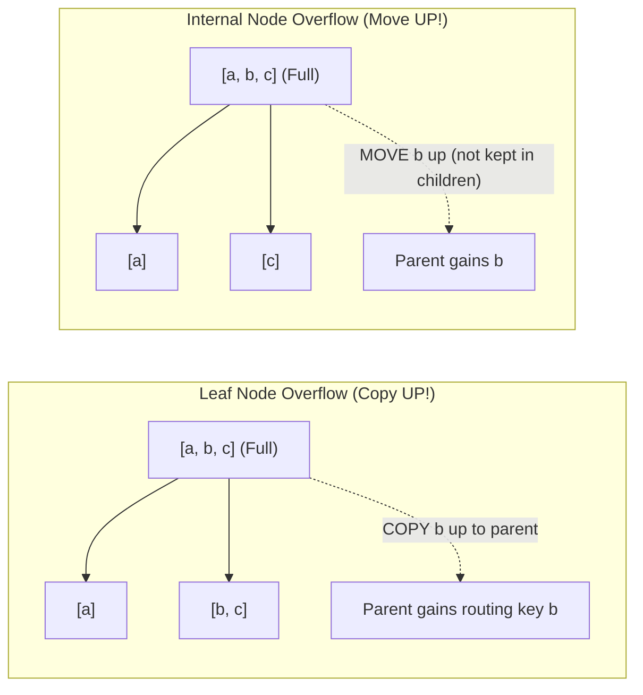
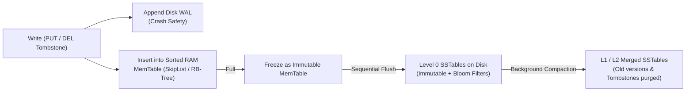
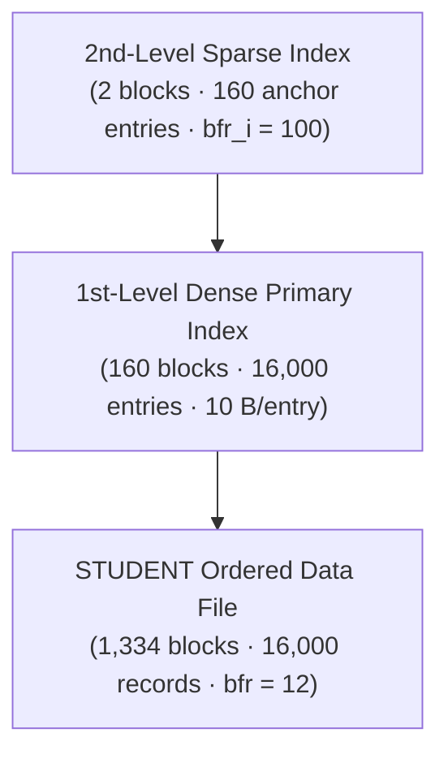
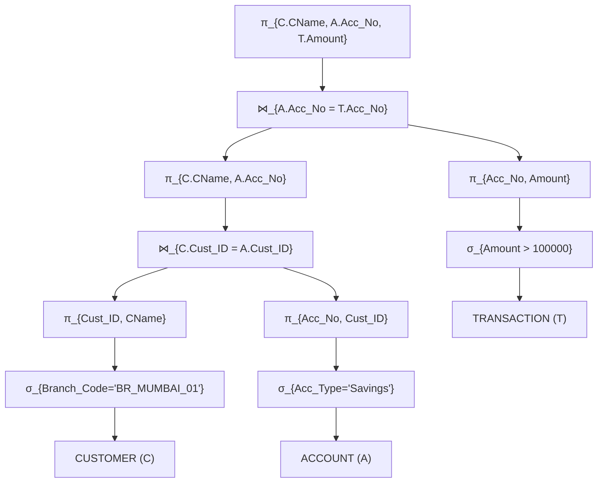

# BACSE202 — Database Systems
## Module 3: Physical Database Design and Query Processing

> **Course Alignment:** VIT `BACSE202` (Database Systems — Syllabus v1.0) · **Module 3 (9 Lecture Hours · CO2)**  
> **Primary Textbooks:** R. Elmasri & S. B. Navathe (*Fundamentals of Database Systems*, 7th Ed., Ch. 8, 16, 17, 18 & 19); Silberschatz, Korth & Sudarshan (*Database System Concepts*, 7th Ed., Ch. 2, 12, 13, 14 & 15)  
> **Synthesized From:** *BACSE202-DBS-Module-3_Complete.pptx*, *Module 3. Indexing.pptx*, *Module 3. Hashing.pptx*, *Linear_Hashing_Numerical_Example.pptx*, *B+.docx*, *Module 3. Relational Algebra.pptx*, *Translating SQL queries to Relational Algebra.pptx*, and *Nov 2026 FAT Slot Papers (A1+TA1 & A2+TA2)*

---

## Table of Contents

- [Part I: Physical File Organization & Hashing](#part-i-physical-file-organization--hashing)
  - [1. Disk Storage, Blocking Factor (`bfr`), Spanned vs. Unspanned Records](#1-disk-storage-blocking-factor-bfr-spanned-vs-unspanned-records)
  - [2. Heap (Unordered) vs. Sequential (Ordered) File Organizations](#2-heap-unordered-vs-sequential-ordered-file-organizations)
  - [3. Static Hashing & Collision Resolution Techniques](#3-static-hashing--collision-resolution-techniques)
  - [4. Dynamic Hashing: Extendible Hashing & Linear Hashing](#4-dynamic-hashing-extendible-hashing--linear-hashing)
- [Part II: Indexing Structures — Single-Level, Multi-Level, B+ Trees & LSM Trees](#part-ii-indexing-structures--single-level-multi-level-b-trees--lsm-trees)
  - [5. Single-Level & Multi-Level Ordered Indexes (`bfr_i`, Dense vs. Sparse)](#5-single-level--multi-level-ordered-indexes-bfr_i-dense-vs-sparse)
  - [6. B+ Trees: Structure, Order Occupancy, Insertion Splits & Deletion Merges](#6-b-trees-structure-order-occupancy-insertion-splits--deletion-merges)
  - [7. Log-Structured Merge (LSM) Trees, Bloom Filters & Compaction Policies](#7-log-structured-merge-lsm-trees-bloom-filters--compaction-policies)
- [Part III: Formal Query Languages & Heuristic Query Optimization](#part-iii-formal-query-languages--heuristic-query-optimization)
  - [8. Relational Algebra (Fundamental, Joins, Outer Joins, Division & Grouping)](#8-relational-algebra-fundamental-joins-outer-joins-division--grouping)
  - [9. Tuple Relational Calculus (TRC) & Safety Rules (`∃`, `∀`)](#9-tuple-relational-calculus-trc--safety-rules--)
  - [10. Query Processing & Heuristic Query Tree Optimization](#10-query-processing--heuristic-query-tree-optimization)
- [Part IV: Exam Prep, Worked FAT Solutions & Revision Self-Check](#part-iv-exam-prep-worked-fat-solutions--revision-self-check)
  - [11. Worked FAT Examination Solutions](#11-worked-fat-examination-solutions)
  - [12. Module 3 Revision Self-Check Quiz](#12-module-3-revision-self-check-quiz)
  - [13. Official Fall 2026-27 Model Question Paper & Slide Additions](#13-official-fall-2026-27-model-question-paper--slide-additions-m3_hashing-linear_hashing_numerical_example-m3_indexing)

---

# Part I: Physical File Organization & Hashing

## 1. Disk Storage, Blocking Factor (`bfr`), Spanned vs. Unspanned Records

### 1.1 Storage Hierarchy & Why Block I/O Dominates Cost
Main memory (RAM) loses contents on power failure and costs more per GB than NVMe/SSD/HDD secondary storage. Because transferring **one fixed-size disk block (page)** of size $B$ bytes between disk and the RAM buffer pool takes milliseconds (orders of magnitude slower than nanosecond RAM lookups), physical database performance is measured in **number of disk block accesses (I/Os)**.

### 1.2 Record Formats & Blocking Formulas
Suppose a relation stores $r$ records, each of size $R$ bytes, inside disk blocks of size $B$ bytes:

| Strategy | Meaning | Blocking Factor (`bfr`) | Total Blocks (`b`) | Space vs. Read Trade-off |
| :--- | :--- | :--- | :--- | :--- |
| **Unspanned Records** | No single record may cross a block boundary. | $\text{bfr} = \lfloor B / R \rfloor$ | $b = \lceil r / \text{bfr} \rceil$ | Wastes $B - (\text{bfr} \times R)$ bytes/block, but reads any record in **1 block I/O**. |
| **Spanned Records** | A record that does not fit completely splits across 2 blocks using a trailing pointer ($P$ bytes). | $\text{bfr}_{\text{spanned}} \approx \frac{B - P}{R + P}$ | Fewer blocks when $R > B/2$ | Zero large end-of-block waste, ideal for variable-length records, yet reading a split record needs **2 block reads**. |

- **Fixed-Length Records:** Attribute offsets are fixed ($O(1)$ arithmetic). Deleted slots form a linked **Free List** anchored in Block 0 (`header`), allowing new inserts to reuse gaps without scanning the file.
- **Variable-Length Records (`Slotted-Page Organization`):** Handles `VARCHAR` and optional columns. A page header grows *forward* storing `(slot_count, free_ptr, [(offset_i, len_i), ...])` while record bytes pack *backward* from the end of the block—keeping external Record IDs `(block_id, slot_no)` invariant even if records are compacted inside the page.

---

## 2. Heap (Unordered) vs. Sequential (Ordered) File Organizations

- **Heap (Unordered) File:** Records are appended wherever free space exists (typically the last block).
- **Sequential (Ordered) File:** Records are physically sorted on disk by an **Ordering Key** field (e.g., `Student_ID`).

| Operation | Heap (Unordered) File | Ordered (Sequential) File (No Overflow) | Ordered File + Overflow Strategy |
| :--- | :--- | :--- | :--- |
| **Equality Search (Ordering Key)** | Avg: $b / 2$ · Worst: $b$ | Binary search: $\lceil \log_2 b \rceil$ | $\lceil \log_2 b \rceil + b_{\text{ov}}$ (linear scan tiny overflow) |
| **Equality Search (Non-Key Field)** | Avg: $b / 2$ · Worst: $b$ | Linear scan: $b / 2$ avg, $b$ worst | Full scan of main + overflow |
| **Range Query (`BETWEEN a AND b`)** | Full scan: $b$ blocks | $\lceil \log_2 b \rceil$ to locate start + sequential read | Binary search + merge overflow hits |
| **Insert New Record** | Read last block + write = **2 I/Os ($O(1)$)** | $\log_2 b$ + shift average $b / 2$ blocks (huge cost!) | Append to unordered **Overflow File** (**2 I/Os**), merge-sort periodically |
| **Delete Existing Record** | Search ($b/2$) + set deletion marker bit + rewrite (1 I/O) | Search ($\log_2 b$) + set deletion marker bit + rewrite | Search + set **Deletion Marker** (reclaim space during compaction) |

> **Why Ordered Files Avoid Shifting:** Physically shifting $b/2$ blocks on every insert/delete is prohibitively slow. Real engines append inserts to an **Overflow File** and mark deletes using a 1-bit **Deletion Marker**, then periodically reorganize via batch merge-sort.

---

## 3. Static Hashing & Collision Resolution Techniques

Instead of searching an entire file or tree, **Hashing** computes a disk bucket address directly from the search key via $h(K)$—achieving ~$O(1)$ equality access (though it **cannot support ordered range queries** efficiently).

### 3.1 Hash Functions & Collision Handling
When two distinct keys map to the same address ($h(K_1) = h(K_2)$), a **Collision** occurs:

1. **Closed Addressing (Separate Chaining / External Overflow Buckets):** Each hash slot $0 \dots B-1$ owns a primary disk bucket of capacity $c$ records. If a bucket fills completely, it links via a pointer to an **Overflow Bucket Chain** (`B1 -> B1_ov1 -> B1_ov2`). *Drawback:* As the table outgrows fixed $B$, long chains degrade $O(1)$ into linear scanning, and resizing requires rehashing the entire file.
2. **Open Addressing (In-Memory / Probing Techniques):**
   - **Linear Probing:** $h(k, i) = (h(k) + i) \bmod m$. Suffers **Primary Clustering** (long contiguous runs of filled slots).
   - **Quadratic Probing:** $h(k, i) = (h(k) + c_1 i + c_2 i^2) \bmod m$. Avoids primary clustering, still exhibits **Secondary Clustering** for keys sharing the same initial hash.
   - **Double Hashing:** $h(k, i) = (h_1(k) + i \cdot h_2(k)) \bmod m$ (e.g., $h_1(k) = k \bmod 11$, $h_2(k) = 8 - (k \bmod 8)$ ensuring $h_2(k) \neq 0$). Eliminates clustering with near-uniform probe dispersion.

---

## 4. Dynamic Hashing: Extendible Hashing & Linear Hashing

Dynamic hashing allows the hash index to grow and shrink gracefully record-by-record without expensive full-file pauses.

### 4.1 Extendible Hashing (Directory + Global Depth `d` vs. Local Depth `d'`)
Extendible hashing maintains an in-memory **Directory** of $2^d$ pointers (where $d$ = **Global Depth**), indexing $d$ bits of the binary hash $h(K)$. Each disk bucket holds up to $c$ keys and tracks its own **Local Depth ($d' \le d$)**, indicating how many bits all keys inside that bucket share.

> **Bit Convention Warning (CHECK THE EXAM PROMPT!):**  
> - **MSB (Prefix bits, leftmost $d$ bits):** Used in Prof. Complete PPT and **Nov 2026 FAT A1 Q5(a)** (*"Bucket A for prefix 0, Bucket B for prefix 1"*).  
> - **LSB (Suffix bits, rightmost $d$ bits):** Used in `Module 3. Hashing.pptx` Slide 37 (*"use last $d$ binary bits"*).  
> Always follow whichever convention the problem statement specifies!

#### Exact Insertion & Split Rules (When Bucket $B$ Overflows $> c$ keys)
- **Case 1 — `d' == d` (Local Depth equals Global Depth):**
  1. **Double the Directory:** Increment $d \leftarrow d + 1$ (directory grows from $2^d$ to $2^{d+1}$ slots; unsplit buckets are simply shared by two directory pointers).
  2. **Split ONLY the Overflowing Bucket** into two new buckets, each assigned local depth $d'_{\text{new}} = d_{\text{new}}$.
  3. Rehash ONLY the $c + 1$ keys from the split bucket into its two halves using $d_{\text{new}}$ bits.
- **Case 2 — `d' < d` (Local Depth strictly less than Global Depth):**
  1. **Do NOT double the directory!** Global depth $d$ stays unchanged.
  2. Split ONLY the overflowing bucket into two buckets with $d' \leftarrow d' + 1$.
  3. Reassign only the directory pointers that previously pointed to that overflowing bucket.

#### Deletion & Directory Shrink Rule
- If deleting a key leaves two **buddy buckets** (differing only in their $d'$-th bit) whose combined occupancy $\le c$, **merge** them and decrement $d' \leftarrow d' - 1$.
- **Shrink Directory ($d \leftarrow d - 1$)** if and only if **ALL** buckets in the file now satisfy $d' < d$.

### 4.2 Linear Hashing (Directory-Free Sequential Splitting)
Linear hashing eliminates the directory completely! It begins with $N$ buckets ($B_0 \dots B_{N-1}$), **Round Level $i = 0$**, and **Split Pointer $p = 0$**, using a paired hash family:
$$h_i(k) = k \bmod (2^i \cdot N) \qquad\text{and}\qquad h_{i+1}(k) = k \bmod (2^{i+1} \cdot N)$$

#### Step-by-Step Operation Rules
1. **Routing Key $k$ (Lookup or Insert):** Compute $m = h_i(k)$.
   - If **$m < p$**: Bucket $B_m$ has already been split in this round $\implies$ **re-route using $h_{i+1}(k)$**!
   - If **$m \ge p$**: Bucket $B_m$ has not split yet $\implies$ use **$B_m$** directly.
2. **Handling Overflow (CRITICAL RULE):** When *any* bucket overflows:
   - Append the overflowing key to a temporary **overflow block** attached to that bucket.
   - **Always split bucket $B_p$** (the bucket currently pointed to by Split Pointer $p$—even if a different bucket overflowed!), creating $B_{p + 2^i N}$, and rehash all keys inside $B_p$ using $h_{i+1}(k)$.
   - Advance $p \leftarrow p + 1$. Once $p$ reaches $2^i \cdot N$ (the round finishes), increment **$i \leftarrow i + 1$** and reset **$p \leftarrow 0$**.

#### Complete Worked Trace (`Linear_Hashing_Numerical_Example.pptx`)
Insert `[2, 4, 6, 1, 3, 5, 7]` with $N = 2$ ($B_0, B_1$), capacity $c = 2$, $i = 0, p = 0$, $h_0(k) = k \bmod 2$, $h_1(k) = k \bmod 4$:
- **Insert `2, 4`:** Both hash (`%2 = 0`) into $B_0 = [2, 4]$ (full).
- **Insert `6` (`6%2=0`):** Overflows $B_0$! Attach `6`, **split $B_p = B_0$** creating $B_2$, rehash `{2, 4, 6}` with `%4`: `4%4=0` $\rightarrow$ $B_0=[4]$; `2%4=2, 6%4=2` $\rightarrow$ $B_2=[2, 6]$. Advance **$p = 1$**.
- **Insert `1, 3` (`%2 = 1 >= p`):** Fit cleanly into $B_1 = [1, 3]$ (full).
- **Insert `5` (`5%2 = 1 >= p`):** Overflows $B_1$! Attach `5`, **split $B_p = B_1$** creating $B_3$, rehash `{1, 3, 5}` with `%4`: `1%4=1, 5%4=1` $\rightarrow$ $B_1=[1, 5]$; `3%4=3` $\rightarrow$ $B_3=[3]$. Advance $p = 2 == 2^0 \cdot 2$ $\implies$ **Round 0 finishes! Set $i = 1, p = 0$**.
- **Insert `7` ($i=1 \implies h_1(7) = 7 \bmod 4 = 3$):** Inserts cleanly into $B_3 = [3, 7]$! Final buckets: $B_0=[4], B_1=[1,5], B_2=[2,6], B_3=[3,7]$.

---

# Part II: Indexing Structures — Single-Level, Multi-Level, B+ Trees & LSM Trees

## 5. Single-Level & Multi-Level Ordered Indexes (`bfr_i`, Dense vs. Sparse)

An index is an auxiliary sorted file of `<Search_Key, Pointer>` entries of size $R_i = V + P$ bytes (key size $V$ + block pointer $P$), giving index blocking factor (fan-out):
$$\text{bfr}_i = \lfloor B / (V + P) \rfloor \quad\text{entries/block}$$

### 5.1 Four Single-Level Ordered Index Types

| Index Type | Indexed Field Property | Density | Number of Level-1 Index Entries ($r_1$) | 1st-Level Blocks ($b_1$) |
| :--- | :--- | :--- | :--- | :--- |
| **Primary (Sparse)** | Ordering **Key** field of sorted data file | **Sparse** (1 anchor per data block) | $r_1 = b$ (number of data blocks) | $b_1 = \lceil b / \text{bfr}_i \rceil$ |
| **Primary (Dense)** | Ordering key, yet explicitly kept dense | **Dense** (1 entry per record) | $r_1 = r$ (total records) | $b_1 = \lceil r / \text{bfr}_i \rceil$ |
| **Clustering** | Ordering **Non-Key** field (duplicate keys grouped) | **Sparse** (1 entry per *distinct* field value) | $r_1 = \#$ distinct values of clustering key | $b_1 = \lceil r_1 / \text{bfr}_i \rceil$ |
| **Secondary** | **Unordered** file (key or non-key) | **MUST be Dense!** (1 entry per record) | $r_1 = r$ (or extra indirection block for duplicates) | $b_1 = \lceil r / \text{bfr}_i \rceil$ |

> **Why Can Secondary Indexes Never Be Sparse?** Because records on disk are NOT sorted on the secondary field—skipping any record means there is no contiguous block guarantee to find it!

### 5.2 Multi-Level Indexing (Reducing $\log_2 b_1$ to $O(\log_{\text{fo}} b)$)
Once the 1st-level index occupies $b_1 > 1$ blocks, build a **Sparse 2nd-level index** with 1 anchor entry per 1st-level block ($b_2 = \lceil b_1 / \text{bfr}_i \rceil$), repeating until a single **Root Block** ($b_t = 1$) remains!
- **Exact Disk Block Accesses:** With $t$ index levels terminating in 1 root block, locating any record takes **$t + 1$ block accesses** ($1$ per index level $+ 1$ data block read). If the top level still has $b_{\text{top}} > 1$ blocks (such as $b_2 = 2$ in FAT A2 Q4), binary-searching the top level takes $\lceil \log_2 b_{\text{top}} \rceil + (t - 1) + 1$ accesses.

---

## 6. B+ Trees: Structure, Order Occupancy, Insertion Splits & Deletion Merges

Static multilevel indexes degrade on frequent insertions/deletions. A **B+ Tree** is a self-balancing $m$-way search tree tailored to disk block fan-out (`p` pointers per node).

### 6.1 B-Tree vs. B+ Tree Crucial Difference
- **B-Tree:** Stores `<key, data_pointer>` pairs inside *both* internal nodes and leaves—wasting internal node space and requiring full tree traversal for range scans.
- **B+ Tree:** Stores **ONLY routing keys and child block pointers** in internal nodes; stores **ALL search keys + data record pointers strictly in the leaf level**, connected horizontally by a **linked list of next-leaf sibling pointers** for blistering `BETWEEN` range scans!

### 6.2 Formal B+ Tree Order-$m$ Occupancy Rules (`B+.docx` & Lecture Convention)
Let order **$m$** denote the maximum number of child pointers in a node:

| Property | Internal Node (Non-Root) | Leaf Node (Non-Root) | Root Node |
| :--- | :--- | :--- | :--- |
| **Max Child / Sibling Pointers** | $m$ tree pointers | $m - 1$ data pointers + 1 sibling pointer | $m$ |
| **Max Keys** | $m - 1$ | $m - 1$ | $m - 1$ |
| **Min Child Pointers** | $\lceil m / 2 \rceil$ | — | $2$ (if not leaf) |
| **Min Keys** | **$\lceil m / 2 \rceil - 1$** | **$\lceil (m - 1) / 2 \rceil$** *(check prompt!)* | $1$ |

- **Order $m = 3$ (Used in FAT A1 Q5b & A2 Q10a):** Max **$2$ keys**, Min **$1$ key** (both internal & leaf).
- **Order $m = 4$ (Used in Predicted Slot Q5b):** Max **$3$ keys**, Internal min **$1$ key**, Leaf min **$2$ keys**.

### 6.3 Insertion Split & Deletion Borrow/Merge Rules



1. **Leaf Overflow (`[a, b, c]` at $m=3$):** Split into Left `[a]` and Right `[b, c]` (retaining $b$ in the leaf level!), link sibling pointer `[a] -> [b, c]`, and **COPY `b` upward** into the parent internal node.
2. **Internal Node Overflow (`[a, b, c]` at $m=3$):** Split into Left `[a]` and Right `[c]`, and **MOVE `b` upward** (do *not* duplicate `b` in `[a]` or `[c]`). If the root splits, tree height increases by $+1$.
3. **Leaf Deletion (`< min keys` Underflow):**
   - **Priority 1 — Redistribute (Borrow):** If an adjacent sibling under the *same* parent has $> \text{min keys}$, borrow its nearest key and update the parent's separator key cleanly.
   - **Priority 2 — Merge:** Otherwise merge the underflowing leaf with an adjacent sibling and remove the separating key from the parent. If the parent internal node now underflows (e.g., hits 0 keys at $m=3$), recursively **borrow from an internal sibling (rotating through the parent separator)** OR **merge internal siblings pulling the parent separator down** (which reduces tree height if the root empties!).

---

## 7. Log-Structured Merge (LSM) Trees, Bloom Filters & Compaction Policies

While B+ Trees perform fast reads ($3–4$ I/Os), random `INSERT`/`UPDATE` workloads cause heavy **random disk page I/O and write amplification**. **LSM Trees** (O'Neil 1996; used in RocksDB, LevelDB, Cassandra, HBase) convert all random writes into **sequential appends**:



- **Write Path:** Appends sequentially to disk **Write-Ahead Log (WAL)** + sorted RAM **MemTable** (zero random seeks!). When full, MemTable freezes and flushes sequentially to disk as an immutable **SSTable** (Sorted String Table) paired with a sparse key index and a **Bloom Filter**.
- **Updates & Deletes:** SSTables are never modified in place! Updates append a newer timestamped entry; Deletes write a **Tombstone** marker that hides older SSTable values until background compaction removes them.
- **Read Path & Bloom Filters:** Checks MemTable $\rightarrow$ Immutable MemTable $\rightarrow$ SSTables newest-to-oldest. Each SSTable checks its in-memory **Bloom Filter** ($k$ hash bits):
  - If *any* bit for search key $K$ is `0` $\implies$ **$K$ is Definitely NOT in this SSTable** (**0% False Negatives**, skipping disk read completely!).
  - If all $k$ bits are `1` $\implies$ $K$ is *probably* present (small false-positive rate due to hash collisions), so read the SSTable block.
- **Compaction Policies:**
  - **Size-Tiered Compaction (STCS — Write-Optimized, Cassandra default):** Merges SSTables of similar size when `N` accumulate (lowest write overhead, up to 50% temporary disk overhead).
  - **Leveled Compaction (LCS — Read-Optimized, RocksDB/LevelDB):** Enforces strictly non-overlapping key ranges across exponential levels ($L_1, L_2 = 10\times L_1, \dots$) so point lookups touch at most 1 SSTable per level ($\ge L_1$).
  - **Time-Window / FIFO:** Drops expired time-series SSTables in $O(1)$ once TTL passes.

---

# Part III: Formal Query Languages & Heuristic Query Optimization

## 8. Relational Algebra (Fundamental, Joins, Outer Joins, Division & Grouping)

Relational Algebra (RA) is a **procedural** query algebra operating over mathematical sets of tuples (automatically removing duplicates on `π`, `∪`, `∩`, `−`).

### 8.1 Six Fundamental Operators
1. **Select ($\sigma_{p}(R)$):** Keeps tuples satisfying predicate $p$ (row filter = SQL `WHERE`). Commutative: $\sigma_{c_1}(\sigma_{c_2}(R)) = \sigma_{c_2}(\sigma_{c_1}(R))$.
2. **Project ($\pi_{A_1, \dots, A_k}(R)$):** Keeps listed columns and eliminates duplicate rows (column filter = SQL `SELECT DISTINCT`).
3. **Union ($R \cup S$):** Tuples in $R$ or $S$ (requires **Union Compatibility**: identical degree $n$ and matching domains per column position).
4. **Set Difference ($R - S$):** Tuples in $R$ and NOT in $S$ (Union Compatible).
5. **Cartesian Product ($R \times S$):** Pairs every tuple of $R$ with every tuple of $S$ (degree = $\text{deg}(R) + \text{deg}(S)$, cardinality = $|R| \times |S|$).
6. **Rename ($\rho_{S(B_1, \dots, B_n)}(R)$):** Renames relation/attributes (essential for self-joins!).

### 8.2 Derived Operators, Outer Joins & Division (`÷`)
- **Intersection:** $R \cap S \equiv R - (R - S)$.
- **Theta / Equi Join:** $R \bowtie_{\theta} S \equiv \sigma_{\theta}(R \times S)$.
- **Natural Join ($R \bowtie S$):** Equates all same-named attributes automatically and drops duplicate join columns.
- **Outer Joins:** Preserve unmatched orphan tuples padded with `NULL`:
  - **Left Outer ($R \mathbin{⟕} S$):** All $R$ preserved; unmatched $S$ cols = `NULL`.
  - **Right Outer ($R \mathbin{⟖} S$):** All $S$ preserved; unmatched $R$ cols = `NULL`.
  - **Full Outer ($R \mathbin{⟗} S$):** Both sides preserved.
- **Relational Division ($R(A, B) \div S(B)$):** Answers universal **"for EVERY / ALL"** queries (e.g., *Students enrolled in ALL Core Courses*). Algebraic expansion:
  $$R(A, B) \div S(B) \equiv \pi_A(R) - \pi_A\big((\pi_A(R) \times S) - R\big)$$
  *(Read intuitively: Start with all candidates $\pi_A(R)$, subtract any candidate missing at least one required $B$ from $S$!)*

### 8.3 Extended RA & 4-Step SQL-to-RA Compilation Order
- **Grouping & Aggregation:** ${}_{G}\mathcal{F}_{\text{AGG}(A)}(R)$ (or $\gamma_{G,\text{AGG}(A)}(R)$) groups by $G$ and evaluates `COUNT`, `SUM`, `AVG`, `MIN`, `MAX`.
- **Exact Inside-Out Evaluation Order for SQL Queries:**
  $$\text{SELECT}\;(\pi) \;\longleftarrow\; \text{HAVING}\;(\sigma_{\text{group}}) \;\longleftarrow\; \text{GROUP BY}\;(\mathcal{F}) \;\longleftarrow\; \text{WHERE}\;(\sigma_{\text{row}}) \;\longleftarrow\; \text{FROM / JOIN}\;(\times \text{ or } \bowtie)$$

**Worked SQL-to-RA Translation:**
```sql
SELECT D.Dept_Name, COUNT(S.Student_ID) AS Total
FROM STUDENT S JOIN DEPARTMENT D ON S.Dept_ID = D.Dept_ID
WHERE S.CGPA >= 8.0
GROUP BY D.Dept_Name
HAVING COUNT(S.Student_ID) > 5;
```
$$\pi_{D.\text{Dept\_Name},\,\text{Total}}\!\left(\sigma_{\text{Total} > 5}\!\left({}_{D.\text{Dept\_Name}}\mathcal{F}_{\text{COUNT}(S.\text{Student\_ID})\text{ AS Total}}\!\left(\big(\sigma_{S.\text{CGPA} \ge 8.0}(\text{STUDENT } S)\big) \bowtie_{S.\text{Dept\_ID}=D.\text{Dept\_ID}} D\right)\right)\right)$$

---

## 9. Tuple Relational Calculus (TRC) & Safety Rules (`∃`, `∀`)

Whereas RA is *procedural* (specifies operator execution order), **Tuple Relational Calculus (TRC)** is *non-procedural / declarative*: `{ t.Attrs | P(t) }`, returning tuples satisfying first-order predicate $P(t)$. (**Domain Relational Calculus (DRC)** quantifies scalar domain variables instead of whole tuple variables: `{ <x1, x2> | P(x1, x2) }`.)

### 9.1 Core Rules, Quantifiers & Safety
- **Free vs. Bound Variables:** The output variable `t` to the left of `|` is **free**; any variable scoped by `(∃ s)` (*there exists*) or `(∀ s)` (*for all*) is **bound**.
- **Safety Requirement:** A TRC query MUST return a **finite** subset of values appearing in the database/query. Unanchored negation like `{ t | ¬EMPLOYEE(t) }` matches infinitely many arbitrary tuples outside `EMPLOYEE` and is **UNSAFE**! Always anchor every free/negated variable with a positive range predicate `REL(t)`.

### 9.2 Four Canonical TRC Translation Patterns
1. **Simple Filter & Projection:**  
   `{ s.Name | STUDENT(s) ∧ s.Dept = 'CS' ∧ s.CGPA > 8 }`
2. **Multi-Table Join (`∃`):**  
   `{ s.Name | STUDENT(s) ∧ (∃ d)(DEPARTMENT(d) ∧ d.Did = s.Did ∧ d.Loc = 'Block-A') }`
3. **"None / Not In Any" (`¬∃`):**  
   `{ c.Name | CUSTOMER(c) ∧ ¬(∃ o)(ORDERS(o) ∧ o.Cust_ID = c.Cust_ID) }`
4. **"All / Every" (`∀` with `→` Implication — NEVER `∧`!):**  
   *Customers who ordered EVERY Electronics product:*  
   `{ c.Name | CUSTOMER(c) ∧ (∀ p)((PRODUCT(p) ∧ p.Category = 'Electronics') → (∃ o)(ORDERS(o) ∧ o.Cust_ID = c.Cust_ID ∧ o.Product_ID = p.Product_ID)) }`  
   *(Trap: Writing `(∀ p)(PRODUCT(p) ∧ ...)` evaluates to FALSE because it claims every tuple in the entire DB universe is a `PRODUCT`! Always guard `∀` with implication `→`.)*

> **Codd's Completeness Theorem:** Core Relational Algebra, **Safe** TRC, and **Safe** DRC share **exact equal expressive power** (*relationally complete*).

---

## 10. Query Processing & Heuristic Query Tree Optimization

### 10.1 Three Stages of Query Processing
1. **Parsing & Translation:** Checks syntax and privileges against System Catalog; breaks SQL into query blocks and builds an initial **Canonical Query Tree** (leaves = base tables, internal nodes = RA operators, evaluated bottom-up).
2. **Optimization:** Applies **Heuristic Algebraic Equivalences** + **Cost Estimation** (cardinalities, selectivity histograms, available indexes) to produce the lowest-I/O **Execution Plan**.
3. **Evaluation:** Streams tuples upward via pipelined iterators or temporary materialized buffers.

### 10.2 Five Golden Heuristic Optimization Rules (Elmasri Ch. 19)

| Step | Heuristic Rule | Algebraic Identity | Why It Slashes Cost |
| :--- | :--- | :--- | :--- |
| **1** | **Cascade (Split) $\sigma$** | $\sigma_{c_1 \land c_2}(R) \equiv \sigma_{c_1}(\sigma_{c_2}(R))$ | Separates multi-table `AND` predicates so each travels independently. |
| **2** | **Push $\sigma$ Down to Leaves** | $\sigma_c(R \times S) \equiv \sigma_c(R) \times S$ (if $c$ uses only $R$) | Filters rows *before* multiplication/joins! |
| **3** | **Reorder Leaves / Joins** | $(R \bowtie S) \bowtie T \equiv R \bowtie (S \bowtie T)$ | Execute the **most restrictive $\sigma$** (smallest intermediate relation) first! |
| **4** | **Convert $\times + \sigma_{\text{join}}$ into $\bowtie$** | $\sigma_{R.A=S.A}(R \times S) \equiv R \bowtie_{R.A=S.A} S$ | Uses Hash / Sort-Merge / Index Join instead of massive $|R| \times |S|$ products. |
| **5** | **Push $\pi$ Down as Far as Possible** | $\pi_L(R \bowtie_c S) \equiv \pi_L(\pi_{L_R}(R) \bowtie_c \pi_{L_S}(S))$ | Drops unused wide columns early (`Keep = Output_Cols ∪ Join_Keys_Above`). |

---

# Part IV: Exam Prep, Worked FAT Solutions & Revision Self-Check

## 11. Worked FAT Examination Solutions

### Worked Question 1 — `Nov 2026 FAT · Slot A2+TA2 · Q4` [10M, CO2, BL3]
> **Multilevel Index Numerical:** `STUDENT` has $r = 16,000$ fixed records of $R = 80$ bytes, stored unspanned in $B = 1,000$-byte blocks. Dense primary index has $4$-byte key + $6$-byte pointer ($10$ bytes total).
> **(a)** Calculate `bfr` and data blocks [2M] · **(b)** 1st-level and 2nd-level index blocks [3M] · **(c)** Max block accesses [3M] · **(d)** Draw multilevel structure [2M].

- **Part (a) Data Blocking Factor & Blocks [2M]:**
  - $\text{bfr} = \lfloor 1000 / 80 \rfloor = \mathbf{12\text{ records/block}}$ *(40 bytes wasted per block)*.
  - Data blocks $b = \lceil 16,000 / 12 \rceil = \lceil 1333.33 \rceil = \mathbf{1,334\text{ blocks}}$.
- **Part (b) 1st-Level & 2nd-Level Index Blocks [3M]:**
  - Index entry size $R_i = 4 + 6 = 10$ B $\implies$ $\text{bfr}_i = \lfloor 1000 / 10 \rfloor = \mathbf{100\text{ entries/block}}$.
  - Because the 1st-level index is explicitly **DENSE**, it has $r_1 = r = 16,000$ entries $\implies$ $b_1 = \lceil 16,000 / 100 \rceil = \mathbf{160\text{ blocks}}$.
  - The 2nd-level index is sparse (1 entry per 1st-level block $\implies r_2 = 160$ entries) $\implies$ $b_2 = \lceil 160 / 100 \rceil = \mathbf{2\text{ blocks}}$.
- **Part (c) Maximum Block Accesses [3M]:**
  - Binary searching the 2-block 2nd-level index takes $\lceil \log_2 2 \rceil = 1$ block read + $1$ read in 1st-level index + $1$ read in `STUDENT` data file = **`3` disk block accesses** *(note: if reading both 2nd-level blocks linearly or adding a 1-block 3rd-level root, worst case = `2 + 1 + 1 = 4` accesses — state both `3` via binary search and `4` via 3rd-level/linear top scan)*.
- **Part (d) Multilevel Index Diagram [2M]:**



---

### Worked Question 2 — `Nov 2026 FAT · Slot A1+TA1 · Q5(a)` [10M, CO2, BL3]
> **Static vs. Extendible Hashing:** Bucket capacity $c = 2$. Keys: `K1(0001), K2(1001), K3(0101), K4(0010), K5(1101)`.
> **Part A [4M]:** Static hashing with $B_0(00), B_1(01), B_2(10), B_3(11)$ using $h_{\text{static}}(k) = \text{last 2 bits}$.
> **Part B [6M]:** Extendible hashing starting with $d = 1$, directory `(0, 1)`, `Bucket_A` (prefix `0`, $d'=1$) and `Bucket_B` (prefix `1`, $d'=1$).

- **Part A — Static Hashing Overflow Trace:**
  1. `K1(0001)` $\rightarrow$ `01` $\rightarrow$ $B_1 = [K1]$
  2. `K2(1001)` $\rightarrow$ `01` $\rightarrow$ $B_1 = [K1, K2]$ *(Full!)*
  3. `K3(0101)` $\rightarrow$ `01` $\rightarrow$ **Overflow on $B_1$!** Link $B_{1\_\text{ov1}} = [K3]$
  4. `K4(0010)` $\rightarrow$ `10` $\rightarrow$ $B_2 = [K4]$
  5. `K5(1101)` $\rightarrow$ `01` $\rightarrow$ **Overflow on $B_1$!** Append to $B_{1\_\text{ov1}} = [K3, K5]$  
  *Final Static Buckets:* $B_0=[]$, $B_1=[K1, K2] \rightarrow B_{1\_\text{ov1}}=[K3, K5]$, $B_2=[K4]$, $B_3=[]$.

- **Part B — Extendible Dynamic Hashing (MSB Prefix Bits!):**
  1. `K1(0001)` prefix `0` $\rightarrow$ $B_A=[K1]$ ($d'=1$)
  2. `K2(1001)` prefix `1` $\rightarrow$ $B_B=[K2]$ ($d'=1$)
  3. `K3(0101)` prefix `0` $\rightarrow$ $B_A=[K1, K3]$ *(Full, $c=2$)*
  4. `K4(0010)` prefix `0` $\rightarrow$ **`B_A` Overflows!** Since **$d'(A) = 1 == d = 1$ (Case 1)**: **double directory to $d = 2$** (`00, 01, 10, 11`), split $B_A$ into $A_1(d'=2)$ for `00` and $A_2(d'=2)$ for `01`, and rehash `{K1(0001), K3(0101), K4(0010)}` $\implies$ **$A_1=[K1, K4]$**, **$A_2=[K3]$**. Directory entries `10` and `11` both share $B_B(d'=1)$.
  5. `K5(1101)` 2-bit prefix `11` $\rightarrow$ lands in $B_B=[K2, K5]$ (fits with $c=2$, **NO split!**).
  - *Final Layout:* Global Depth **$d = 2$**: `00 -> A1[K1, K4] (d'=2)`, `01 -> A2[K3] (d'=2)`, `10 & 11 -> Bucket_B[K2, K5] (d'=1)`.

---

### Worked Question 3 — `Nov 2026 FAT · Slot A1+TA1 · Q5(b)` [10M, CO2, BL3]
> **B+ Tree (Order $m = 3$, max $2$ keys, min $1$ key):** Insert `[10, 20, 5, 15, 25, 30, 2]`, then Delete `[5, 20, 15]`.

- **Phase 1 — Insertions [5M]:**
  1. **Ins 10, 20:** Single leaf `[10, 20]`.
  2. **Ins 5:** Overflows `[5, 10, 20]` $\rightarrow$ split `[5]` & `[10, 20]`, copy `10` up $\rightarrow$ Root `[10]`.
  3. **Ins 15:** Overflows `[10, 15, 20]` $\rightarrow$ split `[10]` & `[15, 20]`, copy `15` up $\rightarrow$ Root `[10, 15]`.
  4. **Ins 25:** `[15, 20, 25]` splits into `[15]` & `[20, 25]`, copy `20` up $\rightarrow$ Root `[10, 15, 20]` overflows and splits, **moving `15` up**: `Root [15]` $\rightarrow$ `[10]([5],[10])` | `[20]([15],[20,25])`.
  5. **Ins 30:** `[20, 25, 30]` splits into `[20]` & `[25, 30]`, copy `25` up $\rightarrow$ right internal `[20, 25]`.
  6. **Ins 2:** Fits in `[2, 5]`. *(Final Phase-1 Leaves: `[2,5] -> [10] -> [15] -> [20] -> [25,30]`.)*
- **Phase 2 — Deletions [5M]:**
  1. **Delete 5:** `[2, 5] -> [2]` ($\ge 1$ key, valid!).
  2. **Delete 20:** `[20]` underflows (`0` keys); right sibling `[25, 30]` has 2 keys $\rightarrow$ **Borrow `25`** (leaves `[25]`, `[30]`) and update parent `[20, 25]` separators to **`[25, 30]`**.
  3. **Delete 15:** `[15]` underflows (`0` keys); right sibling `[25]` has only 1 key $\rightarrow$ **Merge** into `[25]`, delete separator `25` from parent `[25, 30]` leaving `[30]`, and update Root `15 -> 25` (inorder successor).  
  *Final Tree:* `Root [25]` $\rightarrow$ `L:[10]([2], [10])` | `R:[30]([25], [30])`.

---

### Worked Question 4 — `Nov 2026 FAT · Slot A2+TA2 · Q10(a)` [10M, CO2, BL6]
> **Interleaved B+ Tree (Order $m = 3$):** `Insert 10, 20, 5, 15, 25` $\rightarrow$ **`Delete 10`** $\rightarrow$ `Insert 30, 35, 40` $\rightarrow$ **`Delete 20`**.

1. **After `10, 20, 5, 15, 25`:** `Root [15]` $\rightarrow$ `[10]([5], [10])` | `[20]([15], [20, 25])`.
2. **`Delete 10` (Leaf Merge + Height Shrink $3 \to 2$!):** Leaf `[10]` merges into `[5]`, emptying internal node `[10]`. Internal sibling `[20]` has only 1 key $\implies$ **Internal Merge + Pull Root `15` Down** into single `Root [15, 20]` over leaves `[5] -> [15] -> [20, 25]`.
3. **`Insert 30` (Height $2 \to 3$):** Copies `25` up $\rightarrow$ `Root [15, 20, 25]` splits moving `20` up $\rightarrow$ `Root [20]` over `[15]([5],[15])` and `[25]([20],[25,30])`.
4. **`Insert 35`:** Splits `[25, 30, 35]` $\rightarrow$ right internal `[25, 30]` over `[20]`, `[25]`, `[30, 35]`.
5. **`Insert 40`:** Splits `[30, 35, 40]` copying `35` up $\rightarrow$ `[25, 30, 35]` splits moving `30` up $\rightarrow$ `Root [20, 30]` over `[15]`, `[25]`, `[35]` (leaves: `[5], [15], [20], [25], [30], [35,40]`).
6. **`Delete 20` (Leaf Merge + Internal Merge):** Leaf `[20]` merges into `[25]` $\rightarrow$ `[25]`, emptying middle internal node `[25]`; pull root key `20` down merging with left `[15]` into `[15, 20]` over `([5], [15], [25])`. **Final Root:** `Root [30]` $\rightarrow$ `L:[15, 20] ([5], [15], [25])` | `R:[35] ([30], [35, 40])`.

---

### Worked Question 5 — `Nov 2026 FAT · Slot A1+TA1 · Q6` & `A2+TA2 · Q10(b)` [10M, CO2, BL3]

#### A1+TA1 Q6 (Retail Banking Heuristic Query Tree)
```sql
SELECT C.CName, A.Acc_No, T.Amount
FROM CUSTOMER C, ACCOUNT A, TRANSACTION T
WHERE C.Cust_ID = A.Cust_ID AND A.Acc_No = T.Acc_No
  AND C.Branch_Code = 'BR_MUMBAI_01' AND A.Acc_Type = 'Savings' AND T.Amount > 100000;
```



- **A2+TA2 Q10(b) Final Optimized RA (`CUSTOMER ⋈ ORDERS ⋈ PRODUCT` where `C.City='Chennai'`):**
  $$\pi_{C.\text{Name},\, P.\text{Product\_Name}}\!\left(\pi_{C.\text{Name},\, O.\text{Product\_ID}}\!\Big(\big(\pi_{\text{Cust\_ID},\,\text{Name}}(\sigma_{\text{City='Chennai'}}(C))\big) \bowtie_{C.\text{Cust\_ID}=O.\text{Cust\_ID}} \big(\pi_{\text{Cust\_ID},\,\text{Product\_ID}}(O)\big)\Big) \bowtie_{O.\text{Product\_ID}=P.\text{Product\_ID}} \big(\pi_{\text{Product\_ID},\,\text{Product\_Name}}(P)\big)\right)$$
  *(Golden Projection Rule: Always retain join keys `{Cust_ID, Product_ID}` on intermediate `π` nodes even though they aren't in the final `SELECT`!)*

---

## 12. Module 3 Revision Self-Check Quiz

1. **Q:** *An ordered file has 30,000 records of 100B stored unspanned in 1,024B blocks. Compare average Heap vs. worst-case Ordered binary search I/Os.*  
   **A:** $\text{bfr} = \lfloor 1024 / 100 \rfloor = 10$; $b = \lceil 30,000 / 10 \rceil = 3,000$ blocks. Heap avg = $3,000 / 2 = \mathbf{1,500}$ I/Os; Ordered binary search = $\lceil \log_2 3,000 \rceil = \mathbf{12}$ I/Os.

2. **Q:** *When pushing $\pi$ down below `CUSTOMER ⋈_{C.Cust_ID=O.Cust_ID} ORDERS` when the query outputs only `C.Name` and `O.Amount`, what must `π` keep on `CUSTOMER`?*  
   **A:** Both `C.Name` (final output) and **`C.Cust_ID`** (required by the parent join condition).

3. **Q:** *Why can an LSM Tree Bloom Filter rule out an SSTable in 0 disk reads without false negatives?*  
   **A:** Every inserted key sets all $k$ of its hash bit positions in the Bloom Filter to `1`. Seeing even one `0` bit at a query key's hash index proves mathematically the key was never written into that SSTable.

4. **Q:** *In TRC, why is `{ e.Name | EMPLOYEE(e) ∧ (∀p)(PROJECT(p) ∧ p.Dnum=5 ∧ ...) }` wrong for finding employees on all Dept 5 projects?*  
   **A:** Without implication `→`, `(∀p)(PROJECT(p) ∧ ...)` requires *every tuple in the universe* to satisfy `PROJECT(p)` (which is false!). Write `(PROJECT(p) ∧ p.Dnum=5) → (∃w)(WORKS_ON(w) ∧ ...)`.


---

## 13. Official Fall 2026-27 Model Question Paper & Slide Additions (`M3_Hashing`, `Linear_Hashing_Numerical_Example`, `M3_Indexing`)

### 13.1 Hash Function Construction Methods & Collision Traces (`M3_Hashing.pptx`)

1. **Six Hash Function Construction Techniques:**
   - **Truncation:** Ignore part of the key and use remaining digits directly (e.g., key `12345678` -> last 3 digits `678`).
   - **Mid-Square Method:** Square the key and extract the middle digits (e.g., `K = 123` -> `K² = 15129` -> middle digits **`51`**).
   - **Folding Method:** Partition key into parts (`123 | 456 | 78`) and add them (`123 + 456 + 78 = 657`).
   - **Modular Method:** `h(K) = K mod M` where `M` is a prime table size (e.g., `M = 97`).
   - **Floating-Point Multiplication:** Multiply key by a fractional constant in `(0, 1)` and multiply fractional part by `M = 97`.
   - **String ASCII Sum:** Sum ASCII codes of characters mod prime `M`: for `"suresh"`, `115 + 117 + 114 + 101 + 115 + 104 = 666`, so `h("suresh") = 666 mod 97 = 84`.
2. **Open Addressing Traces (`M = 11` Slots `0..10`):**
   - **Linear Probing (`[22, 31, 45, 76, 54, 98, 25]`):** `22->0, 31->9, 45->1, 76->10, 54->2` (collides at `10,0,1`), `98->3` (collides at `10,0,1,2`), `25->4` (collides at `3`).
   - **Quadratic Probing (`[22, 44, 33, 55, 66]`):** `22->0`; `44->0+1²=1`; `33->0+2²=4`; `55->0+3²=9`; `66->(0+4²) mod 11 = 5`.
3. **Complete 7-Step Linear Hashing Numerical Trace (`[2, 4, 6, 1, 3, 5, 7]`, `N = 2`, Capacity = 2, `h₀(K) = K mod 2`, `h₁(K) = K mod 4`):**

| Step | Insert Key | Hash Used | Target Bucket & Split Action (`s` = Next-to-Split) | Resulting Directory (`s` Value) |
| :---: | :---: | :--- | :--- | :--- |
| **1** | **`2`** | `2 mod 2 = 0` | Fits in `B₀` (`[2]`) | `B₀:[2]`, `B₁:[]` (`s = 0`) |
| **2** | **`4`** | `4 mod 2 = 0` | Fits in `B₀` (`[2, 4]`) | `B₀:[2, 4]`, `B₁:[]` (`s = 0`) |
| **3** | **`6`** | `6 mod 2 = 0` | `B₀` overflows (`[2, 4] + [6]`) -> **Split `B₀`** via `K mod 4`: `{2, 6} -> B₂ (2 mod 4 = 2)`, `{4} -> B₀ (4 mod 4 = 0)`; advance `s = 1` | `B₀:[4]`, `B₁:[]`, `B₂:[2, 6]` (`s = 1`) |
| **4** | **`1`** | `1 mod 2 = 1` (`1 ≥ s=1`) | Fits in `B₁` (`[1]`) | `B₀:[4]`, `B₁:[1]`, `B₂:[2, 6]` (`s = 1`) |
| **5** | **`3`** | `3 mod 2 = 1` (`1 ≥ s=1`) | Fits in `B₁` (`[1, 3]`) | `B₀:[4]`, `B₁:[1, 3]`, `B₂:[2, 6]` (`s = 1`) |
| **6** | **`5`** | `5 mod 2 = 1` (`1 ≥ s=1`) | `B₁` overflows (`[1, 3] + [5]`) -> **Split `B₁`** via `K mod 4`: `{1, 5} -> B₁ (mod 4 = 1)`, `{3} -> B₃ (3 mod 4 = 3)`; round ends -> increment `i = 1`, reset `s = 0` | `B₀:[4]`, `B₁:[1, 5]`, `B₂:[2, 6]`, `B₃:[3]` (`s = 0`) |
| **7** | **`7`** | `7 mod 4 = 3` | Fits in `B₃` (`[3, 7]`) | `B₀:[4]`, `B₁:[1, 5]`, `B₂:[2, 6]`, `B₃:[3, 7]` (`s = 0`) |

---

### 13.2 Official Fall 2026-27 Model Question Paper — Q6(a) & Q6(b) [7M + 3M = 10 Marks] (Order-4 B+ Tree Construction & Deletions)

> **Prompt Q6 [10M]:** *(a) Construct a B+ tree of order 4 for the following set of values: `24, 45, 11, 89, 55, 67, 49, 38, 7, 23, 12, 78, 97, 36, 21`. [7M] (b) Using the B+ tree built in Q6(a), show the structure after deleting `38, 12, and 89`. [3M]*

#### Solution — Q6(a): Step-by-Step Order-4 (`p = 4`, max 3 keys/node, min `⌈3/2⌉ = 2` leaf keys) Construction:
1. **Insert `24, 45, 11`:** Single root leaf `[11, 24, 45]`.
2. **Insert `89` (Leaf Split #1):** `[11, 24, 45, 89]` splits into `L₁=[11, 24]` and `L₂=[45, 89]`; copy-up **`45`** -> Root `[45]`.
3. **Insert `55, 67` (Leaf Split #2):** `L₂=[45, 55, 67, 89]` splits into `[45, 55]` and `[67, 89]`; copy-up **`67`** -> Root `[45, 67]`.
4. **Insert `49, 38` (Leaf Split #3):** `[45, 49, 55]` holds 3 keys; `[11, 24, 38]` holds 3 keys.
5. **Insert `7` (Leaf Split #4):** `[7, 11, 24, 38]` splits into `[7, 11]` and `[24, 38]`; copy-up **`24`** -> Root `[24, 45, 67]`.
6. **Insert `23, 12` (Leaf Split #5 + First Root Split!):** `[7, 11, 12, 23]` splits into `[7, 11]` and `[12, 23]`; copy-up `12` overflows Root `[12, 24, 45, 67]` -> **Push-up `45`** to new Root **`[45]`** with Left Internal **`[12, 24]`** and Right Internal **`[67]`**.
7. **Insert `78, 97` (Leaf Split #6):** `[67, 78, 89, 97]` splits into `[67, 78]` and `[89, 97]`; copy-up **`89`** -> Right Internal **`[67, 89]`**.
8. **Insert `36, 21` (Final 15-Key Tree):** `36` fits in `[24, 36, 38]`; `21` fits in `[12, 21, 23]`.
   - **Final Q6(a) Structure:** Root **`[45]`** -> Left Internal **`[12, 24]`** (Leaves: `[7, 11] <-> [12, 21, 23] <-> [24, 36, 38]`) and Right Internal **`[67, 89]`** (Leaves: `[45, 49, 55] <-> [67, 78] <-> [89, 97]`).

#### Solution — Q6(b): Sequential Deletions of `38`, `12`, and `89`:
1. **Delete `38` (Case I — Leaf only):** Leaf `[24, 36, 38]` becomes **`[24, 36]`** (`≥ 2` keys, no underflow).
2. **Delete `12` (Case II — Leaf + Internal Separator Update):** Leaf `[12, 21, 23]` becomes **`[21, 23]`** (`≥ 2` keys); update separator `12` in Left Internal node to new leaf minimum **`21`** (`Left Internal = [21, 24]`).
3. **Delete `89` (Case III — Leaf Underflow + Merge with `[67, 78]`):** Removing `89` from `[89, 97]` leaves `[97]` (underflow `< 2` keys), and sibling `[67, 78]` has only 2 keys. Merge into **`[67, 78, 97]`** and drop separator `89` from Right Internal node (`Right Internal = [67]`).

---

### 13.3 Official Fall 2026-27 Model Question Paper — Q8(i)–(v) [10 Marks] (`Projects, Products, Suppliers, Deliveries` Relational Algebra)

- **(i) Project names residing in Mumbai:**
  `π_{Proj_Name}(σ_{Address = 'Mumbai'}(Projects))`
- **(ii) Product names whose price does not exceed Rs. 1000:**
  `π_{Prod_Name}(σ_{Price ≤ 1000}(Products))`
- **(iii) Supplier names and their credit status for suppliers located in Delhi:**
  `π_{S_Name, Credit}(σ_{Address = 'Delhi'}(Suppliers))`
- **(iv) Product IDs and Project IDs where delivered quantity exceeds 50 units:**
  `π_{Prod_Id, Proj_Id}(σ_{Quantity > 50}(Deliveries))`
- **(v) Supplier names who delivered products to projects located in Chennai:**
  `π_{S_Name}(Suppliers ⋈ Deliveries ⋈ π_{Proj_Id}(σ_{Address = 'Chennai'}(Projects)))`
