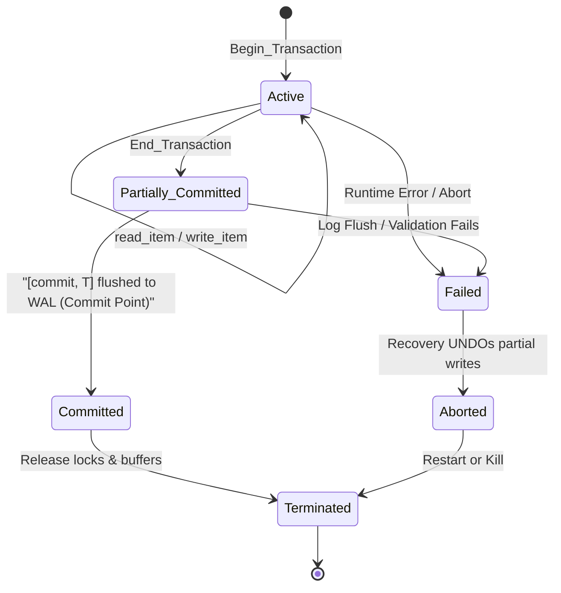
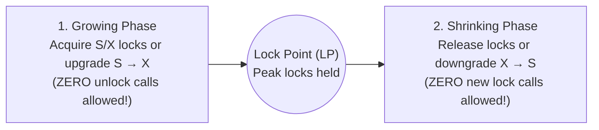
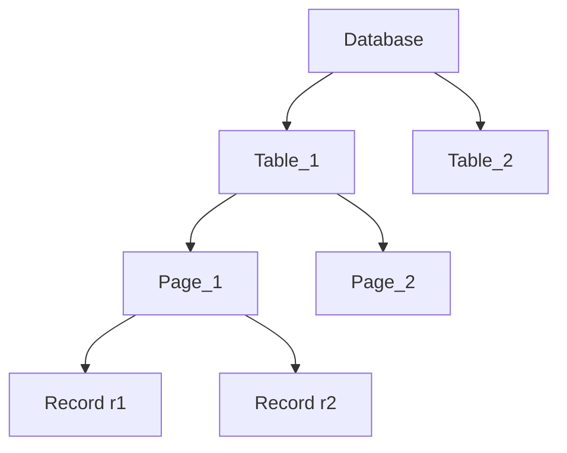

# BACSE202 — Database Systems
## Module 4: Transaction Processing, Concurrency Control and Recovery

> **Course Alignment:** VIT `BACSE202` (Database Systems — Syllabus v1.0) · **Module 4 (10 Lecture Hours · CO3)**  
> **Primary Textbooks:** R. Elmasri & S. B. Navathe (*Fundamentals of Database Systems*, 7th Ed., Ch. 20, 21 & 22); Silberschatz, Korth & Sudarshan (*Database System Concepts*, 7th Ed., Ch. 17, 18 & 19)  
> **Synthesized From:** *Module - 4 Transaction Processing and Recovery.pptx*, *Module - 4 Database Concurrency Control Techniques.pptx*, *Module-4.ppt*, and *Nov 2026 FAT Slot Papers (A1+TA1 & A2+TA2)*

---

## Table of Contents

- [Part I: Transaction Concepts, ACID & Schedule Classification](#part-i-transaction-concepts-acid--schedule-classification)
  - [1. Transactions, Low-Level I/O & System Log Structure](#1-transactions-low-level-io--system-log-structure)
  - [2. ACID Properties & Five-State Transaction Lifecycle](#2-acid-properties--five-state-transaction-lifecycle)
  - [3. The Five Classic Concurrency Anomalies](#3-the-five-classic-concurrency-anomalies)
  - [4. Schedule Classification Based on Recoverability](#4-schedule-classification-based-on-recoverability)
  - [5. Conflict Serializability, Precedence Graphs & View Serializability](#5-conflict-serializability-precedence-graphs--view-serializability)
- [Part II: Concurrency Control Protocols](#part-ii-concurrency-control-protocols)
  - [6. Lock-Based Protocols & The Four Variants of Two-Phase Locking (2PL)](#6-lock-based-protocols--the-four-variants-of-two-phase-locking-2pl)
  - [7. Deadlock Detection (Wait-For Graph), Prevention (`Wait-Die / Wound-Wait`) & Starvation](#7-deadlock-detection-wait-for-graph-prevention-wait-die--wound-wait--starvation)
  - [8. Timestamp Ordering (`BTO`) & Thomas's Write Rule](#8-timestamp-ordering-bto--thomass-write-rule)
  - [9. Multiple Granularity Locking (`IS, IX, SIX`) Hierarchy](#9-multiple-granularity-locking-is-ix-six-hierarchy)
- [Part III: Database Crash Recovery & Buffering](#part-iii-database-crash-recovery--buffering)
  - [10. Buffer Pool Policies (`Steal / Force`), WAL & Checkpointing](#10-buffer-pool-policies-steal--force-wal--checkpointing)
  - [11. Deferred Update, Immediate Update & Shadow Paging](#11-deferred-update-immediate-update--shadow-paging)
- [Part IV: Exam Prep, Worked FAT Solutions & Revision Self-Check](#part-iv-exam-prep-worked-fat-solutions--revision-self-check)
  - [12. Worked FAT Examination Solutions](#12-worked-fat-examination-solutions)
  - [13. Module 4 Revision Self-Check Quiz](#13-module-4-revision-self-check-quiz)
  - [14. Official Fall 2026-27 Model Question Paper Solutions (`Q5`, `Q7`, `Q9`)](#14-official-fall-2026-27-model-question-paper-solutions-q5-q7-q9)

---

# Part I: Transaction Concepts, ACID & Schedule Classification

## 1. Transactions, Low-Level I/O & System Log Structure

A **Transaction ($T$)** is a logical unit of database processing delimited by `Begin_Transaction` and `End_Transaction` (or `Commit` / `Abort`) that accesses and modifies database items atomically.

### 1.1 Low-Level Read/Write Execution Model
Transactions interact with volatile RAM buffers and non-volatile disk blocks using two primitives:
- **`read_item(X)`:** (1) Find the disk block containing `X`; (2) Copy that disk block into a main-memory buffer (if not already cached); (3) Copy item `X` into the transaction's local program variable.
- **`write_item(X)`:** (1) Locate the disk block of `X` and buffer it in RAM; (2) Overwrite `X` in the memory buffer with the new value; (3) Mark the buffer page **dirty** to be flushed back to disk (either immediately or lazily later).

### 1.2 Five Failure Types & Append-Only System Log Records
1. **Computer / System Crash:** Hardware/OS fault wiping volatile RAM buffers while leaving disk intact.
2. **Transaction / System Error:** Runtime fault inside $T$ (integer overflow, divide-by-zero, invalid user input).
3. **Local Exception Detected by $T$:** Application-triggered rollback (e.g., `Insufficient Funds` $\rightarrow$ `Abort`).
4. **Concurrency Control Enforcement:** Deadlock victim rollback or serializability abort.
5. **Disk Failure / Catastrophe:** Physical storage loss (handled via archival full backups + shipped logs).

To recover safely, the **Write-Ahead Log (WAL)** records every step sequentially on stable storage:
`[start_transaction, T]` · `[write_item, T, X, old_value (BFIM), new_value (AFIM)]` · `[read_item, T, X]` · `[commit, T]` · `[abort, T]` · `[checkpoint]`.

---

## 2. ACID Properties & Five-State Transaction Lifecycle

### 2.1 ACID Contract (`Nov 2026 FAT A2+TA2 · Q5(a)`)

| Property | Formal Guarantee | Enforcing Subsystem | Bank Transfer Example (`₹1,000` from `A` to `B`) |
| :--- | :--- | :--- | :--- |
| **Atomicity (A)** | *"All or nothing"* — either every operation completes or all partial effects vanish. | **Transaction / Recovery Manager** (`UNDO` logs) | Power fails right after `A` is debited (`5000→4000`) and before `B` is credited: Recovery **UNDOs `A`** back to `5000`. |
| **Consistency (C)** | Isolated execution preserves every database constraint and business invariant. | **Application Code + DBMS Integrity Constraints** | Total sum $A + B$ remains identical before (`5000+2000=7000`) and after (`4000+3000=7000`), and `CHECK(Balance ≥ 0)` holds. |
| **Isolation (I)** | Effects of an uncommitted transaction stay invisible to concurrent users; outcome equals some serial run. | **Concurrency Control Subsystem** (`Strict 2PL` / `TO`) | A concurrent `SUM(A+B)` audit sees either pre-transfer (`7000`) or post-transfer (`7000`), never `6000` mid-transfer. |
| **Durability (D)** | Once committed, updates survive all subsequent power losses or crashes. | **Recovery Manager** (`WAL` / `REDO` logs on disk) | Server crashes 1 ms after *"Transfer Complete"* while `B=3000` was still in RAM buffer: restart **REDOs `B=3000`** from WAL. |

### 2.2 Five-State Transaction Lifecycle & Commit Point



- **Commit Point:** The exact instant all write logs and `[commit, T]` flush permanently to stable disk storage. Prior to the Commit Point, $T$ can still fail and roll back; once past it, $T$ is irrevocably **Committed**.

---

## 3. The Five Classic Concurrency Anomalies

Interleaving operations across concurrent transactions boosts CPU/disk utilization, yet uncontrolled interleaving causes five anomalies:

| Anomaly | Root Mechanism | Canonical Schedule Trace | Resulting Bug |
| :--- | :--- | :--- | :--- |
| **1. Lost Update (`WW`)** | Two transactions read initial `X`, compute updates locally, and overwrite sequentially. | `T1:R(X=80)` $\to$ `T2:R(X=80)` $\to$ `T1:W(X=75)` $\to$ `T2:W(X=84)` | `T1`'s `-5` deduction vanishes completely (`X=84` instead of `79`). |
| **2. Dirty Read / Temporary Update (`WR`)** | `T2` reads `X` written by uncommitted `T1`, and `T1` later fails and rolls `X` back. | `T1:W(X=75)` $\to$ `T2:R(X=75)` $\to$ `T1:ABORT (X→80)` | `T2` used phantom value `75` that logically never existed! |
| **3. Incorrect Summary (`Inconsistent Analysis`)** | Aggregate `T1` reads `A` *before* transfer `T2` moves funds `A → B` and reads `B` *after* `T2` commits. | `T1:R(A=100)` $\to$ `T2:W(A=80);W(B=70);C2` $\to$ `T1:R(B=70)` | `T1` computes `100 + 70 = 170` (**double-counting** `20` in transit!). |
| **4. Unrepeatable Read (`RW + WR`)** | `T1` reads `X` twice while `T2` updates and commits `X` between reads. | `T1:R(X=50)` $\to$ `T2:W(X=80);C2` $\to$ `T1:R(X=80)` | Two identical `SELECT`s inside one transaction return conflicting values. |
| **5. Phantom Read** | `T1` runs a range query twice while `T2` inserts/deletes new matching tuples and commits. | `T1:WHERE Dept=5 (3 rows)` $\to$ `T2:INSERT Dept=5;C2` $\to$ `T1:re-runs (4 rows)` | New "phantom" row appears unless predicate/range locks protect gaps. |

---

## 4. Schedule Classification Based on Recoverability

Serializability proves correctness when everything commits; **Recoverability** ensures the DB stays safe if a transaction **aborts**!

```
Strict Schedules  ⊂  Cascadeless (ACA) Schedules  ⊂  Recoverable Schedules  ⊂  All Concurrent Schedules
```

| Schedule Class | Formal Condition on $T_i \to T_j$ | Minimal Test Pattern | Crash / Rollback Behavior |
| :--- | :--- | :--- | :--- |
| **Irrecoverable** | $T_j$ reads `X` written by $T_i$, and **`Commit(T_j)` happens BEFORE `Commit(T_i)`**. | `W1(X); R2(X); C2; C1` | **ILLEGAL!** If `T1` aborts after `C2`, `T2` already committed with dirty data! |
| **Recoverable (Cascading)** | $T_j$ reads uncommitted `X` from $T_i$, yet **`Commit(T_i) < Commit(T_j)`**. | `W1(X); R2(X); C1; C2` | Safe against durability breakage, **but** aborting `T1` forces `T2` (and `T3`...) to cascade-abort. |
| **Cascadeless (ACA)** | Every transaction reads **ONLY committed** data (zero Dirty Reads / `WR` before commit). | `W1(X); C1; R2(X); C2` | Zero cascading rollbacks! *(Note: `W1(X); W2(X); C1; C2` is ACA, yet NOT Strict!)* |
| **Strict** | $T_j$ neither **reads NOR overwrites** `X` written by $T_i$ until $T_i$ commits or aborts. | `W1(X); C1; W2(X); R2(X); C2` | **Gold Standard** (enforced by Strict 2PL). Rollback simply restores `BFIM`! |

> **Exam Decision Checklist for 3M Questions:**  
> 1. Does any $T_j$ read or overwrite an uncommitted write? Yes $\implies$ **Not Strict**.  
> 2. Does any $T_j$ read an uncommitted write (`WR` before writer commits)? Yes $\implies$ **Not Cascadeless**.  
> 3. Whenever $T_j$ reads from $T_i$, does `Commit(T_i)` precede `Commit(T_j)`? Yes $\implies$ **Recoverable**; No $\implies$ **Irrecoverable**!

---

## 5. Conflict Serializability, Precedence Graphs & View Serializability

### 5.1 Conflicting Operations (`RW`, `WR`, `WW`)
Two operations $O_i$ (of $T_i$) and $O_j$ (of $T_j$) **conflict** if and only if:
1. $T_i \neq T_j$ (different transactions),
2. Both access the **same data item $Q$**, AND
3. **At least one is a Write (`W`)** — i.e., `(Ri, Wj)`, `(Wi, Rj)`, or `(Wi, Wj)`. Two Reads `(Ri, Rj)` NEVER conflict!

### 5.2 Conflict Equivalence & Precedence Graph Theorem
- Schedules $S$ and $S'$ are **conflict equivalent** if $S$ converts into $S'$ by swapping adjacent non-conflicting instructions.
- **Precedence (Serialization) Graph $G = (V, E)$:**
  1. Nodes $V$ = all transactions $\{T_1, T_2, \dots, T_n\}$.
  2. Group operations by variable (`X`, `Y`, `Z`...); draw directed edge **$T_i \rightarrow T_j$** whenever an operation of $T_i$ precedes and conflicts with an operation of $T_j$ on that variable.
  3. **Theorem:** **$S$ is Conflict Serializable $\iff G$ is Acyclic (no cycles!)**. Every **Topological Sort** (repeatedly picking a node with in-degree `0`) gives a valid equivalent serial order!

### 5.3 View Serializability & Blind Writes
Every conflict-serializable schedule is **View Serializable**. When a Precedence Graph has a cycle, check whether any **Blind Write** (`W(Q)` inside a transaction that never read `Q` earlier) exists:
- **No blind writes exist** (e.g., both A1 Q7 and A2 Q5b $S_2$) $\implies$ **Definitely NOT View Serializable**.
- **Blind writes exist** (e.g., `S = R1(Q); W2(Q); W1(Q); W3(Q)`) $\implies$ test against each serial order using the **3 View Equivalence Rules** for every item $Q$:
  1. **Initial Read:** Same transaction reads initial DB value of $Q$.
  2. **Read-From (`Wj -> Ri`):** Every `read(Q)` reads the value produced by the exact same `write(Q)`.
  3. **Final Write:** Same transaction executes the last `write(Q)` on $Q$.

---

# Part II: Concurrency Control Protocols

## 6. Lock-Based Protocols & The Four Variants of Two-Phase Locking (2PL)

### 6.1 Shared (`S`) and Exclusive (`X`) Locks

| Requested \ Held | `S` (Shared — Read) | `X` (Exclusive — Read/Write) |
| :--- | :--- | :--- |
| **`S` (Shared)** | **Yes (Compatible)** | **No (Blocked)** |
| **`X` (Exclusive)** | **No (Blocked)** | **No (Blocked)** |

Naive locking (unlocking item `A` immediately after reading it before acquiring `B`) still allows serialization cycles and anomalies. **Two-Phase Locking (2PL)** restricts lock timing cleanly:



- **Lock Point Theorem:** Any schedule obeying 2PL is guaranteed **Conflict Serializable** in the chronological order of each transaction's **Lock Point**!

### 6.2 Comparing All Four Variants of 2PL

| 2PL Variant | Locking Rule | Conflict Serializable? | Cascadeless / Strict? | Deadlock-Free? | Trade-Off |
| :--- | :--- | :--- | :--- | :--- | :--- |
| **1. Basic 2PL** | Acquire all locks before first unlock. | **Yes** (LP order) | **No** (early `unlock-X` allows Dirty Reads!) | **No** | Highest concurrency; vulnerable to cascading aborts & deadlock. |
| **2. Conservative (Static) 2PL** | Acquire **ALL** read/write set locks before starting execution (if any unavailable, wait holding nothing). | **Yes** | **No** (if X unlocked early) | **YES!** *(never holds locks while waiting)* | Low concurrency; requires predeclaring full read/write sets upfront. |
| **3. Strict 2PL** | Hold **ALL Exclusive (`X`) locks** until Commit/Abort (`S`-locks may release after LP). | **Yes** (Commit order) | **YES (Strict!)** | **No** | **Industry RDBMS Standard** — high read sharing + trivial recovery. |
| **4. Rigorous 2PL** | Hold **ALL `S` and `X` locks** until Commit/Abort. | **Yes** (Commit order) | **YES (Strict!)** | **No** | Simplest to implement (no shrinking logic before commit). |

---

## 7. Deadlock Detection (Wait-For Graph), Prevention (`Wait-Die / Wound-Wait`) & Starvation

### 7.1 Deadlock Detection & Recovery (Wait-For Graph)
- **Wait-For Graph (WFG):** Vertices = transactions; add directed edge **$T_i \rightarrow T_j$** whenever $T_i$ is blocked waiting for $T_j$ to release a conflicting lock. **Deadlock exists $\iff$ WFG contains a cycle!**
- **Victim Selection Criteria:** Abort the transaction with (1) *Least work/writes done* (minimum rollback cost), (2) *Fewest locks held* (or fewest dependents), and (3) *Fewest restarts so far* (prevent cyclic starvation).

### 7.2 Deadlock Prevention: `Wait-Die` vs. `Wound-Wait`
Assign each transaction a unique starting timestamp `TS(T)` (`TS(T_old) < TS(T_young)`). Suppose requester **$T_i$** waits for lock held by **$T_j$**:

| Contention Case | `Wait-Die` (Non-Preemptive) | `Wound-Wait` (Preemptive) |
| :--- | :--- | :--- |
| **$T_i$ is OLDER than $T_j$** (`TS(T_i) < TS(T_j)`) | Older **$T_i$ WAITS** for $T_j$ | Older **$T_i$ WOUNDS (aborts)** younger $T_j$ and grabs lock! |
| **$T_i$ is YOUNGER than $T_j$** (`TS(T_i) > TS(T_j)`) | Younger **$T_i$ DIES (self-aborts)** | Younger **$T_i$ WAITS** for older $T_j$ |
| **Why Acyclic / Deadlock-Free?** | Edges only point Older $\to$ Younger | Edges only point Younger $\to$ Older |
| **Mnemonic** | **"Old Waits, Young Dies"** *(more rollbacks)* | **"Old Wounds, Young Waits"** *(fewer rollbacks)* |

- **Preventing Starvation:** Grant locks in **FIFO request queue order** AND **preserve original `TS(T)`** across restarts so an aborted transaction eventually becomes oldest and finishes safely!

---

## 8. Timestamp Ordering (`BTO`) & Thomas's Write Rule

Instead of locks, **Timestamp Ordering** forces all conflicting operations to execute in ascending transaction start timestamp `TS(T)`—meaning **deadlocks are impossible!** Each item $Q$ tracks:
- `RTS(Q)`: largest timestamp of any transaction that successfully executed `read(Q)`.
- `WTS(Q)`: largest timestamp of any transaction that successfully executed `write(Q)`.

### 8.1 Exact Check Rules (`Basic TO` vs. `Thomas's Write Rule`)

| Operation by $T_i$ | Comparison Test | Basic TO Action | Thomas's Write Rule Modification |
| :--- | :--- | :--- | :--- |
| **`read(Q)`** | If `WTS(Q) > TS(T_i)` | **Abort & restart $T_i$** (younger writer already updated `Q`!) | *(Unchanged)* |
| **`read(Q)`** | Else (`WTS(Q) <= TS(T_i)`) | Execute read; **`RTS(Q) = max(RTS(Q), TS(T_i))`** | *(Unchanged)* |
| **`write(Q)`** | If **`RTS(Q) > TS(T_i)`** | **Abort & restart $T_i$** (younger reader saw old `Q`!) | **STILL Aborts $T_i$!** *(Cannot ignore!)* |
| **`write(Q)`** | Else if **`WTS(Q) > TS(T_i)`** | **Abort & restart $T_i$** | **IGNORE obsolete `write(Q)`** and let $T_i$ continue! *(Enables View-Serializable schedules!)* |
| **`write(Q)`** | Else (`RTS <= TS` and `WTS <= TS`) | Execute write; **`WTS(Q) = TS(T_i)`** | Execute write; **`WTS(Q) = TS(T_i)`** |

- **Drawbacks of Basic TO:** Susceptible to *starvation* (restarted transactions can loop if conflicting younger ones bump `RTS`/`WTS`) and schedules are **NOT automatically Cascadeless/Strict** unless **Strict TO** buffers writes until older writers commit.

---

## 9. Multiple Granularity Locking (`IS, IX, SIX`) Hierarchy

Coarse table locks block concurrent writers on disjoint rows, while row locks force millions of lock acquisitions during full-table scans. **Multiple Granularity Locking (MGL)** organizes items in a tree (`Database → Area/File → Table → Page → Record`) using **Intention Locks**:



- **Protocol Direction:** Lock **Strictly Top-Down** (`Database -> Table -> Page -> Record`) and Unlock **Strictly Bottom-Up** (`Record -> Page -> Table -> Database`).
- **Modes:** **`IS`** (will place `S` on descendants), **`IX`** (will place `X`/`S` on descendants), **`SIX`** (`S` on whole subtree + `IX` to `X`-lock select rows).

### 5 × 5 MGL Compatibility Matrix

| Requested \ Held | `IS` | `IX` | `S` | `SIX` | `X` |
| :--- | :---: | :---: | :---: | :---: | :---: |
| **`IS`** | **Yes** | **Yes** | **Yes** | **Yes** | No |
| **`IX`** | **Yes** | **Yes** | No | No | No |
| **`S`** | **Yes** | No | **Yes** | No | No |
| **`SIX`** | **Yes** | No | No | No | No |
| **`X`** | No | No | No | No | No |

*(Example: `T1` updating `r1` acquires `IX(DB) -> IX(Table_1) -> IX(Page_1) -> X(r1)`, while `T2` reading `r2` acquires `IS(DB) -> IS(Table_1) -> IS(Page_1) -> S(r2)`. Since `(IS, IX) = Yes`, both execute concurrently; a full-table scan `S(Table_1)` sees `(S, IX) = No` at the table root in $O(1)$ without inspecting 100,000 child rows!)*

---

# Part III: Database Crash Recovery & Buffering

## 10. Buffer Pool Policies (`Steal / Force`), WAL & Checkpointing

### 10.1 Four Buffer Management Combinations
- **No-Steal vs. Steal:** *No-Steal* forbids flushing dirty uncommitted pages to disk (eliminates `UNDO`). *Steal* allows evicting dirty uncommitted pages early for RAM flexibility (requires **`UNDO` via `BFIM`**).
- **Force vs. No-Force:** *Force* flushes all modified pages to disk at commit (eliminates `REDO`, slows commits). *No-Force* keeps committed pages cached in RAM buffer (boosts throughput, requires **`REDO` via `AFIM`**).

### 10.2 Write-Ahead Logging (WAL) Rules
1. Never flush a modified dirty buffer page `X` to disk until its `[write_item, T, X, BFIM, AFIM]` log record has been forced to stable log storage (**enables `UNDO`**).
2. Never signal `COMMIT` success until all log records of $T$ including `[commit, T]` are forced to stable storage (**enables `REDO`**).

### 10.3 Checkpointing Timeline
Scanning logs all the way from database birth on recovery is infeasible. Periodically the DBMS executes a **`[CHECKPOINT]`**: pauses new starts briefly, flushes all dirty buffers + active logs to disk, and records `[checkpoint, Active_Txn_List]`:
- **Flushed committed before Checkpoint (`T1`):** Safely ignored during crash recovery!
- **Committed after Checkpoint (`T2`, `T4`):** **REDO** forward using `AFIM`.
- **Uncommitted at Crash (`T3`, even if started before checkpoint):** **UNDO** backward using `BFIM` (under Immediate Update).

---

## 11. Deferred Update, Immediate Update & Shadow Paging

| Feature | Deferred Update (`NO-UNDO / REDO`) | Immediate Update (`UNDO / REDO`) | Shadow Paging (`NO-UNDO / NO-REDO`) |
| :--- | :--- | :--- | :--- |
| **Buffer Policy** | **No-Steal + No-Force** | **Steal + No-Force** *(Standard RDBMS / ARIES)* | Copy-on-Write Page Directory (`Shadow` vs `Current`) |
| **When Does Disk Change?** | Strictly **AFTER Commit** only | **BEFORE Commit** allowed (with WAL) | Writes go to newly allocated blocks; directory pointer swaps atomically at commit |
| **Crash Recovery Action** | Ignore uncommitted txns (**NO-UNDO**); **REDO** committed forward (`AFIM`). | **UNDO** uncommitted **backward** (`BFIM`), then **REDO** committed **forward** (`AFIM`). | Simply discard `Current Page Table` and revert to immutable `Shadow Page Table`! |
| **System Log Needed?** | Yes (`AFIM` + `commit`) | Yes (`BFIM` + `AFIM` + `commit`) | No (for single-user) |
| **Trade-Offs** | Simple recovery, risks RAM exhaustion on huge txns | Best runtime throughput & buffer efficiency | Instant recovery, yet breaks physical block clustering & complicates concurrency |

> **Why UNDO MUST Run Backward Before REDO Forward:** Suppose uncommitted `T1` changed `X: 10->20` and later uncommitted `T2` changed `X: 20->30` before crashing. **Backward UNDO** restores `T2` (`X=20`) then `T1` (`X=10`)—recovering true `X=10`. Forward UNDO would leave corrupted `X=20`!

---

# Part IV: Exam Prep, Worked FAT Solutions & Revision Self-Check

## 12. Worked FAT Examination Solutions

### Worked Question 1 — `Nov 2026 FAT · Slot A1+TA1 · Q7` [10M, CO3, BL3]
> **Schedule:** `1:R1(X); 2:W1(X); 3:R2(X); 4:W2(X); 5:R1(Y); 6:R2(Y); 7:W1(Y); 8:C1; 9:C2`

- **Part A — List All Conflicting Operation Pairs [3M]:**
  - On `X`: `(Op1 R1(X), Op4 W2(X))` [`RW`, `T1->T2`], `(Op2 W1(X), Op3 R2(X))` [`WR`, `T1->T2`], `(Op2 W1(X), Op4 W2(X))` [`WW`, `T1->T2`].
  - On `Y`: `(Op6 R2(Y), Op7 W1(Y))` [`RW`, `T2->T1`]. *(Note: `Op5 R1(Y)` vs `Op6 R2(Y)` is `RR` — NO conflict!)*
- **Part B — Precedence Graph & Serializability [4M]:** Edges **`T1 -> T2`** (on `X`) and **`T2 -> T1`** (on `Y`) create a **2-cycle `T1 -> T2 -> T1`** $\implies$ **NOT Conflict Serializable** (and no blind writes exist, so not View Serializable either).
- **Part C — Recoverability Classification [3M]:** `Op2 W1(X) -> Op3 R2(X)` before `Op8 C1` is a **Dirty Read**, so `S` is **NOT Cascadeless** and **NOT Strict**. Because `C1` precedes `C2`, `S` IS **Recoverable (with Cascading Rollback)**.

---

### Worked Question 2 — `Nov 2026 FAT · Slot A2+TA2 · Q5(b)` [5M of 10M, CO3, BL4]
- **`S1: r1(X); r2(Z); r1(Z); r3(X); r3(Y); w1(X); c1; w3(Y); c3; r2(Y); w2(Z); w2(Y); c2`:**
  - `X`: `r3(X)->w1(X)` $\implies T_3 \to T_1$
  - `Y`: `r3(Y)->w2(Y)`, `w3(Y)->r2(Y)`, `w3(Y)->w2(Y)` $\implies T_3 \to T_2$
  - `Z`: `r1(Z)->w2(Z)` $\implies T_1 \to T_2$ *(note: `r2(Z)` vs `r1(Z)` is RR — no edge!)*
  - **Acyclic Graph** ($T_3 \to T_1 \to T_2$, $T_3 \to T_2$) $\implies$ **Conflict Serializable!** Unique serial order: **`T3 -> T1 -> T2`**.
- **`S2: r1(X); w1(X); r2(X); w2(X); r2(Y); w2(Y); r3(Y); w3(Y); r3(Z); w3(Z); r1(Z); w1(Z)`:**
  - `X` adds **`T1 -> T2`**; `Y` adds **`T2 -> T3`**; `Z` adds **`T3 -> T1`**.
  - **3-Node Cycle (`T1 -> T2 -> T3 -> T1`)** $\implies$ **NOT Conflict Serializable!**

---

### Worked Question 3 — `Nov 2026 FAT · Slot A1+TA1 · Q8(a)` [10M, CO3, BL3]
> **Inventory Audit vs. Stock Transfer (`A=100, B=50`, Total = `150`):**
1. **Part A — Concurrency Problem [3M]:** **Incorrect Summary Problem**. `T1` reads pre-transfer `A=100` (`t2–t3`), `T2` updates `A=80, B=70` and commits (`t4–t10`), and `T1` reads post-transfer `B=70` (`t11`), double-counting 20 units (`Sum = 170`).
2. **Part B — 2PL Resolution Trace [5M]:**
   - `t1`: `T1: lock-S(A)` [Granted]; `t2–t3`: `T1: Read(A)=100; Sum=100`.
   - `t4`: `T2: lock-X(A)` $\rightarrow$ **WAIT!** *(2PL forbids `T1` from unlocking `A` before acquiring `lock-S(B)`!)*
   - `t5–t8`: `T1: lock-S(B)` [Lock Point], `Read(B)=50`, `Sum=150; Output(150); Commit; unlock(A); unlock(B)`.
   - `t9–t13`: `T2` unblocks, acquires `lock-X(A)`, writes `A=80`, acquires `lock-X(B)`, writes `B=70`, commits & unlocks.
3. **Part C — Final Sum & Consistency [2M]:** `T1` outputs **`Sum = 150`**, matching serial order `T1 -> T2`, and final DB inventory `80 + 70 = 150` holds invariant.

---

### Worked Question 4 — `Nov 2026 FAT · Slot A2+TA2 · Q6` [10M, CO3, BL4]
> **Strict 2PL Trace (`T1, T2, T3`):** `1: T1 S(A), 2: T1 R(A), 3: T2 X(B), 4: T2 W(B), 5: T3 S(C), 6: T3 R(C), 7: T1 X(C), 8: T2 X(A), 9: T3 X(B)`.
- Steps `1–6` succeed (`T1` holds `S(A)`, `T2` holds `X(B)`, `T3` holds `S(C)`).
- Step `7`: `T1: X(C)` **BLOCKS** on `T3` $\implies$ WFG edge **`T1 -> T3`**.
- Step `8`: `T2: X(A)` **BLOCKS** on `T1` $\implies$ WFG edge **`T2 -> T1`**.
- Step `9`: `T3: X(B)` **BLOCKS** on `T2` $\implies$ WFG edge **`T3 -> T2`**.
- **Cycle `T1 -> T3 -> T2 -> T1` proves Deadlock EXISTS!**
- **Resolution:** Select **Victim = `T3`** (`0` writes, minimum rollback cost; note `T2` wrote `B`), abort `T3` releasing `S(C)`. Now `T1` gets `X(C)` & commits $\rightarrow$ `T2` gets `X(A)` & commits $\rightarrow$ `T3` restarts cleanly.

---

### Worked Question 5 — `Nov 2026 FAT · Slot A1+TA1 · Q8(b)` [10M, CO3, BL3]
> **Crash Log (`Initial A=500, B=1000`):** `[Start T1]; [W, T1, A, 500, 400]; [Start T2]; [W, T2, B, 1000, 1200]; [Commit T1]; [Start T3]; [W, T3, A, 400, 450]; <CRASH>`

- **Part A [2M]:** Deferred Update (`No-Steal / No-Force`) buffers writes and updates disk **only after commit** (`NO-UNDO / REDO`); Immediate Update (`Steal / No-Force`) may write dirty buffers **before commit** with WAL (`UNDO / REDO`).
- **Part B [4M]:**
  - **Deferred Update:** `UNDO = {}` (ignore `T2, T3`), `REDO = {T1}` $\rightarrow$ Redo `T1` sets `A = 400` (`B` stays `1000`).
  - **Immediate Update:** **Backward `UNDO = {T3, T2}`** (1st Undo `T3`: `A := BFIM = 400`; 2nd Undo `T2`: `B := BFIM = 1000`) $\rightarrow$ **Forward `REDO = {T1}`** (Redo `T1`: `A := AFIM = 400`).
- **Part C [4M]:** Final disk balances in **both** cases: **`A = 400`, `B = 1,000`**.

---

## 13. Module 4 Revision Self-Check Quiz

1. **Q:** *Classify `S = W1(X); W2(X); C1; C2` on Strictness, Cascadelessness, and Recoverability.*  
   **A:** **Cascadeless (ACA) and Recoverable, yet NOT Strict!** No transaction read an uncommitted write (`WR` absent), so it is ACA, yet `T2` blindly overwrote `X` before `T1` committed, breaking Strictness.

2. **Q:** *With `TS(T1) = 10` and `TS(T2) = 20`, trace what happens when `T1` requests a lock held by `T2` under (a) Wait-Die and (b) Wound-Wait.*  
   **A:** (a) Wait-Die: Older `T1` **WAITS**. (b) Wound-Wait: Older `T1` **WOUNDS (aborts)** younger `T2` and takes the lock immediately.

3. **Q:** *Given `RTS(Q) = 40, WTS(Q) = 60` and `T1(TS = 50)` executes `write(Q)`, compare Basic TO vs. Thomas's Write Rule.*  
   **A:** `RTS <= TS(T1)` holds (`40 <= 50`), while `WTS > TS(T1)` (`60 > 50`). **Basic TO rolls back `T1`**; **Thomas's Write Rule ignores the obsolete write** and lets `T1` proceed.

4. **Q:** *What lock must `T` acquire on `Database` and `Table` before placing an `X` lock on a single tuple in Multiple Granularity Locking?*  
   **A:** **`IX` (Intent Exclusive)** on every ancestor (`Database`, `Table`, `Page`) from root down to the record.


---

## 14. Official Fall 2026-27 Model Question Paper Solutions (`Q5`, `Q7`, `Q9`)

### 14.1 Official Fall 2026-27 Model Question Paper — Q5(a) & Q5(b) [5M + 5M = 10 Marks]

> **Prompt Q5(a) [5M]:** *Consider the following schedule `S` involving four transactions `T1, T2, T3, and T4`:*
> `R1(A), R2(B), W1(B), R3(A), W2(A), R4(B), W3(C), W4(B), R2(C), C1, C2, C3, C4`
> *Construct the precedence (serialization) graph for the schedule `S` and determine whether the schedule is conflict serializable.*

1. **Conflicting Operations & Precedence Graph Edges:**
   - **Data Item `A` (`R1(A), R3(A), W2(A)`):** `R1(A)` before `W2(A)` (`RW`) -> **`T1 → T2`**; `R3(A)` before `W2(A)` (`RW`) -> **`T3 → T2`**.
   - **Data Item `B` (`R2(B), W1(B), R4(B), W4(B)`):** `R2(B)` before `W1(B)` (`RW`) -> **`T2 → T1`**; `R2(B)` before `W4(B)` (`RW`) -> **`T2 → T4`**; `W1(B)` before `R4(B)` & `W4(B)` (`WR/WW`) -> **`T1 → T4`**.
   - **Data Item `C` (`W3(C), R2(C)`):** `W3(C)` before `R2(C)` (`WR`) -> **`T3 → T2`**.
2. **Cycle Detection & Conclusion:**
   - Directed Edge Set: **`E = { T1 → T2, T2 → T1, T1 → T4, T2 → T4, T3 → T2 }`**.
   - Because the precedence graph contains the cycle **`T1 → T2 → T1`**, Schedule `S` is **NOT conflict serializable**.

> **Prompt Q5(b) [5M]:** *A bank allows customers to perform online transactions such as balance inquiries, fund transfers, and bill payments simultaneously. Explain the concepts of transactions, ACID properties, and concurrency anomalies if multiple transactions access the same account simultaneously.*

- **Transaction:** A logical unit of database processing (`BEGIN_TRANSACTION ... COMMIT/ROLLBACK`) that transforms the database from one consistent state to another.
- **ACID Properties:** **Atomicity** (debit + credit both succeed or both roll back via Undo logs), **Consistency** (total money `A + B` invariant preserved), **Isolation** (2PL/MVCC prevents concurrent interference), **Durability** (committed transfers survive power loss via WAL Redo logs).
- **Three Concurrency Anomalies:** (1) **Lost Update (`WW` overwrite):** Two simultaneous transfers read balance `₹10,000` and overwrite each other’s deduction; (2) **Dirty Read / Uncommitted Dependency (`WR` on aborted tx):** Inquiry reads an uncommitted transfer that later rolls back; (3) **Inconsistent Summary / Unrepeatable Read (`RW`):** Branch audit sums accounts mid-transfer after `A` is debited but before `B` is credited.

---

### 14.2 Official Fall 2026-27 Model Question Paper — Q7 [10 Marks] (Two-Phase Locking Instrumentation on `T1, T2`)

> **Prompt Q7 [10M]:** *Given two concurrent transactions `T1` (`read_item(X); read_item(Y); X := X + Y; write_item(X)`) and `T2` (`read_item(X); read_item(Y); Y := X + Y; write_item(Y)`), apply the Two-Phase Locking (2PL) protocol by inserting appropriate lock and unlock operations. Analyze and justify whether the resulting execution eliminates Lost Update, Uncommitted Update, and Inconsistent Summary problems.*

| **`T1` with Strict / Basic 2PL (Canonical Order `X` then `Y`)** | **`T2` with Strict / Basic 2PL (Canonical Order `X` then `Y`)** |
| :--- | :--- |
| `1. write_lock(X);` *(Growing Phase)* | `1. read_lock(X);` *(Growing Phase)* |
| `2. read_item(X);` | `2. read_item(X);` |
| `3. read_lock(Y);` *(All locks acquired before any unlock!)* | `3. write_lock(Y);` *(All locks acquired before any unlock!)* |
| `4. read_item(Y);` | `4. read_item(Y);` |
| `5. X := X + Y;` | `5. Y := X + Y;` |
| `6. write_item(X);` | `6. write_item(Y);` |
| `7. COMMIT;` | `7. COMMIT;` |
| `8. unlock(X); unlock(Y);` *(Shrinking Phase)* | `8. unlock(X); unlock(Y);` *(Shrinking Phase)* |

- **Why All Three Anomalies Are Eliminated:**
  1. **No Lost Update:** `write_lock(X)` and `write_lock(Y)` are mutually exclusive with all other locks on the same item.
  2. **No Uncommitted Update (Dirty Read):** Under **Strict 2PL**, exclusive locks are held until after `COMMIT/ABORT`, so no transaction can read uncommitted writes.
  3. **No Inconsistent Summary:** `T1` holds locks on both `X` and `Y` at its Lock Point before `T2` can modify `Y` (and vice versa), guaranteeing conflict serializability (`T1 → T2` or `T2 → T1`), while locking in alphabetical order `(X, Y)` prevents deadlock.

---

### 14.3 Official Fall 2026-27 Model Question Paper — Q9(a) & Q9(b) [6M + 4M = 10 Marks] (Timestamp Ordering Trace & Deferred vs. Immediate Update)

> **Prompt Q9(a) [6M]:** *Trace Basic Timestamp Ordering for `TS(T1)=10, TS(T2)=20, TS(T3)=30` on `X=100, Y=200, Z=300` (initial `RTS=WTS=0`) across the 9 operations:*

| Step | Operation | Timestamp Check (`TS(Ti)` vs `RTS/WTS`) | Decision & Updated `[RTS, WTS]` |
| :---: | :--- | :--- | :--- |
| **1** | `T1: Read(X)` | `TS(T1)=10 ≥ WTS(X)=0` | **ALLOWED** -> `X:[RTS=10, WTS=0]` |
| **2** | `T2: Write(X)` | `TS(T2)=20 ≥ RTS(X)=10` and `20 ≥ WTS(X)=0` | **ALLOWED** -> `X:[RTS=10, WTS=20]` |
| **3** | `T1: Write(X)` | `TS(T1)=10 < WTS(X)=20` (fails `WTS` check) | **REJECTED -> ABORT & ROLLBACK `T1`!** |
| **4** | `T3: Read(Y)` | `TS(T3)=30 ≥ WTS(Y)=0` | **ALLOWED** -> `Y:[RTS=30, WTS=0]` |
| **5** | `T2: Write(Y)` | `TS(T2)=20 < RTS(Y)=30` (younger `T3` already read `Y`!) | **REJECTED -> ABORT & ROLLBACK `T2`!** (Undoes `T2:Write(X)` -> `WTS(X)=0`) |
| **6** | `T3: Write(Z)` | `TS(T3)=30 ≥ RTS(Z)=0, WTS(Z)=0` | **ALLOWED** -> `Z:[RTS=0, WTS=30]` |
| **7** | `T1: Read(Z)` | `T1` already aborted at Step 3 (or if checked, `10 < WTS(Z)=30`) | **SKIPPED / REJECTED** (`T1` already rolled back) |
| **8** | `T2: Read(Z)` | `T2` already aborted at Step 5 (or if checked, `20 < WTS(Z)=30`) | **SKIPPED / REJECTED** (`T2` already rolled back) |
| **9** | `T3: Write(X)` | `TS(T3)=30 ≥ RTS(X)=10, WTS(X)=0` | **ALLOWED -> `T3` COMMITS** (`X:[RTS=10, WTS=30]`) |

> **Prompt Q9(b) [4M]:** *Differentiate between Deferred Update and Immediate Update recovery techniques in database systems.*

| Dimension | Deferred Update (`NO-UNDO / REDO`) | Immediate Update (`UNDO / REDO`) |
| :--- | :--- | :--- |
| **Disk Flush Timing** | Buffers all writes (`No-Steal`) and modifies physical disk **only after `COMMIT`**. | May flush dirty buffers to physical disk **before `COMMIT`** (`Steal`), after WAL flush. |
| **Log Images Stored** | Only After-Image (`AFIM` — new value) + `COMMIT`. | Both Before-Image (`BFIM` — old value) and After-Image (`AFIM`). |
| **Uncommitted Txns on Crash** | **NO UNDO** needed (uncommitted changes never reached disk). | **Backward UNDO** in reverse chronological order using `BFIM`. |
| **Committed Txns on Crash** | **Forward REDO** using `AFIM`. | **Forward REDO** using `AFIM` (after UNDO completes). |
