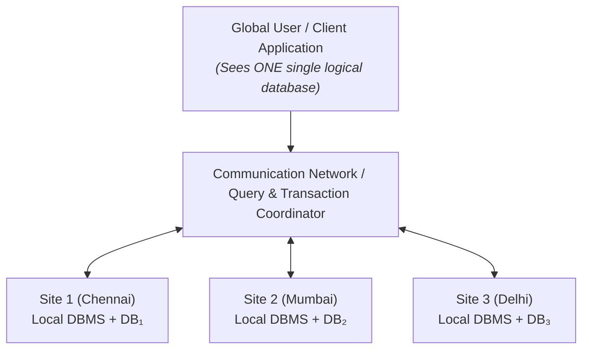
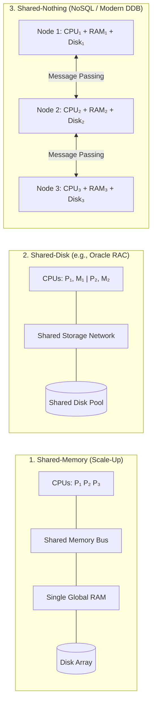
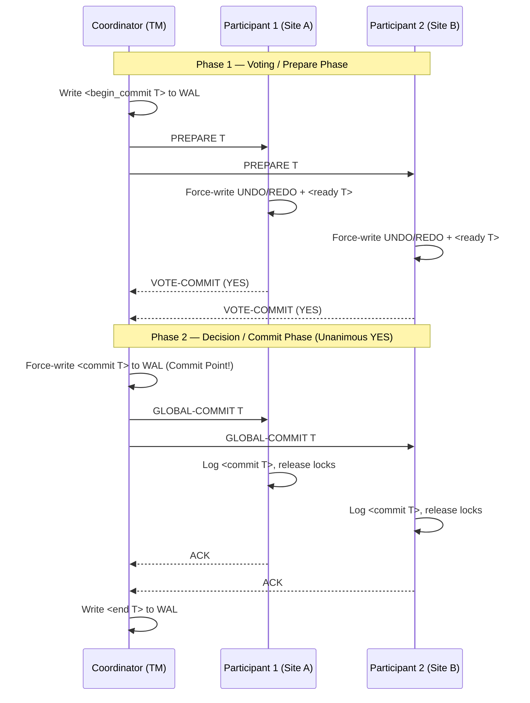
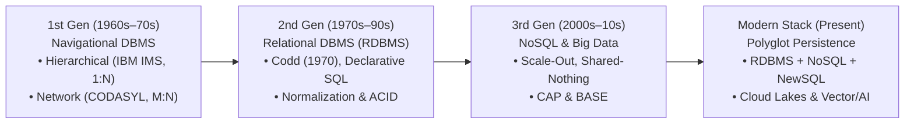
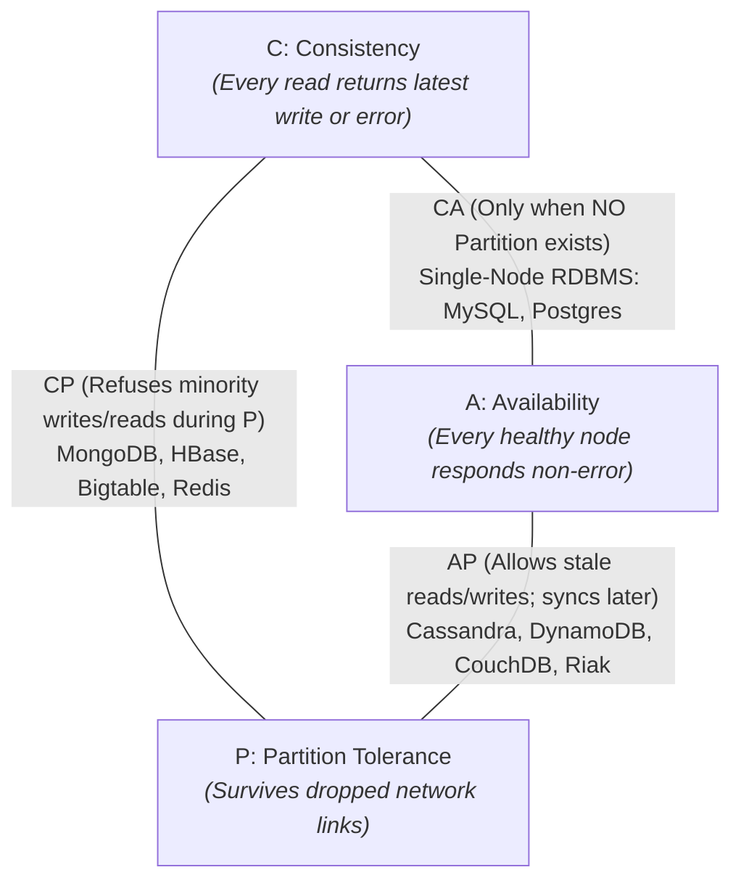
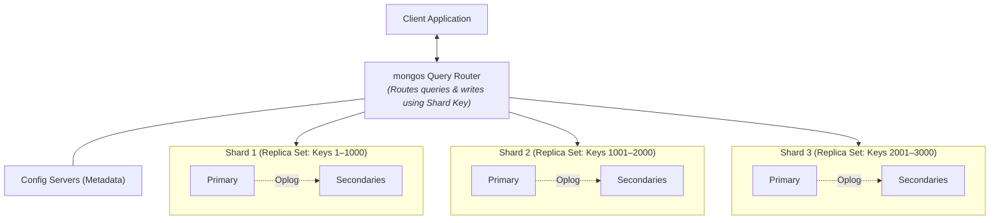
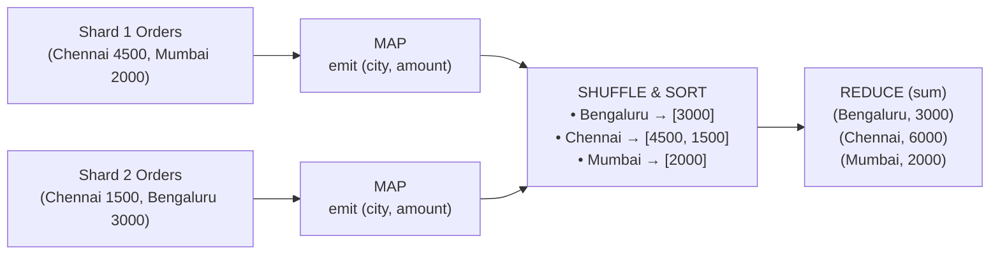
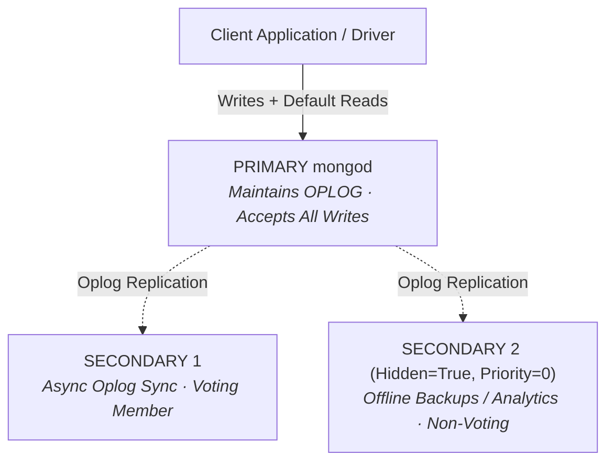

# BACSE202 — Database Systems
## Module 5: Distributed and NoSQL Databases

> **Course Alignment:** VIT `BACSE202` (Database Systems — Syllabus v1.0, Academic Council 78) · **Module 5 (7 Lecture Hours · CO4)** + Indicative Lab Experiments 10 & 11  
> **Primary Textbooks:** R. Elmasri & S. B. Navathe (*Fundamentals of Database Systems*, 7th Ed., Ch. 23 & Ch. 24); M. T. Özsu & P. Valduriez (*Principles of Distributed Database Systems*, 4th Ed.)  
> **Synthesized From:** *BACSE202-DBS-Module-5.ppt*, *Module 5. No-SQL database management.pptx*, *DDBMS Allocation Techniques*, *MongoDB Deep-Dive Notes*, and *Nov 2026 FAT Slot Papers (A1+TA1 & A2+TA2)*

---

## Table of Contents

- [Part I: Distributed Databases (DDBMS)](#part-i-distributed-databases-ddbms)
  - [1. Introduction, Goals & Distribution Transparencies](#1-introduction-goals--distribution-transparencies)
  - [2. Distributed Database Architectures (Software & Hardware)](#2-distributed-database-architectures-software--hardware)
  - [3. Data Fragmentation, Replication & Allocation Techniques](#3-data-fragmentation-replication--allocation-techniques)
  - [4. Distributed Concurrency Control, Deadlocks & Atomic Commit (2PC / 3PC)](#4-distributed-concurrency-control-deadlocks--atomic-commit-2pc--3pc)
  - [5. Distributed Query Processing & Semijoin Optimization](#5-distributed-query-processing--semijoin-optimization)
- [Part II: NoSQL Databases & Consistency Models](#part-ii-nosql-databases--consistency-models)
  - [6. Evolution of NoSQL & Comparison with Relational DBMS](#6-evolution-of-nosql--comparison-with-relational-dbms)
  - [7. Core Characteristics of NoSQL Systems](#7-core-characteristics-of-nosql-systems)
  - [8. The CAP Theorem & Distributed Consistency Models](#8-the-cap-theorem--distributed-consistency-models)
  - [9. ACID ("The Perfectionist") vs. BASE ("The Realist")](#9-acid-the-perfectionist-vs-base-the-realist)
  - [10. NoSQL Modeling, Sharding, Consistent Hashing & MapReduce](#10-nosql-modeling-sharding-consistent-hashing--mapreduce)
  - [11. The Four Families of NoSQL Databases](#11-the-four-families-of-nosql-databases)
  - [12. Deep-Dive Case Study: MongoDB & Practical Lab Mapping](#12-deep-dive-case-study-mongodb--practical-lab-mapping)
- [Part III: Exam Prep, Worked FAT Solutions & Revision Self-Check](#part-iii-exam-prep-worked-fat-solutions--revision-self-check)
  - [13. Worked Past Exam Questions (Nov 2026 FAT `A1+TA1` & `A2+TA2`)](#13-worked-past-exam-questions-nov-2026-fat-a1ta1--a2ta2)
  - [14. Revision Self-Check Quiz](#14-revision-self-check-quiz)
  - [15. Official Fall 2026-27 Model Question Paper & Elmasri Ch. 24 Additions (`Q10(a)` & `Q10(b)`)](#15-official-fall-2026-27-model-question-paper--elmasri-ch-24-additions-q10a--q10b)

---

# Part I: Distributed Databases (DDBMS)

## 1. Introduction, Goals & Distribution Transparencies

### 1.1 Formal Definitions
- **Distributed Database (DDB):** A collection of **multiple, logically interrelated databases** distributed physically over a computer network. *(Crucial exam distinction: A pile of unrelated databases running on separate branch servers is NOT a DDB—their schemas and transactions must be logically integrated.)*
- **Distributed Database Management System (DDBMS):** The software system that manages the distributed database and makes physical data distribution **transparent** to users and application programs—presenting **one unified logical database**.



### 1.2 Advantages vs. Challenges of a DDBMS (`Nov 2026 FAT A1+TA1 · Q9(A)`)

| Advantages | Challenges / Disadvantages |
| :--- | :--- |
| **Higher Reliability & Availability:** Replication across independent sites ensures that a single server or power failure does not halt enterprise operations. | **Increased Complexity & Software Cost:** Requires distributed query optimizers, global deadlock detectors, catalog managers, and atomic commit protocols. |
| **Improved Performance (Data Localization & Parallelism):** Storing fragments near the branches that query them most cuts WAN latency and lets sub-queries execute in parallel across sites. | **Communication Overhead:** Inter-site message round-trips and cross-network joins add latency when data is not localized properly. |
| **Modular / Incremental Scalability:** Capacity expands smoothly by adding commodity branch nodes rather than replacing a costly central mainframe. | **Complex Integrity & Security:** Enforcing global foreign keys and securing links across untrusted public networks is much harder. |
| **Local Autonomy:** Regional offices retain operational control over local data while seamlessly answering enterprise-wide queries. | **Concurrency & Recovery Difficulty:** Coordinating distributed locks and ensuring all-or-nothing atomic commits across crashing nodes is non-trivial. |

> **Exam Note (`Reliability` vs. `Availability`):** **Reliability** is the probability that a system executes without failure over a time interval; **Availability** is the probability that the system is accessible and operational at any given instant.

### 1.3 The Four Distribution Transparencies
A primary objective of a DDBMS is hiding physical distribution behind **transparencies**:
1. **Location Transparency:** Users write queries without specifying *where* (which site IP or server name) a table or fragment is physically stored.
2. **Fragmentation Transparency:** Applications query the global unfragmented schema (`SELECT * FROM EMPLOYEE`) unaware that `EMPLOYEE` is split horizontally by region or vertically by security level.
3. **Replication Transparency:** Users read and write one logical data item while the DDBMS automatically routes reads to the healthiest/closest replica and synchronizes updates across physical copies.
4. **Network / Distribution Transparency:** Combines all three above so the distributed database behaves logically like a single centralized DBMS.

```sql
-- Executed transparently from a Chennai client terminal:
SELECT Ename, Salary FROM EMPLOYEE WHERE Dno = 5;
```
- No `Site_Delhi` address appears in the SQL (**Location Transparency**), no `Emp_North ∪ Emp_South` union is written manually (**Fragmentation Transparency**), and the user never picks Replica #1 vs. Replica #2 (**Replication Transparency**).

### 1.4 Three-Step Distributed Database Design Pipeline
Distributed database design proceeds in an iterative **3-step pipeline**:
1. **Fragmentation:** Partition global relations into smaller logical units (*fragments*) aligned with access patterns.
2. **Allocation:** Decide *where* (at which network sites) each fragment should be placed to minimize network traffic.
3. **Replication:** Decide *which* fragments merit duplicate copies across sites for availability and read speed.

---

## 2. Distributed Database Architectures (Software & Hardware)

Following **Özsu & Valduriez**, DDBMS architectures are classified along three orthogonal dimensions:
1. **Autonomy:** How independently local sites operate (*Tightly Integrated*, *Semiautonomous*, or *Totally Isolated*).
2. **Distribution:** How control and data are structured (*Client–Server* vs. *Peer-to-Peer*).
3. **Heterogeneity:** Differences in hardware, OS, data models, or underlying DBMS engines.

### 2.1 Logical & Software Architectures
- **Homogeneous vs. Heterogeneous DDBMS:**
  - **Homogeneous:** Every site runs the exact same DBMS product (e.g., all PostgreSQL or all Oracle) under one unified global schema—simpler query translation and transaction coordination.
  - **Heterogeneous (or Federated / Multidatabase Systems — MDBMS):** Different sites run distinct DBMS software (e.g., Oracle at HQ, MySQL at branch offices, MongoDB for logs). A federation wrapper/translator converts global queries into local dialects while preserving local site autonomy.
- **Client–Server Architecture:**
  - **2-Tier:** Client UI sends SQL directly over the network (ODBC/JDBC) to Database Servers.
  - **3-Tier:** Inserts a middle **Application / Query Router Tier** (`Client UI → Application/Router Tier → Database Layer`), offloading business logic, caching, and connection pooling—widely used in modern distributed/NoSQL tiers.
- **Peer-to-Peer (Fully Distributed):** Eliminates strict client–server hierarchy; every node runs full local DBMS software and participates symmetrically in fragment storage, query routing, and commit coordination.
- **Network Topologies:** *Centralized* (all branch sites connect through one central hub DB) vs. *Distributed* (peer sites interconnected across a mesh hosting local fragments).

### 2.2 Hardware Memory-Sharing Topologies

Why do traditional single-server RDBMSs hit scaling ceilings while NoSQL scales out effortlessly? Hardware memory-sharing explains the bottleneck:



| Hardware Topology | Memory & Disk Ownership | Scaling Mode | Bottleneck / Engineering Consequence |
| :--- | :--- | :--- | :--- |
| **Shared Memory** | All CPUs share one global RAM pool & disk pool | Vertical (*Scale-Up*) | Severe memory-bus contention caps maximum CPU count. |
| **Shared Disk** | Private RAM (`M`) per CPU; shared central disk array (`D`) | Limited Horizontal | Better memory isolation, but storage interconnect still bottlenecks heavy I/O. |
| **Shared Nothing** | Each node owns private **CPU + RAM + Disk** | Horizontal (*Scale-Out*) | Nodes coordinate strictly via network messages—independent failure domains and nearly linear throughput scaling. |

---

## 3. Data Fragmentation, Replication & Allocation Techniques

### 3.1 Data Fragmentation (`Nov 2026 FAT A1+TA1 · Q9(B,C)`)

**Why fragment instead of storing full tables everywhere?**
1. **Data Localization & Performance:** Branch queries target only local rows/columns (e.g., Chennai branch queries South India customers), slashing WAN bandwidth and allowing parallel sub-query execution.
2. **Storage Efficiency:** Sites avoid storing irrelevant tuples or unused attributes.
3. **Security & Privacy:** Sensitive columns (`Salary`, `TaxID`) remain strictly at HQ while branches store public profile columns.

#### Three Correctness Rules of Fragmentation
Splitting a global relation $R$ into fragments $R_1, R_2, \dots, R_n$ is valid **only** if all three rules hold:
1. **Completeness:** Every data item (tuple or attribute) present in $R$ must appear in at least one fragment $R_i$ (nothing gets dropped).
2. **Reconstruction:** There must exist a relational algebra operator (Union $\cup$ or Natural Join $\bowtie$) that restores $R$ **losslessly** from $R_1, \dots, R_n$.
3. **Disjointness:** Fragments must not duplicate non-key data items across partitions (except Primary Keys replicated in Vertical Fragmentation so reconstruction works unambiguously).

#### The Three Types of Fragmentation

1. **Horizontal Fragmentation (HF)** *(Closest relational analog to NoSQL Sharding)*
   - Splits $R$ into subsets of **tuples (rows)** using Relational Algebra **Selection ($\sigma$)**:
     - *Primary HF:* $R_i = \sigma_{P_i}(R)$ (e.g., $\text{Emp\_South} = \sigma_{\text{Region}='\text{South}'}(\text{EMPLOYEE})$ at Chennai).
     - *Derived HF:* Splits a child table based on a parent table's horizontal fragmentation (via semijoin) so parent–child rows stay co-located on the same site.
   - **Reconstruction:** **Union ($\cup$)** $\rightarrow$ $R = R_1 \cup R_2 \cup \dots \cup R_n$.

2. **Vertical Fragmentation (VF)**
   - Splits $R$ into subsets of **attributes (columns)** using **Projection ($\pi$)**.
   - **Mandatory PK Rule:** Every vertical fragment **must include the Primary Key ($PK$)** (or tuple ID):
     $$R_i = \pi_{L_i \cup PK}(R)$$
   - *Example:* Split `EMPLOYEE(EmpID, Name, Region, Dept, Salary)` into `Emp_Public(EmpID, Name, Region, Dept)` at branches and `Emp_Payroll(EmpID, Salary)` at HQ.
   - **Reconstruction:** **Natural Join ($\bowtie$)** $\rightarrow$ $R = R_1 \bowtie R_2 \bowtie \dots \bowtie R_n$. *(Without the shared `PK`, Natural Join turns into a Cartesian product generating spurious rows!)*

3. **Mixed / Hybrid Fragmentation**
   - Combines Horizontal and Vertical splits sequentially (e.g., split `CUSTOMER` horizontally by `Region`, then vertically separate `(Cid, Name, Region, PinCode)` from `(Cid, Balance)` inside the `South` partition).
   - **Reconstruction:** Reverse the fragmentation order using **Natural Joins ($\bowtie$)** and **Unions ($\cup$)**:
     $$(\text{C\_South\_Info} \bowtie \text{C\_South\_Acct}) \cup \text{C\_Other} = \text{CUSTOMER}$$

### 3.2 Data Replication
Replication stores duplicate copies (*replicas*) of fragments across servers to achieve **Availability, Fault Tolerance, Read Scaling, and Load Balancing**.

- **Three Degrees of Replication:**
  1. **Non-Replicated (Partitioned):** Zero duplication—each fragment lives at exactly one site.
  2. **Full Replication:** Every fragment is copied to every site ($F_1, F_2, F_3$ at all sites). Highest read speed and fault tolerance, but steep storage cost and expensive synchronous updates.
  3. **Partial Replication:** Only hot/critical fragments are duplicated at selected sites (e.g., Node 1 stores `P1(Primary), P2(Replica)`; Node 2 stores `P2(Primary), P3(Replica)`; Node 3 stores `P1(Replica), P3(Primary)`). Balances read speed, storage, and fault tolerance.

- **Two Propagation Topologies & Timing:**

| Topology | How Updates Propagate | Advantages | Disadvantages |
| :--- | :--- | :--- | :--- |
| **Master–Slave (Primary–Replica)** | Only **Primary** accepts writes and ships logs to **Secondaries** (which serve reads). | Simple control, fast read scale-out, zero write conflicts. | Single Primary write bottleneck; requires failover election on crash. |
| **Master–Master (Multi-Leader)** | Multiple servers accept **both reads and writes** and sync peer-to-peer. | No single write bottleneck; multi-region write availability. | Complex conflict resolution if two leaders edit the same record concurrently. |

- **Synchronous vs. Asynchronous Replication:** *Synchronous* waits for replicas to confirm before returning ACK (strong consistency, higher write latency); *Asynchronous* acknowledges immediately and ships logs in background (fast writes, risks **replication lag** / lost tail writes if Primary crashes).

### 3.3 Data Allocation Techniques
**Concept Distinction:** *Allocation* decides **WHERE** fragments live; *Replication* decides **HOW MANY copies** exist. Factors guiding allocation include access frequency, read/write ratio, network communication cost, site storage/CPU capacity, reliability targets, load balance, and security (Elmasri & Navathe).

| Allocation Strategy | Copies per Fragment | Storage Cost | Query Speed | Update Cost | Availability | Best Workload Match |
| :--- | :--- | :--- | :--- | :--- | :--- | :--- |
| **Centralized** | One copy of whole DB at 1 central hub | Low | Slow for remote users | Low | Low (SPOF) | Small apps, low network load |
| **Non-Replicated (Partitioned)** | Exactly 1 copy of each fragment | Low | Fast locally; slow remotely | Low | Medium | **Write-Intensive** (Banking, Airline booking, Hospital) |
| **Partial Replication** | Hot fragments copied at selected sites | Medium | Fast | Medium | High | **Mixed Workloads** (University ERP, Enterprise E-Commerce) |
| **Full Replication** | Copy of every fragment at every site | Very High | Very Fast locally | Very High | Very High | **Read-Intensive** (News portals, Digital libraries, Catalogs) |

**Five Allocation Costs to Minimize:** *Communication Cost*, *Storage Cost*, *Processing Cost*, *Update Synchronization Cost*, and *Reliability Cost*.

---

## 4. Distributed Concurrency Control, Deadlocks & Atomic Commit (2PC / 3PC)

A **Global Transaction** originates at one site and executes sub-transactions across multiple sites, coordinated by a **Transaction Manager (Coordinator)** communicating with local **Resource Managers (Participants)**.

### 4.1 Distributed Concurrency Control Protocols
1. **Centralized 2PL:** One designated site hosts the Global Lock Manager. Simple deadlock detection, but single-node bottleneck and Single Point of Failure (SPOF).
2. **Primary Copy 2PL:** Each replicated data item designates one site as its **primary copy site**; all lock requests for $X$ go exclusively to $X$'s primary site, distributing lock load without locking every replica.
3. **Distributed 2PL (For Replicated Items):**
   - **ROWA (Read-One, Write-All):** Read any single local replica, but acquire locks and update **all** $N$ replicas on write (high write latency; blocks if any single replica crashes).
   - **Quorum Consensus (Majority Locking):** To read, lock $N_r$ replicas; to write, lock $N_w$ replicas satisfying both inequalities:
     $$N_r + N_w > N \quad \text{and} \quad N_w > \frac{N}{2}$$
     *Numerical Check ($N = 5$):* Choosing $N_w = 3$ and $N_r = 3$ gives $3 + 3 = 6 > 5$, guaranteeing every Read Quorum intersects every Write Quorum at $\ge 1$ up-to-date node.
4. **Distributed Timestamp Ordering:** Assigns globally unique timestamps $\text{TS}(T_i) = \langle \text{local\_clock}, \text{site\_id} \rangle$ kept monotonic using **Lamport Clocks**, eliminating central lock tables.

### 4.2 Distributed Deadlocks
- **Prevention (Acyclic by Design):**
  - **Wait-Die (Non-preemptive):** Older $T_1$ waits for younger $T_2$; younger $T_1$ dies (aborts & restarts keeping original timestamp).
  - **Wound-Wait (Preemptive):** Older $T_1$ wounds (forces abort of) younger $T_2$; younger $T_1$ waits for older $T_2$.
- **Detection (Global Wait-For Graph — GWFG):** Local WFGs at individual sites cannot see cross-site cycles ($T_1$ at Site A waits for $T_2$ at Site B, which waits for $T_1$ at Site A). Merging LWFGs into a centralized or hierarchical GWFG exposes cross-site cycles. *(Pitfall: Delayed network messages can cause **False Cycles** in snapshots—verify edge timestamps before aborting victims!)*

### 4.3 Atomic Commit Protocols: Two-Phase Commit (2PC) & Three-Phase Commit (3PC)

All participating sites must unanimously commit or unanimously abort despite crashes.



#### Two-Phase Commit (2PC) Recovery Rules & The Blocking Limitation
- **Why Force-Write `<ready T>` Matters:** Once a participant votes `VOTE-COMMIT`, it relinquishes its unilateral right to abort and promises to honor whatever global decision the Coordinator makes.
- **The Critical Weakness of 2PC (Blocking Protocol):** If a participant logs `<ready T>` (entering the **Uncertain / Ready State**) and **the Coordinator crashes** before broadcasting `GLOBAL-COMMIT` or `GLOBAL-ABORT`, that participant **cannot safely commit OR abort unilaterally** (another participant might already have received the opposite decision or crashed). It remains **BLOCKED**, holding locks indefinitely until the Coordinator recovers!

| Recovering Site $S_k$ WAL State | Exact Meaning at Crash Instant | Mandatory Recovery Action |
| :--- | :--- | :--- |
| Contains `<commit T>` | Decision was to commit globally | Execute **REDO($T$)** using after-images |
| Contains `<abort T>` | Transaction was aborted globally | Execute **UNDO($T$)** using before-images |
| Contains `<ready T>` **ONLY** (no commit/abort) | Site voted YES; missed Phase 2 decision | **UNCERTAIN / BLOCKED:** Query Coordinator (or peer participants) while holding locks |
| Contains **no** `<ready T>` for $T$ | Site crashed before voting YES | Unilaterally **ABORT** and execute **UNDO($T$)** |

#### Three-Phase Commit (3PC)
- Solves 2PC's blocking flaw under **fail-stop crashes (assuming no network partitions)** by splitting Phase 2 into two steps:
  1. **Phase 1 (`CanCommit?`):** Same voting phase (`YES` / `NO`).
  2. **Phase 2 (`PreCommit`):** If all vote `YES`, Coordinator broadcasts `PREPARE-TO-COMMIT` (`PreCommit`). Participants enter a *prepared-to-commit* buffer state and ACK (no site commits yet).
  3. **Phase 3 (`DoCommit`):** Coordinator broadcasts final `GLOBAL-COMMIT`.
- **Why Non-Blocking?** If the Coordinator crashes, a newly elected Coordinator polls surviving sites: if **no** survivor reached `PreCommit`, safely **ABORT**; if **at least one** survivor reached `PreCommit`, safely **COMMIT**. *(Note: Under arbitrary network partitions, no protocol can guarantee both safety and non-blocking liveness.)*

---

## 5. Distributed Query Processing & Semijoin Optimization

### 5.1 Distributed Cost Model & Four Optimization Stages
Unlike single-node RDBMSs (dominated by disk I/O), WAN **Communication Cost** dominates distributed query execution:
$$\text{Total Cost} = C_{\text{CPU}} + C_{\text{I/O}} + C_{\text{COMM}}, \qquad C_{\text{COMM}}(X) = C_0 + C_1 \times X$$
where $C_0$ is message startup latency and $C_1 \times X$ is the transmission cost for $X$ bytes.

**Four Optimization Stages:**
1. **Query Decomposition:** Parse SQL, validate schema/types, normalize `WHERE` predicates, build an initial algebraic query tree.
2. **Data Localization:** Replace global tables with their fragment reconstruction expressions ($R_1 \cup R_2$), then push selections down to **prune unnecessary sites** immediately (e.g., `WHERE Region='North'` drops `Site_South`).
3. **Global Optimization:** Determine optimal join ordering, replica choice, and **Semijoin** data-movement plan to minimize total network bytes.
4. **Local Optimization:** Each site runs its local B+ tree / cost-based planner on its reduced sub-query.

### 5.2 Distributed Join Strategies & Semijoin Numerical
Suppose Site 1 holds $R(A, B)$ and Site 2 holds $S(A, C)$, and we need $R \bowtie_A S$ at Site 1:
- **Ship-Whole:** Transfer all rows of $S$ to Site 1, then join locally (wastes massive bandwidth if most rows in $S$ never match $R$).
- **Fetch-as-Needed:** Scan $R$ at Site 1 and send a separate RPC lookup per tuple to Site 2 (terrible message latency).
- **Semijoin Optimization ($S \ltimes_A R$):**
  $$S \ltimes_A R = \pi_S(S \bowtie_A R) = S \bowtie_A \pi_A(R)$$
  Ship *only* the compact join-key projection $\pi_A(R)$ first so Site 2 filters out non-matching tuples of $S$ locally before transmitting results!

#### Worked Semijoin Numerical (Standard Predicted Pattern)
- **Given:**
  - Site 1: `Dept(Dno, Dname, Budget)` — $100$ rows $\times 50$ B $= 5{,}000$ B. Local filter `Budget > 50L` selects **$5$ departments**.
  - Site 2: `Emp(Eid, Ename, Salary, Dno)` — $10{,}000$ rows $\times 100$ B $= \mathbf{1{,}000{,}000\text{ B (1 MB)}}$. Only **$80$ employees** match those $5$ departments. Join key `Dno` = $4$ B.
- **Method A (Ship-Whole `Emp` $\rightarrow$ Site 1):** Transfers **$1{,}000{,}000$ bytes**.
- **Method B (Semijoin `Emp ⋉ Dept'`):**
  1. At Site 1, execute local filter $\text{Dept}' = \sigma_{\text{Budget} > 50\text{L}}(\text{Dept})$ ($5$ rows; **0 network bytes**).
  2. Project and ship only join keys $\pi_{\text{Dno}}(\text{Dept}')$ to Site 2: $5 \times 4 = \mathbf{20\text{ bytes}}$.
  3. At Site 2, compute $\text{Emp}' = \text{Emp} \ltimes_{\text{Dno}} \pi_{\text{Dno}}(\text{Dept}')$ ($80$ matching rows) and ship $\text{Emp}'$ to Site 1: $80 \times 100 = \mathbf{8{,}000\text{ bytes}}$.
  4. Join $\text{Dept}' \bowtie_{\text{Dno}} \text{Emp}'$ locally at Site 1.
- **Total Data Transferred:** $20 + 8{,}000 = \mathbf{8{,}020\text{ bytes}}$ vs. $1{,}000{,}000\text{ bytes}$ — a **99.198% reduction** in network traffic! *(Always push local selection $\sigma$ BEFORE projecting $\pi_{\text{Dno}}$!)*

---

# Part II: NoSQL Databases & Consistency Models

## 6. Evolution of NoSQL & Comparison with Relational DBMS

### 6.1 Meaning, Origin & Misconceptions
- **NoSQL ("Not Only SQL" / "NoREL"):** Database architectures built to store, partition, and query data outside rigid relational tables. Coined by **Carlo Strozzi (1998)** and popularized in **2009** by Google, Amazon, and Facebook.
- **What NoSQL is NOT:** Not a ban on SQL dialects (many NoSQL engines offer SQL-like query layers), not strictly open-source, not limited to "big data" or cloud/RAM caching, and not universally better than RDBMS—selection is **workload-driven**.

### 6.2 Three Database Generations & 4 Business Pressures



Single-node RDBMSs cracked under **four web-scale business pressures**:
1. **Volume:** Petabytes of user/sensor data outgrowing single disks.
2. **Velocity:** Millions of concurrent likes, clicks, and telemetry writes/sec.
3. **Variability:** Semi-structured JSON logs and heterogeneous attributes that fail rigid column schemas.
4. **Agility:** Rapid product iteration where zero-downtime schema changes matter more than `ALTER TABLE` locks.

### 6.3 Five Foundational Industry Systems
| Milestone System | Business Driver | Key Architectural Innovation |
| :--- | :--- | :--- |
| **LiveJournal Memcache** | Accelerate slow relational reads | Distributed RAM hash caching slashes database read load. |
| **Google MapReduce** | Index billions of web pages cheaply | Moves computation to data across parallel commodity servers. |
| **Google Bigtable** | Store massive sparse tabular web data | Sparse wide-column matrix (billions of rows $\times$ dynamic columns). |
| **Amazon Dynamo** | Keep shopping carts 24×7 write-available | Consistent-hashing P2P key-value store accepting writes during failures. |
| **MarkLogic** | Query huge XML collections fast | Local disk indexes evaluated across commodity cluster nodes. |

### 6.4 SQL vs. NoSQL Side-by-Side Comparison

| Dimension | SQL (RDBMS) | NoSQL |
| :--- | :--- | :--- |
| **Data Model** | Flat normalized tables (fixed rows & columns) | Non-relational (Key-Value, Document, Column-Family, Graph) |
| **Schema** | Static, explicit predefined DDL schema | Dynamic, implicit, schema-free / flexible |
| **Hierarchical Data** | Awkward (requires multi-table `JOIN`s / ORM) | Natural fit (nested JSON/BSON documents) |
| **Complex Joins** | Native declarative optimizer & multi-table `JOIN`s | Avoids cross-node joins; optimized for primary access pattern |
| **Scalability** | Primarily Vertical (*Scale-Up*) | Primarily Horizontal (*Scale-Out*, Shared-Nothing) |
| **Consistency Model** | Strict **ACID** properties | **CAP** trade-offs & **BASE** (often tunable per query) |
| **Representative DBs** | MySQL, PostgreSQL, Oracle, SQL Server | MongoDB, Redis, Apache Cassandra, HBase, Neo4j, DynamoDB |

---

## 7. Core Characteristics of NoSQL Systems

1. **Non-Relational & Aggregate-Oriented:** Stores related entities together as self-contained aggregates rather than shredding objects across normalized tables.
2. **Schema-Free / Dynamic Schema:** Documents or rows in the same collection/table can hold distinct fields without `ALTER TABLE` downtime.
3. **Horizontal Scalability (Scale-Out):** Built on **Shared-Nothing** commodity nodes so adding servers expands storage and throughput linearly.
4. **Auto-Sharding:** Natively partitions datasets and routes requests across cluster shards automatically.
5. **Built-in Replication & Fault Tolerance:** Automatically maintains replicas across racks/data centers.
6. **Relaxed / Tunable Consistency (BASE):** Exchanges strict global locking for high write availability and low latency during failures.

---

## 8. The CAP Theorem & Distributed Consistency Models

### 8.1 Eric Brewer's CAP Theorem (`Nov 2026 FAT A1 Q10 & A2 Q7`)
In any **replicated distributed database**, it is impossible to simultaneously guarantee all three properties:
- **C — Consistency (Linearizability):** Every read receives the most recent committed write or returns an error—all clients observe an identical view of data regardless of which node responds.
- **A — Availability:** Every request reaching a non-failing node receives a timely, non-error response (without guaranteeing it holds the freshest write).
- **P — Partition Tolerance:** The cluster continues operating even when network faults drop or arbitrarily delay messages between disconnected sub-networks.



> **The Binary Partition Rule:** Real wide-area networks *will* experience link failures (**P** is non-negotiable). Therefore:  
> - **No Partition $\rightarrow$ CA** holds (a single-server MySQL node cannot partition internally, so it looks CA).  
> - **Partition Occurs ($P$) $\rightarrow$ Pick CP or AP**, never both!

### 8.2 Bank Branch Analogy & Real-World CAP Decision Matrix
Suppose Account Balance = **₹10,000** replicated across Branch A and Branch B, and the fiber cable between branches snaps (**Partition $P$**). You withdraw ₹10,000 at Branch A; seconds later, someone tries to withdraw ₹10,000 at isolated Branch B:
- **Choose CP (Sacrifice A to save C):** Branch B halts/rejects the withdrawal (*"Cannot verify balance while link is down"*). Zero overdraft occurs; accuracy is protected at the cost of downtime.
- **Choose AP (Sacrifice C to save A):** Branch B approves the withdrawal independently. Both customers get ₹10,000 (true balance drops to **-₹10,000**!), favoring uptime over accuracy.

| Real-World Scenario | Failure / Network Partition Problem | Required Action | CAP Type |
| :--- | :--- | :--- | :--- |
| **1. Bank ATM / Ledger** | ATM A empties balance while link to ATM B breaks | Reject ATM B until balance verifies | **CP** |
| **2. Flight / Flash-Sale Last Seat** | Only 1 unit left; regional data centers disconnect | Block minority DC checkouts to prevent overselling | **CP** |
| **3. Hospital Allergy Record** | Critical allergy logged seconds before ER prescription | Pause prescribing until latest record verifies | **CP** |
| **4. Instagram Likes Counter** | You tap Like; overseas friend briefly sees old count | Show post immediately; synchronize likes shortly | **AP** |
| **5. Google Maps Live Traffic** | One road telemetry cluster drops temporarily | Continue navigation using best available local data | **AP** |

### 8.3 Strong vs. Eventual Consistency
- **Eventual Consistency:** Replicas may return temporarily stale values after an update due to network lag, node crashes, or heavy bursts, **but if new updates stop, all replicas eventually converge to the exact same value**.

| Dimension | Strong / Immediate Consistency | Eventual Consistency |
| :--- | :--- | :--- |
| **Client Read Guarantee** | Always latest committed write | Temporary stale values possible during propagation |
| **Inter-Node Coordination** | High (quorums / primary locks) | Minimal (asynchronous gossip/oplog sync) |
| **Availability Under Partition** | Lower (minority side pauses/errors) | High (local nodes keep serving reads/writes) |
| **Ideal Applications** | Bank transfers, flight seats, single-item flash inventory | Social likes/views, reviews, product recommendations, caches |

---

## 9. ACID ("The Perfectionist") vs. BASE ("The Realist")

| Property / Feature | ACID (Traditional SQL / RDBMS) | BASE (Distributed NoSQL) |
| :--- | :--- | :--- |
| **Acronym Meaning** | **A**tomicity, **C**onsistency, **I**solation, **D**urability | **BA**sically Available, **S**oft State, **E**ventual Consistency |
| **Engineering Philosophy** | *Pessimistic:* "Verify every invariant and lock conflicts before commit." | *Optimistic:* "Keep writes fast and available; background sync reconciles state." |
| **Concurrency Control** | Heavy pessimistic locking (`2PL`); blocks conflicting writers | Lock-free / multi-version / last-writer-wins; **never blocks writes** |
| **Consistency Timing** | Immediate at transaction commit | Eventual (**Soft State:** node state changes *without* new user writes via sync!) |
| **CAP Alignment** | **CA** / **CP** | **AP** |

#### Instagram Likes BASE Trace (Cassandra)
| Time | System Event | Server A | Server B | Server C |
| :--- | :--- | :--- | :--- | :--- |
| `T₀` | Baseline state | `10,000` | `10,000` | `10,000` |
| `T₁ (+0 ms)` | User likes post $\rightarrow$ Server A ACKs *(Basically Available)* | **`10,001`** | `10,000` | `10,000` |
| `T₂ (+5 ms)` | Friend queries Server B *(Soft State / stale lag)* | `10,001` | **`10,000`** | `10,000` |
| `T₃ (+40 ms)` | Anti-entropy gossip completes *(Eventual Consistency)* | **`10,001`** | **`10,001`** | **`10,001`** |

---

## 10. NoSQL Modeling, Sharding, Consistent Hashing & MapReduce

### 10.1 Aggregate Data Models: Embedding vs. Referencing
- **Impedance Mismatch:** Object-oriented applications manipulate nested trees (`Order -> Items[] + Address`), whereas normalized RDBMSs shred them into flat rows requiring expensive distributed joins.
- **Aggregate-Oriented Databases (Key-Value, Document, Column-Family):** Store an entire domain unit (*aggregate*) together inside one key/document/row-key so it sits intact on **one shard**.
- **Aggregate-Ignorant Databases (Relational & Graph):** Keep data fine-grained (rows or nodes/edges) for arbitrary multi-angle querying and traversal.

| Modeling Pattern | Structure | Best Used When... | Key Trade-Offs |
| :--- | :--- | :--- | :--- |
| **Embedding (Denormalized)** | Nest child sub-objects/arrays inside parent document (`post.comments[]`) | `1:1` or bounded `1:Few` data always read together; single-doc atomicity needed | Duplication if shared; unbounded arrays risk hitting MongoDB's **16 MB** limit |
| **Referencing (Normalized)** | Store `_id` links across collections (`$lookup` / app join) | Unbounded `1:Many` or `M:N`; referenced objects change often independently | Extra round-trips or slower cross-shard `$lookup` joins |

### 10.2 Sharding vs. Replication & Partitioning Strategies
Sharding and Replication are **orthogonal** cluster building blocks:

| Dimension | Sharding (Horizontal Partitioning) | Replication |
| :--- | :--- | :--- |
| **Primary Purpose** | Scale **storage capacity** & **write throughput** | Boost **availability**, fault tolerance & **read throughput** |
| **Data Placement** | **Different** subsets (chunks) live on different shards | **Identical** copies replicated across nodes |
| **Increases Storage?** | **Yes** (additive across shards) | **No** |
| **Improves Writes?** | **Yes** (spreads writes across shards) | Limited (Primary handles writes in Primary–Replica) |
| **Fault Tolerance Alone?** | **Low** (losing 1 shard loses its data unless replicated) | **High** (survives node crash via failover) |



**Three Sharding Strategies:**
1. **Range-Based Sharding:** Contiguous key spans (`1–1000 -> Shard 1`). Fast range scans, **but sequential keys (timestamps, auto-IDs) overload the newest shard (write hotspot)**.
2. **Hash-Based / Consistent Hashing:** Maps $\text{Hash}(\text{Key})$ uniformly onto a token ring (e.g., **Project Voldemort** / Dynamo). Prevents hotspots, **but breaks range locality** (range scans scatter–gather all shards).
   - *Consistent Hashing Ring Property:* Placing nodes (`A`, `B`, `C`) on a modulo-$360^\circ$ / $2^{128}$ circle ensures that when Node `D` joins or crashes, only adjacent keys in `[prev, D]` migrate—leaving almost all other nodes untouched!
3. **Directory-Based Sharding:** Lookup service maps keys to arbitrary shards. Flexible rebalancing, at the cost of maintaining the central lookup directory.

> **Case Study — The "Hot Shard" Problem:** Sharding **500 million e-commerce orders** by `city` where traffic is **Chennai = 35–50%**, **Bengaluru = 25–30%**, **Mumbai = 15–20%**, Others = 10–15% routes half of all cluster reads/writes onto the single Chennai shard (**data/workload skew = Hot Shard**)!  
> **Three Good Shard Key Rules:** High cardinality + uniform distribution (`customerId`, `userId`, `productId`), avoid monotonic hotspots, and match common query filters. *(MongoDB mandate: the shard key field must **exist in every document** AND **be indexed**.)*

### 10.3 MapReduce Parallel Processing Pipeline
MapReduce moves **computation to the data** across commodity nodes, managed by a **JobTracker** (using *Fair* or *Capacity* schedulers) and worker **TaskTrackers**:



1. **Map (`map(k1, v1) → list(k2, v2)`):** Emits intermediate key–value pairs locally on each shard.
2. **Shuffle & Sort (`Partitioner`):** Groups and sorts identical intermediate keys `k2` onto the same Reducer node.
3. **Reduce (`reduce(k2, list(v2)) → list(k3, v3)`):** Aggregates lists (`SUM`, `COUNT`) into final shard totals.

---

## 11. The Four Families of NoSQL Databases

| NoSQL Family | Core Storage Model | Representative DBs | Ideal Real-Time Use Cases | Concrete Representation |
| :--- | :--- | :--- | :--- | :--- |
| **1. Key-Value** | Distributed Hash Table: `Key → Opaque Value` | **Redis**, DynamoDB, Riak, Memcached, Voldemort | OTP codes, user sessions, shopping carts, leaderboards | `mobile_9876 -> 458921`<br/>`cart_25 -> {item1, item2}` |
| **2. Document** | Self-describing **JSON / BSON / XML** documents | **MongoDB**, CouchDB, Firestore, MarkLogic | Recipes, student profiles, catalogs, CMS blogs | `{ "rollNo": "22BCE101", "skills": ["Python", "MongoDB"] }` |
| **3. Column-Family (Wide-Column)** | Sorted `RowKey` $\rightarrow$ Column Families $\rightarrow$ dynamic `Col:Val @ts` | **Apache HBase**, **Cassandra**, Google Bigtable, ScyllaDB | IoT telemetry, banking audit logs, telecom CDRs, Netflix logs | `Row S101 \| cf:Temp=34C @t1 \| cf:Humidity=60%` |
| **4. Graph** | Nodes, Directed Labeled Edges & Properties (*index-free adjacency*) | **Neo4j**, Amazon Neptune, OrientDB | Social networks, fraud rings, Google Maps routing, recommendations | `(Anu)-[:FRIEND_OF]->(Ravi)-[:WORKS_AT]->(Infosys)` |

### Detailed Model Mechanics (Wide-Column & Graph)
- **Wide-Column Hierarchy (HBase / Bigtable, Elmasri Fig. 24.3):**  
  *Namespace $\rightarrow$ Table $\rightarrow$ Lexicographically Sorted Row Keys (split into Regions) $\rightarrow$ Column Families (`Name`, `Details`) $\rightarrow$ Dynamic Qualifiers (`Fname`, `Lname`) $\rightarrow$ Timestamped Versions*. Different rows need not share columns—zero `NULL` padding!

  | Row Key | `Name` Column Family | `Details` Column Family |
  | :--- | :--- | :--- |
  | `"emp_001"` | `Name:Fname="John"` *(t1)*, `Name:Lname="Smith"` *(t1)* | `Details:Role="DBA"` *(t2)* |
  | `"emp_002"` | `Name:Fname="Asha"` *(t3)* | *(omitted completely — zero `NULL` storage!)* |

- **Graph Traversal (Neo4j Cypher, Elmasri Fig. 24.4):**  
  Because edges store direct physical pointers (*index-free adjacency*), 3–5 hop relationship queries execute in constant time per hop rather than expensive recursive SQL `JOIN`s:
  ```cypher
  CREATE (e:EMPLOYEE {Fname: "John", Ssn: "123"})
  MATCH (e:EMPLOYEE)-[:WORKS_ON]->(p:PROJECT {Pname: "ProductX"})
  RETURN e.Fname, p.Pname;
  ```

---

## 12. Deep-Dive Case Study: MongoDB & Practical Lab Mapping

### 12.1 Architecture, RDBMS Mapping & BSON Constraints
Created in **2009** by **10gen** (**"Humongous"**) in **C++**, MongoDB combines Key-Value horizontal scaling with rich secondary indexes and ad-hoc querying. Internally documents serialize as **BSON (Binary JSON)** supporting native `Date`, `ObjectId`, and binary payloads.

| RDBMS Term | MongoDB Term | Key Structural & Naming Rules |
| :--- | :--- | :--- |
| Database | Database | Meaningful Pascal/camel names (`CollegeDB`, `HospitalDB`) |
| Table | **Collection** | Lowercase plural (`students`, `orders`); dynamic schema per document |
| Row / Tuple | **Document** (BSON) | **Maximum single document size = `16 MB`** |
| Column | **Field** | Field names **cannot start with `$`** or **contain `.` (dot)** |
| Primary Key | **`_id`** | Mandatory unique key; auto-generated 12-byte **`ObjectId`** if omitted |
| `JOIN` | Embedded Docs / `$lookup` | Prefer embedding for localized single-read access |

### 12.2 Capped Collections vs. Normal Collections
A **Capped Collection** is a fixed-size circular FIFO buffer preserving insertion order—once full, new inserts silently overwrite the oldest documents:
```javascript
db.createCollection("logs", { capped: true, size: 100000 })
db.createCollection("recent_events", { capped: true, size: 100000, max: 1000 })
```
- **Great For:** Server logs, recent IoT telemetry, real-time monitoring streams (zero manual cleanup).
- **Fatal Mistake:** **Never** use capped collections for permanent hospital medical histories or financial ledgers—old records get silently evicted!

### 12.3 CRUD Operations, Operators & Police Station Case Study
- **Comparison Operators:** `$eq`, `$ne`, `$gt`, `$gte`, `$lt`, `$lte`, `$in`, `$nin`.
- **Logical Operators:** `$and` (also implicit via comma), `$or`, `$not`, `$nor`.

```javascript
// Police Station Collections:
// criminals(_id, name, crime, arrestDate) | firs(_id, FIR_No, date, officer, section)

db.firs.find({ officer: "Officer X" })                            // Read: FIRs by Officer X
db.firs.countDocuments({ section: "IPC 420" })                    // Count IPC 420 cases
db.criminals.find({ crime: "Theft" })                             // Read: Theft arrests
db.firs.find({ date: { $gte: "2025-09-01" } })                    // Date >= 2025-09-01
db.firs.insertOne({ FIR_No: "FIR005", date: "2025-09-23", officer: "Officer Y", section: "IPC 379" })
db.firs.updateOne({ FIR_No: "FIR001" }, { $set: { officer: "Officer Z" } })
db.criminals.deleteOne({ name: "Ravi" })

// Compound Logical Query: CSE students with CGPA > 8 OR any student with CGPA > 9
db.students.find({ $or: [ { $and: [{ department: "CSE" }, { cgpa: { $gt: 8 } }] }, { cgpa: { $gt: 9 } } ] })
```

### 12.4 Six Types of MongoDB Indexes (`1` = Asc, `-1` = Desc)

| Index Type | Creation Command | Execution & Usage Rule |
| :--- | :--- | :--- |
| **1. Single-Field** | `db.students.createIndex({ regno: 1 })` | Accelerates equality & range queries on one scalar field. |
| **2. Compound** | `db.students.createIndex({ department: 1, semester: 1 })` | Obeys **Leftmost Prefix Rule**: accelerates `department` or `department + semester`, **NOT `semester` alone**! |
| **3. Multikey** | `db.students.createIndex({ skills: 1 })` | Automatically indexes every element inside an array (`skills: ["Python", "MongoDB"]`). |
| **4. Text** | `db.articles.createIndex({ title: "text", description: "text" })` | Enables keyword search via `$text: { $search: "distributed systems" }`. |
| **5. Geospatial** | `db.places.createIndex({ location: "2dsphere" })` | Sphere-geometry proximity queries (nearby cabs, restaurants, clinics). |
| **6. Unique** | `db.students.createIndex({ email: 1 }, { unique: true })` | Enforces uniqueness across all collection documents. |

### 12.5 Replica Sets, Oplog Elections & Read Preferences



- **`oplog` & Failover Elections:** Primary writes every mutation to its **`oplog`**; Secondaries pull and replay entries asynchronously. If Primary crashes, an **odd number** of voting nodes (e.g., 3 or 5 to prevent split-vote ties) holds a majority election. **During election, zero writes are accepted.** If crashed Primary recovers, it rejoins as a Secondary and rolls back any un-replicated tail writes.
- **Secondary Node Tuning:**
  - `Priority = 0`: Cannot win election as Primary, but still serves client reads.
  - `Hidden = True`: Implies `Priority = 0` **AND** hides the node from client reads/writes—ideal for isolated BI reporting/backups.
  - `SlaveDelay = m` (`secondaryDelaySecs`): Must also set `Hidden = True`; lags $m$ seconds behind Primary as a safety window against accidental `dropCollection` commands.
- **Write & Read Modes:** Default write concern `w: 1` acknowledges as soon as Primary writes in RAM. Five Read Preferences: `Primary` *(Default — Strict Consistency)*, `PrimaryPreferred`, `Secondary` *(may see Eventual Consistency lag)*, `SecondaryPreferred`, and `Nearest` *(lowest network latency)*.
- **Lab Alignment (`BACSE202` Exp 10 & 11):** **Exp 10** practices CRUD and shard scaling (`sh.addShard()`, `removeShard`); **Exp 11** practices Replica Sets (`rs.initiate()`, `rs.add()`, `rs.status()`), logical backups (`mongodump` / `mongorestore`), and chunk inspection (`sh.status()`).

---

# Part III: Exam Prep, Worked FAT Solutions & Revision Self-Check

## 13. Worked Past Exam Questions (Nov 2026 FAT `A1+TA1` & `A2+TA2`)

### A. `Nov 2026 FAT · Slot A1+TA1 · Q9` [10 Marks · CO4 · BL2]
**Prompt:** *(A)* State 2 key advantages of a DDBMS over a Centralized DBMS `[2M]`. *(B)* Explain the need for fragmentation `[2M]`. *(C)* Differentiate the types of fragmentation with a concrete example `[6M]`.

**Method & Model Solution:**
1. **Part (A) `[2M]`:** Write two concrete advantages with their architectural causes:
   - *Higher Reliability & Availability:* Replicating fragments across networked sites prevents a single machine crash from halting operations.
   - *Data Localization & Parallelism:* Placing regional slices close to branch users cuts WAN latency and lets sub-queries run concurrently across sites.
2. **Part (B) `[2M]`:** Need for Fragmentation: (i) Branches query only local subsets of rows/columns, so shipping/storing entire tables wastes bandwidth and disk; (ii) enables parallel sub-query execution across fragments; (iii) isolates sensitive columns (e.g., `Salary`) at HQ for tighter security.
3. **Part (C) `[6M]`:** Anchor all 3 types on `EMPLOYEE(EmpID, Name, Region, Dept, Salary)` + state the **3 correctness rules** (*Completeness, Reconstruction, Disjointness*):
   - **Horizontal Fragmentation (HF):** Splits rows via Selection $\sigma$: $\text{Emp\_South} = \sigma_{\text{Region}='\text{South}'}(\text{EMPLOYEE})$, $\text{Emp\_North} = \sigma_{\text{Region}='\text{North}'}(\text{EMPLOYEE})$. Reconstructed by **Union ($\cup$)**: $\text{Emp\_South} \cup \text{Emp\_North} = \text{EMPLOYEE}$.
   - **Vertical Fragmentation (VF):** Splits columns via Projection $\pi$, **preserving Primary Key (`EmpID`) in every fragment**: $\text{Emp\_Public} = \pi_{\text{EmpID, Name, Region, Dept}}(\text{EMPLOYEE})$, $\text{Emp\_Payroll} = \pi_{\text{EmpID, Salary}}(\text{EMPLOYEE})$. Reconstructed by **Natural Join ($\bowtie$)**: $\text{Emp\_Public} \bowtie \text{Emp\_Payroll} = \text{EMPLOYEE}$.
   - **Mixed / Hybrid Fragmentation:** Combines HF + VF—split `EMPLOYEE` horizontally by `Region`, then vertically isolate `(EmpID, Salary)` inside each regional subset. Reconstructed by reversing order using **$\bowtie$ then $\cup$**.

---

### B. `Nov 2026 FAT · Slot A1+TA1 · Q10` [10 Marks · CO4 · BL4]
**Prompt:** Global e-commerce flash sale with `US-East` (Primary) and `EU-West` (Secondary) severed by an undersea cable fault (**Partition $P$**): *(A)* Define C, A, and P `[3M]`; *(B)* Inventory Service (`1` item left) — **CP** or **AP**? `[3M]`; *(C)* Product Review & Recommendation Service — **CP** or **AP**, and trace EU-West UX `[4M]`.

**Method & Model Solution:**
- **Part (A) `[3M]`:** Give crisp 1M definitions of **Consistency (C)** (every read sees latest committed write or error), **Availability (A)** (every healthy node returns a timely non-error response), and **Partition Tolerance (P)** (cluster operates despite dropped inter-DC messages).
- **Part (B) `[3M]` — Inventory Service = `CP`:** Because $P$ exists, we cannot guarantee both $C$ and $A$. With only `1` unit remaining, picking **AP** lets both US-East and EU-West sell the same last unit (**overselling / negative stock**). Picking **CP** rejects/blocks EU-West minority checkouts (sacrificing A locally) to preserve strict inventory accuracy.
- **Part (C) `[4M]` — Review & Recommendation Service = `AP`:** Trace **both** EU-West user actions during the partition:
  - *Reads:* EU-West shoppers continue browsing products, reading cached ratings/recommendations with zero site outage (High Availability).
  - *Writes & Convergence:* Users can submit new reviews locally in EU-West (**Basically Available**), though **Soft State / Eventual Consistency** means US-East reviews written after the cut are briefly invisible until the cable heals and background replication converges both DCs.

---

### C. `Nov 2026 FAT · Slot A2+TA2 · Q7` [10 Marks · CO4 · BL4]
**Prompt:** Banking account holds **₹50,000** replicated on `DB1` and `DB2`. Network partition cuts communication while `DB1` processes a **₹10,000** withdrawal and `DB2` processes a **₹15,000** withdrawal. Analyze: *(i)* allowing transactions independently on `DB1` and `DB2`; *(ii)* halting transactions until communication restores.

**Method & Model Solution:**
1. **CAP Setup `[3M]`:** Define C, A, P and state that link loss between `DB1` and `DB2` is Partition **P**, forcing a binary trade-off between **AP** and **CP**.
2. **Approach (i) — Continue Independently = `AP` (Sacrifices `C`) `[3.5M]`:**
   - True sequential balance must be $50{,}000 - 10{,}000 - 15{,}000 = \mathbf{₹25{,}000}$.
   - Under isolated execution, `DB1` computes $50{,}000 - 10{,}000 = \mathbf{₹40{,}000}$ while `DB2` computes $50{,}000 - 15{,}000 = \mathbf{₹35{,}000}$ (**state divergence / lost update**).
   - Worse, if starting balance had been ₹20,000, both nodes would approve withdrawals totaling ₹25,000 $\rightarrow$ **illegal overdraft / double-spending**!
3. **Approach (ii) — Stop Transactions Until Restored = `CP` (Sacrifices `A`) `[3.5M]`:**
   - Because `DB1` and `DB2` cannot reach consensus, transactions are rejected (`Service Temporarily Unavailable`) until sync resumes. Accuracy of `₹50,000` is strictly protected—proving financial ledgers must choose **CP**.

---

### D. `Nov 2026 FAT · Slot A2+TA2 · Q8` [10 Marks · CO4 · BL2/BL3]
**Prompt:** Recipe-sharing platform stores varying fields (`ingredients`, `steps`, `nutrition`, `images`, optional `notes`) and searches by ingredients, cuisine, and cooking time: *(a)* Select & justify the NoSQL model `[2M]`; *(b)* Explain representation + sample document `[6M]`; *(c)* State 2 advantages `[2M]`.

**Method & Model Solution:**
- **Part (a) `[2M]`:** **Document-Oriented NoSQL Database (e.g., MongoDB)**. Why: (1) varying/optional fields fit schema-free JSON/BSON without `NULL`-padded `ALTER TABLE` schemas; (2) searching inside ingredients, cuisine, and time demands secondary & **Multikey array indexes** (which pure Key-Value stores lack).
- **Part (b) `[6M]`:** Map scalar fields (`_id`, `title`, `cuisine`, `cookingTimeMins`), array-of-objects (`ingredients` — indexed via Multikey index!), ordered array (`steps`), nested sub-document (`nutrition`), media array (`images`), and optional `notes`, then write a clean JSON/BSON document:
  ```json
  {
    "_id": "REC_1042",
    "title": "Masala Dosa",
    "cuisine": "South Indian",
    "cookingTimeMins": 35,
    "ingredients": [
      { "name": "Rice Batter", "qty": "2 cups" },
      { "name": "Potato", "qty": "3 medium" }
    ],
    "steps": ["Boil and mash potatoes", "Spread batter on hot tawa", "Fold with masala"],
    "nutrition": { "calories": 320, "proteinG": 8, "carbsG": 52 },
    "images": ["https://cdn.recipes/dosa-1.jpg"],
    "notes": "Optional: serve hot with coconut chutney"
  }
  ```
- **Part (c) `[2M]`:** (1) **Zero-Downtime Schema Agility** (new recipe attributes need no migrations); (2) **Single-Read Locality + Rich Indexing** (full recipe fetched in 1 disk read without SQL joins; compound `{ cuisine: 1, cookingTimeMins: 1 }` and multikey `{ "ingredients.name": 1 }` accelerate search).

---

### E. Worked Case Study: Indexing 8 Million Student Records (`MongoDB`)
A university stores **8M students** with queries `Q1` (`regno`), `Q2` (`department="CSE" AND semester=5`), `Q3` (`semester=5` only), and `Q4` (`"MongoDB"` in `skills[]`). DBA creates `db.students.createIndex({ department: 1, semester: 1 })`:
1. **Why does `Q2` speed up while `Q3` does not?**  
   Because `{ department: 1, semester: 1 }` is a **Compound Index** sorted first by `department` then by `semester` (**Leftmost Prefix Rule**). `Q2` specifies the leading prefix (`department + semester`), enabling direct B-tree prefix seeks; `Q3` omits `department`, scattering `semester=5` entries across every department branch and forcing a collection/full-index scan.
2. **Targeted Indexes for `Q1` and `Q4`:**  
   - `Q1`: `db.students.createIndex({ regno: 1 }, { unique: true })` (**Unique Single-Field Index**).
   - `Q4`: `db.students.createIndex({ skills: 1 })` (**Multikey Index**).
3. **Critique — *"Index every field just in case."*:**  
   Counter-productive because: (a) **Severe Write Amplification** (every `insert`/`update`/`delete` must update every B-tree); (b) **RAM & Disk Bloat** (evicts hot working set across 8M docs); (c) **Query Planner Overhead**.

---

## 14. Revision Self-Check Quiz

1. A social post has 10,000 likes; after one new like, Server A shows `10,001` while B & C briefly show `10,000`, then all converge to `10,001`. Which model is this?
   - **Answer:** **Eventual Consistency (BASE)** — temporary divergence (*Soft State*) converges asynchronously once updates settle.
2. A MongoDB 3-member replica set (`A` = Primary, `B`, `C` = Secondaries) accepts a write on `A` (`w: 1`) and `A` crashes *before* `B` or `C` pull that `oplog` entry. What happens?
   - **Answer:** Majority (`B`, `C` = 2 of 3) elects a new Primary (`B` or `C`), and the un-replicated tail write on `A` is **lost / rolled back** when `A` rejoins.
3. A server generates high-speed temporary telemetry logs where old entries should be discarded automatically; meanwhile a hospital wants permanent patient medical histories. Should either use a **Capped Collection**?
   - **Answer:** **Yes** for temporary server logs (circular FIFO auto-eviction); **No** for hospital patient histories (old medical records would be silently overwritten!).
4. In a 5-replica distributed system ($N = 5$), if a DBA sets Write Quorum $N_w = 4$, what is the minimum valid Read Quorum $N_r$?
   - **Answer:** $N_r + 4 > 5 \implies N_r \ge 2$ (also checking $N_w = 4 > 5/2 = 2.5$ holds!).
5. A MongoDB collection is sharded by `city` where Chennai receives 50% of all traffic. What failure mode occurs?
   - **Answer:** **Data / Workload Skew creating a Hot Shard** — switch to a high-cardinality uniform key like `customerId`.


---

## 15. Official Fall 2026-27 Model Question Paper & Elmasri Ch. 24 Additions (`Q10(a)` & `Q10(b)`)

### 15.1 Official Fall 2026-27 Model Question Paper — Q10(a) [5 Marks] (Distributed Online Polling System CAP Analysis)

> **Prompt Q10(a) [5M]:** *A distributed online polling system allows users across multiple locations to cast votes simultaneously. During network issues, users can still cast votes without interruption, although vote counts across servers may temporarily differ. Identify which properties of the CAP theorem are prioritized in this system and explain what property is compromised. Also discuss one advantage and one limitation of this design choice.*

1. **Prioritized CAP Properties (`AP` System):**
   - **Partition Tolerance (P):** The system continues functioning across regional nodes during network issues/splits.
   - **Availability (A):** Voters across all locations can cast ballots continuously without error or downtime.
2. **Compromised Property (`Strong Consistency, C`):**
   - Immediate linearizable **Consistency (C)** is traded off for **Eventual Consistency (`BASE` / Soft State)**—polling servers accept writes locally without waiting for global lock synchronization, causing vote counts to diverge temporarily until background gossip/anti-entropy merges them.
3. **One Advantage:** **Uninterrupted High-Throughput Voting & Low Latency** even under massive traffic spikes or inter-datacenter network faults.
4. **One Limitation:** **Temporary Tally Inconsistency & Duplicate-Vote Risk**—users refreshing different servers see slightly different vote totals, and idempotent voter-ID deduplication (`(poll_id, voter_id)` or CRDT counters) is required to prevent double-voting across partitioned servers.

---

### 15.2 Official Fall 2026-27 Model Question Paper — Q10(b) [5 Marks] (Food Delivery Platform Polyglot Persistence Redesign)

> **Prompt Q10(b) [5M]:** *A food delivery platform stores restaurant information, order transactions, delivery logs, and customer–delivery partner interactions. Currently, all data is stored in a single document database. As the system scales, performance issues arise in handling different types of queries. Analyze the limitations of using a single NoSQL database model in this scenario and propose a suitable combination of NoSQL databases, justifying the role of each.*

1. **Three Limitations of Using Only a Single Document Database at Scale:**
   - **Unbounded Log Growth & Write Contention:** Appending millions of GPS/delivery status logs bloats documents (risking the **16 MB BSON limit**) and thrashes secondary B-tree indexes.
   - **Expensive Multi-Hop Graph Queries:** Traversing `Customer <-> Restaurant <-> Delivery Partner` interaction networks for partner matching, recommendations, or fraud detection requires slow cross-shard `$lookup` joins.
   - **High-Frequency Ephemeral State Overhead:** Sub-second rider GPS pings, login tokens, and live cart states incur unnecessary BSON disk serialization overhead compared to an in-memory Key-Value store.
2. **Proposed Polyglot Persistence NoSQL Architecture:**

| Platform Workload | Recommended NoSQL Model & Engine | Architectural Justification |
| :--- | :--- | :--- |
| **1. Restaurant Profiles, Menus & Order Snapshots** | **Document DB (`MongoDB`)** | Hierarchical, variable attributes (nested menus, add-ons, operating hours) fetched in a single `O(1)` aggregate document read |
| **2. Active Shopping Carts, Live Rider Pings & OTP Sessions** | **Key-Value Store (`Redis` / `DynamoDB`)** | Sub-millisecond `O(1)` in-memory `GET/PUT` with automatic `TTL` expiry for high-frequency ephemeral state |
| **3. High-Velocity Delivery & Order Status Logs** | **Wide-Column / Column-Family (`Cassandra` / `HBase`)** | Append-only time-series storage (`RowKey = OrderID_Date`, sorted by `Timestamp`) handles massive write streams without index lock contention |
| **4. Customer–Partner–Restaurant Interactions & Routing** | **Graph DB (`Neo4j`)** | Index-free adjacency (`(Customer)-[:ORDERED_FROM]->(Restaurant)`, `(Partner)-[:DELIVERED_TO]->(Customer)`) powers real-time rider matching, recommendations, and collusion detection |
